# 04 — Datos y dominio

> **Estado:** provisional (documento derivado de una exploración de solo lectura).
> **Fuente de verdad del código:** `backend/` (rama `master`, commit `eb17e7b`).
> **Alcance:** propiedad de datos, modelos, migraciones y fronteras de integración del backend Django.
> **Fecha de verificación:** 2026-11-18.
> **Destinatarios:** backend, revisión de base de datos, agentes que reconstruyan `Aplicacion/`.

## Convenciones de lectura

| Marcador | Significado |
|---|---|
| ✅ | **Verificado** en esta sesión contra el código, los archivos de migración o una lectura de solo lectura de la base SQLite (`mode=ro`). |
| 🟡 | **Supuesto** o inferido; plausible pero no comprobado contra una fuente primaria. |
| 🔴 | **Brecha o conflicto** detectado, sin resolver en esta exploración. |

Precedencia de fuentes: **código > migración aplicada > contrato > documentación histórica**. Cuando un contrato y el código discrepan, este documento describe el código y señala la discrepancia.

## Documentos hermanos

Los documentos hermanos de esta serie se publican en el mismo directorio (`Aplicacion/documentacion/`) y se escriben por separado. Este documento no resume ni anticipa su contenido; enlaza únicamente los que ya existen.

| Documento | Relación con este documento |
|---|---|
| [`README.md`](./README.md) | Índice navegable del conjunto documental. |
| [`00-cobertura-y-trazabilidad.md`](./00-cobertura-y-trazabilidad.md) | Auditoría de cobertura: recuentos verificados de tablas, migraciones y modelos, y checklist reejecutable. |
| [`01-arquitectura-y-runtime.md`](./01-arquitectura-y-runtime.md) | Arquitectura y runtime: topología de servicios, configuración y procesos (su contenido no se anticipa aquí). |
| [`03-frontend.md`](./03-frontend.md) | Arquitectura vigente del frontend: estructura, rutas, estado, transporte y calidad. Describe los consumidores de los datos aquí documentados (su contenido no se anticipa aquí). |
| [`07-guia-para-ui-ux.md`](./07-guia-para-ui-ux.md) | Guía operativa para el agente de UI/UX: qué puede cambiar, qué está prohibido y cómo se entrega un cambio (su contenido no se anticipa aquí). |

Los contratos normativos son [`../../contract/`](../../contract/) y son vinculantes cuando el código y el contrato discrepan: **el código describe la realidad, el contrato describe la obligación**.

## Documentos de detalle asociados

Este documento describe la **propiedad de datos** del dominio. El documento de detalle asociado explica **quién puebla esas tablas**:

| Documento de detalle | Qué añade a este documento |
|---|---|
| [04a — Seeds y datos iniciales](./04a-seeds-y-datos-iniciales.md) | Los 15 mecanismos de siembra, carga inicial y bootstrap del repositorio: los 13 comandos de gestión del proyecto (qué tablas siembran, en qué orden, con qué riesgo), el seed canónico del catálogo, los catálogos estáticos del frontend, la migración con puerta de datos y los residuos heredados de otros proyectos. |
| [02b — Propósito y consumidores de endpoints](./02b-proposito-y-consumidores-de-endpoints.md) | Para cada endpoint, las tablas que lee o escribe y las invariantes que las protegen. |
| [05a — Matriz página → flujo → endpoint → datos](./05a-matriz-pagina-flujo-endpoint-datos.md) | La columna «datos» de la matriz: qué tabla y qué modelo toca cada acción de pantalla. |
| [00 — Cobertura y trazabilidad](./00-cobertura-y-trazabilidad.md) | Recuentos verificados de tablas, migraciones y modelos, con el método y el checklist para repetirlos. |

Fuentes canónicas del repositorio, con rutas relativas desde este archivo:

- Contratos: [django-app-architecture-contract.md](../../contract/django-app-architecture-contract.md) · [api-wrapper-presenter-contract.md](../../contract/api-wrapper-presenter-contract.md) · [PLAN_REFACTORIZACION.md](../../contract/PLAN_REFACTORIZACION.md) · [TEST_ARCHITECTURE_CONTRACT.md](../../contract/TEST_ARCHITECTURE_CONTRACT.md)
- Documentación histórica a sustituir: [DOCUMENTACION_LOGICA_Y_TABLAS_SALESIANOS_FEST.md](../../doc_dev/DOCUMENTACION_LOGICA_Y_TABLAS_SALESIANOS_FEST.md) · [BACKEND_DOMAIN_PLAN.md](../../doc/BACKEND_DOMAIN_PLAN.md) · [BACKEND_CREATEAPP_PLAN.md](../../doc/BACKEND_CREATEAPP_PLAN.md) · [IZIPAY_MODULE.md](../../doc/IZIPAY_MODULE.md)

---

## 1. Raíces de datos canónicas

### 1.1 Raíz canónica: `backend/`

✅ El backend Django que se ejecuta es `backend/`, versionado en Git. Contiene la configuración, el núcleo compartido (`core/`), el módulo legado (`core_application/`) y los siete módulos de negocio en `backend/modules/`.

✅ La base de datos de desarrollo versionada es `backend/db.sqlite3` (1 363 968 bytes). Es un artefacto de desarrollo, no un esquema de despliegue: el compose de producción usa PostgreSQL 16 y ejecuta `migrate` en el arranque.

### 1.2 Raíz objetivo: `Aplicacion/` (andamiaje no rastreado)

✅ `git ls-files Aplicacion` devuelve **0 archivos**: todo el árbol es no rastreado y por tanto no está en revisión ni en el historial.

✅ Contenido actual de `Aplicacion/`:

| Ruta | Estado verificado |
|---|---|
| `Aplicacion/backend/` | Esqueleto derivado de CAM: `config/`, `core/`, `core_application/`, `modules/`, `old_seed/`, `scripts/`, `utils/`, `docs/`, `static/`, `docker/` + `.venv`, `db.sqlite3`, `db.sqlite3.bak-refactor-20260815-1609`, `check_*.py`, `fix_migrations.py`, `fix_tests.py`, `conftest.py`, `diferencias_calculo.csv`, `reporte_ingesta_legacy.csv/.xlsx` |
| `Aplicacion/backend/modules/` | **Sólo `__init__.py`** (22 bytes). Ninguno de los siete módulos de negocio está presente. Ver §10. |
| `Aplicacion/backend/db.sqlite3` | Copia byte a byte de `backend/db.sqlite3` (SHA-256 con prefijo `76de5e0050c9f3a1`, mismo tamaño y misma fecha de modificación). Hereda la deriva de migraciones de §9. |
| `Aplicacion/frontend/` | Réplica del `frontend/` raíz. |
| `Aplicacion/proxy/`, `Aplicacion/worker/` | Réplica del `proxy/` y `worker/scraper/` raíz. |

🔴 Residuo de CAM dentro de la raíz objetivo que no pertenece al dominio Salesianos: `old_seed/cam_db_20260811.dump` y `.sql`, `db.sqlite3.bak-refactor-20260815-1609` (114 tablas CAM: `entidades_*`, `finanzas_*`, `liquidaciones_*`), `utils/ubigeo*`, `scripts/{strip_categoria_tests,strip_evento_id_tests,import_sqlite_to_postgres}.py`, `docs/contracts/LIQUIDACIONES_*.md`, `docs/architecture/liquidaciones-architecture.md`.

### 1.3 Inventario de tablas verificado

✅ Lectura de sólo lectura de `backend/db.sqlite3` (`mode=ro`): **56 tablas**.

| Categoría | Cantidad | Detalle |
|---|---|---|
| Tablas de framework y terceros | 13 | `django_admin_log`, `django_content_type`, `django_migrations`, `django_q_ormq`, `django_q_schedule`, `django_q_task`, `django_session`, `auth_group`, `auth_group_permissions`, `auth_permission`, `token_blacklist_blacklistedtoken`, `token_blacklist_outstandingtoken`, `sqlite_sequence` |
| Tablas de dominio (históricas de `simple_history`) | 10 | `usuarios_historicalpersona`, `usuarios_historicalusuario`, `commerce_historicalcompra`, `pagos_historicalordenpago`, `pagos_historicaltransaccionpago`, `pagos_historicalaprobacionpagomanual`, `competencias_historical{competencia,competenciaequipo,encuentro,ronda}` |
| Tablas de unión M2M | 2 | `usuarios_usuario_groups`, `usuarios_usuario_user_permissions` |
| **Tablas de negocio** | **31** | Detalle en §2 |

✅ `core.SystemPermissions` **no crea tabla**: es un proxy con `managed = False` y `default_permissions = ()`, y hace de ancla única de los permisos de negocio sobre `auth_permission`.

---

## 2. Propiedad por módulo

✅ Registro de propiedad derivado de la definición real de los modelos (clases, `db_table`, FK, constraints) y de las migraciones.

| Módulo (`label`) | Modelos de negocio | Tablas que posee | FKs hacia fuera | Migraciones | Posición en el grafo |
|---|---|---|---|---|---|
| `core` | `SystemPermissions` (proxy, `managed=False`) | 0 | — | 0 | Base compartida |
| `core_application` | 0 (sólo abstractas `VigenciaModel`, `AutoNumeroModel`) | 0 | — | 0 | Base compartida, sin uso por los módulos actuales |
| `usuarios` | `Persona`, `Usuario` | `usuarios_persona`, `usuarios_usuario` (+2 históricas, +2 unión) | — | 3 | Depende de `auth.0012` |
| `eventos` | `Evento` | `eventos` | — | 2 | Raíz sin dependencias |
| `pagos` | `OrdenPago`, `TransaccionPago`, `AprobacionPagoManual` | `pagos_ordenpago`, `pagos_transaccionpago`, `pagos_aprobacion_pago_manual` (+3 históricas) | `usuarios.Usuario` (actor, anulada_por) | 6 | `pagos.0001` sin dependencias |
| `commerce` | `Compra` | `commerce_compra` (+1 histórica) | `usuarios.Persona`, `pagos.OrdenPago` | 3 | `commerce.0001` depende de `pagos.0001` + `usuarios.0003` |
| `salesianos_fest` | 20 modelos | 20 (`inscripciones`, `equipos`, `participaciones`, `acreditaciones_evento`, `paquetes*`, `pases*`, `promociones`, `categorias`, `disciplinas`, `asignaciones_cupo`, `controles_acceso`, `aceptaciones_inscripcion`, `salesianos_fest_compra_*`) | `eventos.Evento`, `usuarios.Persona`/`Usuario`, `commerce.Compra` | 15 | La mayor superficie del sistema |
| `competencias` | `Competencia`, `CompetenciaEquipo`, `Ronda`, `Encuentro` | `competencias`, `competencia_equipos`, `rondas`, `encuentros` (+4 históricas) | `eventos.Evento`, `salesianos_fest.Disciplina/Categoria/Equipo` | 1 (initial) | Depende de `eventos.0002` + `salesianos_fest.0011` |
| `administracion` | 0 | 0 | — (sólo lectura agregada) | 0 | Superficie de consulta |

✅ Los `models.py` en la raíz de cada app son re-export puro, sin lógica:

| Archivo | Contenido |
|---|---|
| `backend/modules/usuarios/models.py` | `from .domain.models import Usuario, Persona` |
| `backend/modules/eventos/models.py` | `from .domain.models import Evento` |
| `backend/modules/commerce/models.py` | `from .domain.models import Compra` |
| `backend/modules/pagos/models.py` | `from .domain.models import AprobacionPagoManual, OrdenPago, TransaccionPago` |
| `backend/modules/administracion/models.py` | Re-export **vacío** (`__all__ = []`), documentado como decisión deliberada |

### 2.1 Convenciones de nombres de tabla

✅ El nombre de tabla **no** sigue una convención uniforme, por diseño histórico:

- Con prefijo de app: `usuarios_*`, `pagos_*`, `commerce_*`, `salesianos_fest_compra_inscripcion`, `salesianos_fest_compra_pase`.
- Sin prefijo: `eventos`, `inscripciones`, `inscripciones_personas`, `equipos`, `participaciones`, `acreditaciones_evento`, `asignaciones_cupo`, `controles_acceso`, `aceptaciones_inscripcion`, `categorias`, `disciplinas`, `promociones`, `paquetes`, `paquetes_beneficios`, `paquetes_disciplinas`, `paquetes_precios`, `pases`, `pases_precios`, `pases_beneficiarios`, `competencias`, `competencia_equipos`, `rondas`, `encuentros`.

🔴 `Persona`, `Usuario`, `OrdenPago` y `TransaccionPago` **no declaran `db_table`** y heredan el nombre por defecto de Django (`usuarios_persona`, `usuarios_usuario`, `pagos_ordenpago`, `pagos_transaccionpago`). Cualquier modelo nuevo debe declarar `db_table` explícito.

### 2.2 Grafo de relaciones (lectura verificada)

```mermaid
erDiagram
    eventos ||--o{ inscripciones : "evento"
    eventos ||--o{ equipos : "evento (vía disciplina)"
    eventos ||--o{ categorias : "evento"
    eventos ||--o{ paquetes : "evento"
    eventos ||--o{ pases : "evento"
    eventos ||--o{ competencias : "evento"
    eventos ||--o{ acreditaciones_evento : "evento"
    usuarios_persona ||--o| usuarios_usuario : "persona_fk"
    usuarios_persona ||--o{ commerce_compra : "responsable (PROTECT)"
    usuarios_persona ||--o{ inscripciones : "responsable / delegado"
    usuarios_persona ||--o{ inscripciones_personas : "persona"
    usuarios_persona ||--o{ acreditaciones_evento : "persona"
    usuarios_usuario ||--o{ pagos_aprobacion_pago_manual : "actor / anulada_por"
    pagos_ordenpago ||--o{ pagos_transaccionpago : "orden_pago"
    pagos_ordenpago ||--o{ pagos_aprobacion_pago_manual : "orden_pago"
    pagos_ordenpago ||--o| commerce_compra : "orden_pago (OneToOne, PROTECT)"
    commerce_compra ||--o| salesianos_fest_compra_inscripcion : "compra (OneToOne)"
    commerce_compra ||--o| salesianos_fest_compra_pase : "compra (OneToOne)"
    commerce_compra ||--o{ asignaciones_cupo : "compra"
    inscripciones ||--o{ equipos : "inscripcion"
    inscripciones ||--o{ inscripciones_personas : "inscripcion"
    inscripciones ||--o{ asignaciones_cupo : "inscripcion"
    inscripciones ||--o{ salesianos_fest_compra_inscripcion : "inscripcion"
    equipos ||--o{ participaciones : "equipo"
    inscripciones_personas ||--o{ participaciones : "inscripcion_persona"
    paquetes ||--o{ paquetes_disciplinas : "paquete"
    paquetes ||--o{ paquetes_beneficios : "paquete"
    paquetes ||--o{ paquetes_precios : "paquete"
    pases ||--o{ pases_precios : "pase"
    pases ||--o{ salesianos_fest_compra_pase : "pase"
    salesianos_fest_compra_pase ||--o{ pases_beneficiarios : "compra_pase"
    pases ||--o{ pases_beneficiarios : "pase (denormalizado por FK evento)"
    acreditaciones_evento ||--o{ controles_acceso : "acreditacion"
    competencias ||--o{ competencia_equipos : "competencia"
    competencias ||--o{ rondas : "competencia"
    rondas ||--o{ encuentros : "ronda"
    competencias ||--o{ salesianos_fest.equipos : "equipo (participante)"
```



🔴 `Participacion` denormaliza `evento`, `disciplina` y `persona` aunque ya son alcanzables por `inscripcion_persona → inscripcion → evento`. Esa redundancia **no** está protegida por ninguna restricción de base de datos: la coherencia depende únicamente del código de servicio.

🔴 `PaseBeneficiario` y `CompraPase` denormalizan `evento` además de la ruta `pase → evento`. Un modelo multi-edición obligaría a auditar cada columna de alcance denormalizada.

---

## 3. Modelos principales y relaciones

> Se documentan únicamente los modelos y relaciones **verificados** en el código. Los campos escalares no se listan uno a uno; el detalle exhaustivo corresponde a las migraciones.

### 3.1 Identidad — `modules.usuarios`

- ✅ `Persona` (`usuarios_persona`): hereda de `BaseModel` (UUID + `created_at`/`updated_at`), con `HistoricalRecords`. Constraint único `unique_tipo_numero_documento` sobre `(tipo_documento, numero_documento)`. Vocabulario: `TipoDocumentoChoices {DNI, CE, PAS}`, `GeneroChoices {M, F}`.
- ✅ `Usuario` (`usuarios_usuario`): `AbstractBaseUser + PermissionsMixin + DjangoAuthMixin + BaseModel`, con `HistoricalRecords`, `OneToOneField` a `Persona` (`persona_fk`). `AUTH_USER_MODEL = "usuarios.Usuario"`. `UsuarioManager` provee `create_user`/`create_superuser`.
- ✅ `DjangoAuthMixin` (`backend/core/models/__init__.py`) aporta `is_staff` e `is_active` como campos abstractos, no el `AbstractUser` completo.
- 🔴 `backend/modules/usuarios/domain/models/perfil_ingeniero.py` es un archivo **marcado como DEPRECATED**: los modelos (`Capitulo`, `EspecialidadIngeniero`, `EspecialidadRevision`, `PerfilIngeniero`, `IngenieroHabilitacion`) ya no están gestionados por Django. El archivo se conserva sólo como referencia.
- 🔴 Los servicios residuales `domain/services/core/{ingeniero_habilitacion_core_service,perfil_ingeniero_core_service}.py`, `domain/services/flujos/ingeniero_habilitado_flujo.py`, `domain/services/orchestrators/ingeniero_habilitado_orchestrator.py` y las schemas asociadas apuntan a modelos que ya no existen. Heredan del proyecto CAM.
- ✅ `backend/modules/usuarios/domain/models.py` (archivo suelto) queda **sombreado** por el paquete `domain/models/`: el import `modules.usuarios.domain.models` resuelve al `__init__.py` del paquete. El archivo suelto es código muerto.
- ✅ `domain/selectors.py` sí es código real (consultas de sólo lectura de `Usuario` y `Persona`, consumidas por `modules.administracion`). Los demás módulos sueltos (`domain/services.py`, `domain/repositories.py`, `domain/schemas.py`, `infrastructure/models.py`, `infrastructure/repositories.py`, `presentation/controllers.py`, `presentation/routers.py`, `presentation/dependencies.py`, `views.py`) son marcadores de posición con un único docstring.

### 3.2 Evento — `modules.eventos`

- ✅ `Evento` (`eventos`): único modelo del módulo. Campos de identidad de la edición (`nombre`, `fecha_inicio`, `fecha_fin`, `esta_activo`) y `fecha_limite_modificacion`.
- ✅ Sin `simple_history` (no es dato financiero). Sin `TextChoices` propios: `domain/constants.py` es un marcador vacío.
- ✅ `Evento.puede_modificar()` implementa en código la ventana de modificación; `Evento.clean()` valida que `fecha_limite_modificacion ≤ fecha_fin`.
- 🔴 `fecha_limite_modificacion` **no** está respaldada por ninguna restricción de base de datos: es una regla de aplicación.

### 3.3 Comercio — `modules.commerce`

- ✅ `Compra` (`commerce_compra`): agregado comercial genérico. `responsable` → `usuarios.Persona` (`PROTECT`, nullable), `orden_pago` → `pagos.OrdenPago` (`OneToOne`, `PROTECT`, nullable), más `descripcion`, `referencia_externa`, `total` (snapshot congelado) y `estado`.
- ✅ Vocabulario `EstadoCompraChoices {PENDIENTE, PAGADA, CANCELADA}` — estado **puramente comercial**.
- ✅ La compra **no** tiene FK a ningún modelo del dominio de negocio. `CompraInscripcion` y `CompraPase` (en `salesianos_fest`) sí apuntan a `commerce.Compra`.

### 3.4 Pagos — `modules.pagos`

- ✅ `OrdenPago` (`pagos_ordenpago`): orden genérica, `numero` único, `monto_total`, `moneda`, `estado` (`OrdenPagoStatus {PENDIENTE, PAGADA, CANCELADA, VENCIDA}`), `pagada_en`, `expires_at`, `descripcion`, `referencia_externa`, `metadata` (JSON). Con `HistoricalRecords`.
- ✅ `TransaccionPago` (`pagos_transaccionpago`): intento de transacción del proveedor, ligado a `OrdenPago` por FK. Constraint parcial `uniq_transpago_activo_orden` sobre `(orden_pago)` **condicionado a `status = PENDIENTE`**: sólo un intento vivo por orden.
- ✅ `AprobacionPagoManual` (`pagos_aprobacion_pago_manual`): evidencia auditada de un pago recibido fuera del proveedor. FKs a `OrdenPago`, `Usuario.actor` y `Usuario.anulada_por`. Constraint parcial `uniq_aprobmanual_activa_orden` sobre `(orden_pago)` **condicionado a `estado = APROBADA`**.
- ✅ `pagos` es **agnóstico del dominio**: no apunta a `salesianos_fest` ni a `commerce` mediante FK. Su contexto de negocio viaja como snapshots de presentación/auditoría en `descripcion`, `referencia_externa` y `metadata`.

### 3.5 FEST — `modules.salesianos_fest` (20 modelos)

| Grupo | Modelos | Tablas | Relaciones clave |
|---|---|---|---|
| Catálogo base | `Disciplina`, `Promocion`, `Categoria` | `disciplinas`, `promociones`, `categorias` | `Categoria` → `Evento`; `Promocion` es global (sin `evento`), única por `anio` |
| Paquetes | `Paquete`, `PaqueteDisciplina`, `PaqueteBeneficio`, `PaquetePrecio` | `paquetes`, `paquetes_disciplinas`, `paquetes_beneficios`, `paquetes_precios` | `Paquete` → `Evento`; único `(evento, nombre)`; precio vigente único por `(paquete, etapa)` condicionado a `activo=True` |
| Inscripción | `Inscripcion`, `InscripcionPersona` | `inscripciones`, `inscripciones_personas` | `Inscripcion` → `Evento`, `Persona.responsable`, `Paquete`, `Promocion` (+ `fusion_promocion`, `delegado`); único `(evento, responsable, paquete)` |
| Equipos y participación | `Equipo`, `Participacion` | `equipos`, `participaciones` | `Equipo` → `Inscripcion`, `Disciplina`, `Categoria`, `Promocion`; `Participacion` → `InscripcionPersona`, `Equipo` + `evento`/`disciplina`/`persona` denormalizados; R11: único parcial `(evento, disciplina, persona)` con `estado = ACTIVA` |
| Compra de inscripción | `CompraInscripcion` | `salesianos_fest_compra_inscripcion` | `OneToOne` → `commerce.Compra`; FK → `Inscripcion`; único parcial `(inscripcion, tipo)` con `tipo = INICIAL` |
| Cupos | `AsignacionCupo` | `asignaciones_cupo` | FK → `Inscripcion`, `commerce.Compra`, `InscripcionPersona`; dos únicos parciales (activa por inscripción-persona y por compra-persona) |
| Pases | `Pase`, `PasePrecio`, `CompraPase`, `PaseBeneficiario` | `pases`, `pases_precios`, `salesianos_fest_compra_pase`, `pases_beneficiarios` | `CompraPase` → `Compra` (OneToOne), `Pase`, `Evento`; `PaseBeneficiario` → `CompraPase`, `Evento`, `Persona`, `Usuario.asignado_por`, `Usuario.revocado_por`; únicos `(compra_pase, slot)`, `(compra_pase, persona)` y parcial `(evento, persona)` activa |
| Acreditación y acceso | `AcreditacionEvento`, `ControlAcceso`, `AceptacionInscripcion` | `acreditaciones_evento`, `controles_acceso`, `aceptaciones_inscripcion` | `AcreditacionEvento` → `Evento`, `Persona` (único `(evento, persona)`); `ControlAcceso` → `AcreditacionEvento`, `get_user_model()` (parcial único de `PERMITIDO`); `AceptacionInscripcion` → `InscripcionPersona` (único por tipo) |

### 3.6 Competencias — `modules.competencias`

- ✅ `CompetenciaBaseModel` (`domain/models/base.py`) aporta `version` (bloqueo optimista) y reenvío de auditoría a `simple_history`.
- ✅ `Competencia` (`competencias`): FK → `Evento`, `Disciplina`, `Categoria`. Único `uq_competencia_evento_disciplina_categoria_nombre` sobre `(evento, disciplina, categoria, Lower(nombre))`.
- ✅ `CompetenciaEquipo` (`competencia_equipos`): FK → `Competencia`, `Equipo`. Dos uniques: `(competencia, equipo)` y `(competencia, orden)` condicionado a `estado = ACTIVO`.
- ✅ `Ronda` (`rondas`): FK → `Competencia`. Uniques `(competencia, etiqueta)` y `(competencia, orden)`.
- ✅ `Encuentro` (`encuentros`): FK → `Ronda`, `CompetenciaEquipo` (participante 1 y 2, ganador, ganador propagado), `self` (`siguiente_encuentro`). Único `(ronda, orden)` y cuatro `CheckConstraint`: participantes distintos, intervalo de programación positivo, siguiente encuentro + slot de destino consistentes, y el ganador debe ocupar un slot.

### 3.7 Administración — `modules.administracion`

- ✅ Cero modelos, cero migraciones, cero tablas. Es una superficie de **consulta agregada** sobre las tablas de los módulos de negocio, con verificación de propiedad y capacidades en `core/permissions.py`.
- ✅ `infrastructure/repositories/` está vacío, igual que en `eventos` y `salesianos_fest`: no hay capa de repositorio que envuelva el ORM, conforme a `contract/django-app-architecture-contract.md` §9.

### 3.8 Núcleo compartido — `core` y `core_application`

- ✅ `core.models` define las bases abstractas `UUIDModel` (PK UUID), `TimestampedModel` (`created_at`/`updated_at`), `BaseModel` (ambas) y `DjangoAuthMixin` (`is_staff`, `is_active`). `core.models.permissions.SystemPermissions` es el ancla de permisos.
- ✅ `core_application` sólo define `VigenciaModel` (abstracta, con `CheckConstraint` `vigencia_rango_valido`) y `AutoNumeroModel` (abstracta, con numeración secuencial en `save()`). Ningún modelo del proyecto las hereda actualmente: son 0 tablas y 0 migraciones.

---

## 4. Migraciones Django

### 4.1 Estado verificado

✅ Existen **30 archivos de migración** en `backend/modules/*/migrations/`:

| App | Archivos | Aplicadas en `backend/db.sqlite3` |
|---|---|---|
| `usuarios` | 3 | 3 |
| `eventos` | 2 | 2 |
| `pagos` | 6 | **5** (`0006` pendiente) |
| `commerce` | 3 | 3 |
| `salesianos_fest` | 15 | 15 |
| `competencias` | 1 | 1 |
| `administracion` | 0 | 0 |

✅ La tabla `django_migrations` de la base de desarrollo registra exactamente las 29 migraciones aplicadas listadas arriba. No hay otras apps con migraciones de dominio.

### 4.2 Ledger de dependencias

✅ Dependencias extraídas del código fuente de cada archivo `Migration`:

```
usuarios.0001 (auth.0012) → .0002 → .0003
eventos.0001 (∅) → .0002
pagos.0001 (∅) → .0002 (commerce.0001) → .0003 (commerce.0002) → .0004 → .0005 → .0006
commerce.0001 (pagos.0001, usuarios.0003) → .0002 → .0003 (pagos.0005, usuarios.0003)
salesianos_fest.0001 (eventos.0001)
  → .0002 (+usuarios.0001) → .0003 → .0004 (+eventos.0001, usuarios.0001)
  → .0005 (+pagos.0001) → .0006 (+eventos.0001, usuarios.0001)
  → .0007 → .0008 → .0009 (+commerce.0001) → .0010 → .0011
  → .0012 (+eventos.0001) → .0013 → .0014 (+commerce.0001, eventos.0001)
  → .0015 (+eventos.0001, usuarios.0003)
competencias.0001 (eventos.0002, salesianos_fest.0011, swappable AUTH_USER_MODEL)
```

✅ **El ciclo `commerce` ↔ `pagos` es real** y está resuelto por una separación deliberada en dos fases:

1. `pagos.0001` crea `OrdenPago` **sin** la FK a `Compra`.
2. `commerce.0001` crea `Compra` con la FK `orden_pago` → `pagos.OrdenPago`.
3. `pagos.0002` añade la columna histórica `Compra` en la tabla de historial, declarando `dependencies` sobre `commerce.0001`.

Este es el patrón de referencia para cualquier nueva relación bidireccional: la migración "hija" se publica primero sin la FK inversa, y la inversa se añade después declarando la dependencia.

### 4.3 Reglas de migración aplicables

✅ Derivadas del código y de `contract/django-app-architecture-contract.md` §12:

1. Una migración por cambio de modelo; nunca editar una migración ya fusionada.
2. `dependencies` explícita en toda dependencia entre apps.
3. Unicidad parcial con `condition=models.Q(...)`; los `check=` están deprecados desde Django 5.1.
4. Nombres de índice de hasta 30 caracteres (`models.E034`).
5. `db_table` explícito en toda tabla nueva.
6. `simple_history` en modelos de dinero y auditoría; `CompetenciaBaseModel` en el bracket.
7. Una app de sólo lectura no declara modelos ni crea migraciones (`administracion` es la plantilla).

### 4.4 Caveats

🔴 La migración `pagos.0006_transpaccionpago_intento_activo_unico` **no es un `AddConstraint` simple**: incluye una puerta de datos `RunPython(exigir_datos_limpios)` que **lee** los intentos vivos y **lanza `RuntimeError`** si alguna orden tiene más de un `TransaccionPago` en estado `PENDIENTE`. La reversión es un `noop` que no toca datos. En la base de desarrollo actual la puerta **se dispararía** (ver §9).

🔴 `pagos.0001` depende de `migrations.swappable_dependency(settings.AUTH_USER_MODEL)`, igual que `pagos.0005`, `commerce.0003`, `salesianos_fest.0006` y `competencias.0001`. Cambiar `AUTH_USER_MODEL` después de haber aplicado migraciones rompería la reproducibilidad del esquema.

🟡 La numeración de `salesianos_fest` refleja una historia de eliminaciones y renombrados (`.0003` elimina una unique y `.0004` la vuelve a crear con otro nombre). El nombre de archivo no describe el efecto final; hay que leer el archivo.

---

## 5. Frontera de pago

### 5.1 Estructura

✅ `modules.pagos` separa tres capas con responsabilidades distintas:

- **Dominio**: `OrdenPago`, `TransaccionPago`, `AprobacionPagoManual`; servicios `core/` (`IzipayCoreService`, `EvidenciaPagoService`, `VerificacionPagoService`, `EstadoOperativoPagoService`); flujos `registrar_pago_izipay_flujo`, `aprobar_pago_manual_flujo`; orquestador `PagosOrchestrator`.
- **Puertos** (`domain/ports/__init__.py`): `IConfirmadorOrdenPagoService`, `IPropietarioOrdenPagoService`, `IEstadoCompraOrdenPagoService`. Los tres están expresados **sólo en vocabulario de pago** (`orden_pago_id`), nunca en vocabulario de `commerce` o `salesianos_fest`.
- **Infraestructura** (`infrastructure/services.py`): `IzipayClient` (httpx contra la API Web Core 2.0 de Izipay Perú) y `VerificadorFirmaIzipay` (HMAC-SHA256 en tiempo constante).

### 5.2 La regla de ports que invierte la dependencia

✅ El patrón documentado en el propio código es: **el puerto lo declara el módulo consumidor y lo implementa el módulo proveedor**.

| Puerto | Implementación | Módulo proveedor |
|---|---|---|
| `IConfirmadorOrdenPagoService` | `ConfirmadorOrdenPagoAdapter` (`modules/salesianos_fest/infrastructure/services/confirmador_orden_pago.py`) | `salesianos_fest` — liquidan la compra y asignan derechos |
| `IPropietarioOrdenPagoService` | `PropietarioOrdenPagoAdapter` (`modules/commerce/infrastructure/services/propietario_orden_pago.py`) | `commerce` |
| `IEstadoCompraOrdenPagoService` | `EstadoCompraOrdenPagoAdapter` (`modules/commerce/infrastructure/services/estado_compra_orden_pago.py`) | `commerce` |

✅ Consecuencia: `pagos` **nunca importa** `commerce` ni `salesianos_fest`. La dirección de dependencias queda `commerce → pagos` y `salesianos_fest → pagos`, sin ciclos.

### 5.3 Verificación de firma y fallo cerrado

✅ `VerificadorFirmaIzipay` lee `settings.IZIPAY_KEY_HASH`. Si la clave está vacía, `disponible` es `False` y `verificar()` devuelve `False` siempre: **no existe un fallback que convierta un payload no verificable en verificado**. El código lo documenta como «fallo cerrado».

🔴 `backend/.env` y `Aplicacion/backend/.env` definen `IZIPAY_SHOP_ID` e `IZIPAY_KEY`, pero **no** `IZIPAY_KEY_HASH` (la línea `#IZIPAY_HASH_KEY=` está comentada y, además, con otro nombre). En consecuencia, en el entorno actual la notificación servidor-a-servidor del proveedor **no es verificable** y debe rechazarse. La clave secreta nunca debe salir del servidor ni escribirse en logs.

### 5.4 Saneado de metadatos

✅ `sanitizar_kr_answer()` elimina de forma recursiva las claves sensibles (datos de tarjeta, secretos, tokens de sesión, 3DS, payloads crudos) antes de guardarlas en `OrdenPago.metadata`. `METADATA_ALLOWED_KEYS` y `METADATA_FORBIDDEN_KEYS` (`domain/constants.py`) acotan además qué puede contener ese campo.

### 5.5 Vocabulario de estado de pago

✅ Persistidos en `pagos`:

| Elección | Valores |
|---|---|
| `OrdenPagoStatus` | `PENDIENTE`, `PAGADA`, `CANCELADA`, `VENCIDA` |
| `IzipayStatus` | `PENDIENTE`, `EXITO`, `FALLIDO`, `CANCELADO` |
| `EstadoAprobacionPagoManual` | `APROBADA`, `ANULADA` |
| `CanalPagoManual` | `TRANSFERENCIA_BANCARIA`, `EFECTIVO`, `YAPE`, `PLIN`, `OTRO` |
| `CanalConfirmacionPago` | `BROWSER`, `NOTIFICACION` |
| `OrigenPago` | `IZIPAY`, `MANUAL`, `SIN_PAGO` |
| `EstadoVerificacionPago` | `FIRMADA`, `NO_FIRMADA`, `NO_VERIFICABLE` |

✅ Derivados, **no persistidos**: `EstadoOperativoPago` (`SIN_ORDEN`, `PAGADA`, `PAGADA_SIN_LIQUIDAR`, `PAGADA_SIN_EVIDENCIA`, `PAGADA_SIN_FECHA`, `PENDIENTE`, `CANCELADA`, `VENCIDA`) y `SettlementStatus` (`SETTLED`, `PENDING`, `NOT_APPLICABLE`). `EstadoOperativoPago` es el veredicto único publicado por el sistema; no debe convertirse en columna.

---

## 6. Frontera de identidad

### 6.1 Alcance

✅ `modules.usuarios` es dueño de la identidad: `Persona` (datos civiles) y `Usuario` (cuenta y autenticación). `AUTH_USER_MODEL = "usuarios.Usuario"`.

✅ La autenticación usa `ninja_jwt`: token de acceso de 1 hora, refresh de 7 días, rotación activada y lista negra de tokens rotados.

### 6.2 Integración externa: consulta de documentos (RENIEC / SUNAT)

✅ La búsqueda de documentos **no** toca la base de datos local: va al microservicio `worker/scraper` (FastAPI) mediante el puerto `IConsultaExternaClient` (`domain/ports/__init__.py`).

| Implementación | Comportamiento |
|---|---|
| `ConsultaExternaSimulator` | Generador determinista por hash del documento, con casos fijos simulados de RENIEC y SUNAT. |
| `RealConsultaExternaClient` | Cliente httpx contra `SCRAPER_URL` (por defecto `http://scraper:8001`), timeout de conexión 10 s y de lectura 300 s. Mapea 404 → `ReniecNotFoundError`/`SunatNotFoundError`, 422 → `HttpError(422)`, 502/503/504 → `HttpError` homólogo. |

✅ La selección simulador/real ocurre en `modules/usuarios/di.py` mediante `CONSULTA_EXTERNA_USE_SIMULATOR`, con fallback a `settings.DEBUG`. `development.py` fuerza `CIP_USE_SIMULATOR = False` y `test.py` fuerza `CONSULTA_EXTERNA_USE_SIMULATOR = True`.

🟡 `CIP_USE_SIMULATOR` (el nombre que queda en `development.py`) es un residuo del proyecto CAM; el flag que realmente decide el binding es `CONSULTA_EXTERNA_USE_SIMULATOR`. La documentación nueva debe usar el segundo nombre.

🔴 El simulador devuelve datos de persona **ficticios** para cualquier DNI no incluido en su diccionario. En desarrollo con `DEBUG=True` y sin la variable explícita, una búsqueda por DNI devuelve un nombre inventado. Es un riesgo de confusion y de datos de prueba no señalados como tales.

### 6.3 Residuo CAM en la capa de identidad

🔴 `backend/modules/usuarios/admin/catalogo_admin.py` registra `ModelAdmin` para `Capitulo`, `EspecialidadIngeniero`, `EspecialidadRevision` e `IngenieroHabilitacion`, modelos que ya no existen como modelos gestionados. `backend/modules/usuarios/management/commands/seed_colegiados.py` y `seed_perfiles_ingeniero_faltantes.py` pertenecen a la misma functionality retirada.

---

## 7. Fronteras de integración externa

✅ Inventario de los puntos donde el dominio toca sistemas externos:

| Frontera | Mecanismo | Configuración | Estado |
|---|---|---|---|
| Proveedor de pagos Izipay Perú | httpx, API `Token/Generate` | `IZIPAY_SHOP_ID`, `IZIPAY_KEY`, `IZIPAY_API_URL`, `IZIPAY_CALLBACK_URL` | ✅ Implementado. La API por defecto es la sandbox. |
| Verificación de firma Izipay | HMAC-SHA256 sobre el payload crudo | `IZIPAY_KEY_HASH` | 🔴 No configurada en `.env` → notificación del proveedor no verificable (fallo cerrado). |
| Portal RENIEC / SUNAT | `worker/scraper` (FastAPI) | `SCRAPER_URL` | ✅ Implementado. |
| Correo | `EMAIL_BACKEND` | `django.core.mail.backends.console.EmailBackend` en desarrollo | 🟡 Sólo backend de consola; no hay envío real configurado. |
| Notificaciones | `core/services/noti.py`, `NOTI_URL`, `NOTI_APP_ID` | `test.py` usa `NOTI_EMULATOR_ENABLED = True` y `NOTI_URL = "http://mock-noti"` | 🟡 No verificado en esta exploración si existe un consumidor real del servicio. |
| Tareas en segundo plano | `django_q` instalado y `Q_CLUSTER` configurado | — | 🔴 Configuración muerta: no hay consumidor `qcluster`, ni `async_task`, ni `schedule()`. Todo el trabajo asíncrono es manual vía `manage.py`. |

🟡 `core/security.py`, `core/capacidades.py`, `core/dependencies.py` y `core/services/{batch,m2m,noti,related_batch}.py` son infraestructura compartida heredada de CAM. Cada una debe confirmarse como usada antes de trasladarla.

---

## 8. El módulo injector de Pagos no registrado

🔴 **Defecto verificado.** `backend/modules/pagos/di.py` define `PagosModule` con cuatro bindings singleton (`IzipayClient`, `IzipayCoreService`, `RegistrarPagoIzipayFlujo`, `PagosOrchestrator`), pero ese módulo **no está registrado** en `NINJA_EXTRA["INJECTOR_MODULES"]` en `backend/config/settings/base.py`:

```python
NINJA_EXTRA = {
    "INJECTOR_MODULES": [
        "modules.usuarios.di.UsuariosModule",
        "modules.eventos.di.EventosModule",
        "modules.commerce.di.CommerceModule",
        "modules.salesianos_fest.di.SalesianosFestModule",
        "modules.competencias.di.CompetenciasModule",
        "modules.administracion.di.AdministracionModule",
        # modules.pagos.di.PagosModule disabled — pagos app disabled in Fase 1
    ]
}
```

✅ Al mismo tiempo, `modules.pagos` **sí está** en `LOCAL_APPS` y sus migraciones **sí** están aplicadas. La app está activa; sólo falta su módulo de inyección.

✅ Consecuencia real: los servicios de `pagos` se resuelven por auto-binding del `injector` (construcción automática de dependencias) en lugar de los bindings singleton explícitos. El `scope=singleton` de `IzipayClient` —un cliente HTTP con `httpx`— no queda garantizado por el cableado previsto.

✅ Los comentarios contiguos en `base.py` son **obsoletos y contradictorios**: afirma «modules.pagos is temporarily disabled in Fase 1 due to FK dependency on modules.inscripciones.Inscripcion» y «Will be re-enabled in Fase 4». El módulo `modules.inscripciones` al que se refiere **no existe**; el modelo se llama `Inscripcion` y vive en `modules.salesianos_fest`. La app está habilitada desde hace tiempo.

✅ Registrado: `modules.usuarios`, `modules.eventos`, `modules.commerce`, `modules.salesianos_fest`, `modules.competencias` y `modules.administracion` — seis de siete.

**Regla derivada:** toda app nueva debe registrarse **en los dos sitios** — `LOCAL_APPS` y `NINJA_EXTRA["INJECTOR_MODULES"]`. La omisión de `pagos` es el contraejemplo.

---

## 9. Deriva de migraciones en la base de datos de desarrollo

🔴 **Hecho verificado:** `pagos.0006_transpaccionpago_intento_activo_unico` **no está aplicada** en `backend/db.sqlite3`. La tabla `django_migrations` registra `pagos.0001` … `pagos.0005` y nada más. Las otras 28 migraciones de dominio sí están aplicadas.

🔴 **La restricción ausente en la base:** el índice parcial `uniq_transpago_activo_orden` **no existe** en `backend/db.sqlite3`. Se puede comprobar directamente: en `pagos_transaccionpago` existen `ix_transpago_orden_status`, `ix_transpago_orden_created` y los índices automáticos, pero ningún índice único parcial. En cambio `uniq_aprobmanual_activa_orden` **sí** existe (`CREATE UNIQUE INDEX ... WHERE "estado" = 'APROBADA'`), porque viene de `pagos.0005`.

Consecuencia: la base de desarrollo permite más de un intento vivo por orden, mientras que el modelo y el esquema reconstruido desde migraciones no lo permiten. El código de servicio asume el invariante (retira el intento vivo antes de crear el nuevo, dentro de una sola transacción); la base local no lo impone.

🔴 **Hallazgo nuevo: la migración no puede aplicarse tal cual sobre los datos actuales.** La puerta `exigir_datos_limpios` de `pagos.0006` cuenta los `TransaccionPago` en estado `PENDIENTE` por orden y lanza `RuntimeError` si alguna orden tiene más de uno. En la base de desarrollo actual:

- Hay **4** intentos en estado `PENDIENTE`.
- Están concentrados en **una sola** orden (`b030a9a3b1cd409fa4c0895ea10bce60`) con **3** intentos vivos simultáneos.

Por tanto, `manage.py migrate` **fallará** con el mensaje que la propia migración define, que remite a `manage.py verificar_intentos_pago` para listar y resolver explícitamente esas órdenes. La secuencia correcta es: auditar con `verificar_intentos_pago` → resolver los intentos vivos duplicados a mano → aplicar `pagos.0006`. La migración nunca modifica datos por sí sola.

🔴 **La copia de la base reproduce la deriva.** `Aplicacion/backend/db.sqlite3` es una copia byte a byte de `backend/db.sqlite3` (SHA-256 con prefijo `76de5e0050c9f3a1`, 1 363 968 bytes, misma fecha de modificación). Hereda la migración pendiente, los intentos duplicados y todos los datos de desarrollo.

🔴 **La suite de tests no ve la deriva.** `config/settings/test.py` usa `NAME: ':memory:'`, de modo que el esquema se construye desde las migraciones en cada ejecución. `manage.py check` no reporta problemas y `makemigrations --check --dry-run` no detecta cambios; **sólo** `showmigrations` revela la divergencia.

### 9.1 Configuración de base de datos

✅ `config/settings/base.py` selecciona el motor por la variable de entorno `USE_SQLITE`:

| Condición | Motor | Nombre |
|---|---|---|
| `USE_SQLITE` ∈ {1,true,yes} | `django.db.backends.sqlite3` | `SQLITE_PATH` (por defecto `:memory:`) |
| en cualquier otro caso | `django.db.backends.postgresql` | `DB_NAME` / `DB_USER` / `DB_PASSWORD` / `DB_HOST` / `DB_PORT` |

✅ `config/settings/development.py` **ignora `SQLITE_PATH`** y fija `NAME = BASE_DIR / 'db.sqlite3'` siempre que `USE_SQLITE` esté activo.

🔴 Consecuencia: `SQLITE_PATH=:memory:` en `backend/.env` y en `Aplicacion/backend/.env` es **configuración muerta**. Quien configure un entorno nuevo creyendo que la base es efímera escribiendo allí un archivo vacío que luego se ignora.

✅ `config/settings/production.py` existe y es el punto de override del despliegue (PostgreSQL en el compose).

### 9.2 Estado de los datos de desarrollo

✅ Recuento por tabla en `backend/db.sqlite3` (lectura de sólo lectura):

| Tabla | Filas | Tabla | Filas |
|---|---|---|---|
| `usuarios_persona` | 26 | `usuarios_usuario` | 5 |
| `eventos` | 1 | `inscripciones` | 12 |
| `inscripciones_personas` | 25 | `equipos` | 20 |
| `participaciones` | 22 | `asignaciones_cupo` | 23 |
| `acreditaciones_evento` | 21 | `aceptaciones_inscripcion` | 0 |
| `controles_acceso` | 0 | `paquetes` | 8 |
| `paquetes_precios` | 16 | `paquetes_beneficios` | 8 |
| `paquetes_disciplinas` | 13 | `categorias` | 4 |
| `disciplinas` | 4 | `promociones` | 56 |
| `commerce_compra` | 18 | `pagos_ordenpago` | 18 |
| `pagos_transaccionpago` | 12 | `pagos_aprobacion_pago_manual` | 2 |
| `salesianos_fest_compra_inscripcion` | 18 | `salesianos_fest_compra_pase` | 0 |
| `pases` / `pases_precios` / `pases_beneficiarios` | 0 / 0 / 0 | `competencias` / `rondas` / `encuentros` / `competencia_equipos` | 0 / 0 / 0 / 0 |

🔴 **Dato histórico fuera del vocabulario actual:** `pagos_transaccionpago` contiene **3 filas con `status = 'CAPTURED'`**, valor que **no existe** en `IzipayStatus` (`PENDIENTE`, `EXITO`, `FALLIDO`, `CANCELADO`). Procede del proveedor anterior (Iyzico) y es un residuo que el modelo ya no reconoce.

🟡 El catálogo de datos de desarrollo está sembrado: `seed_catalogo_fest` fija precios (`PASE_FIESTA_PREVENTA = 25.00`, `REGULAR = 35.00`) y nombres de paquetes. `seed_commerce` crea personas de prueba con prefijo de DNI `0000000` y está protegido por `DEBUG`.

🟡 El módulo `competencias` tiene esquema completo pero **cero filas**: la tabla existe, los tests existen, el dato no.

---

## 10. Instantánea incompleta de `Aplicacion/backend/modules/`

🔴 **Hecho verificado:** `Aplicacion/backend/modules/` contiene **únicamente** `__init__.py` (22 bytes) más su `__pycache__`. **Ninguno** de los siete módulos de negocio (`usuarios`, `eventos`, `commerce`, `pagos`, `salesianos_fest`, `competencias`, `administracion`) está presente.

🔴 El esqueleto que sí está presente (`Aplicacion/backend/{config,core,core_application}`) deriva del proyecto CAM, no de Salesianos: `old_seed/cam_db_20260811.dump` + `.sql`, `db.sqlite3.bak-refactor-20260815-1609` (114 tablas CAM), `docs/contracts/LIQUIDACIONES_*.md`, `docs/architecture/liquidaciones-architecture.md`, `utils/ubigeo_constants.py` + `ubigeo.json`, `scripts/strip_*.py`, `scripts/import_sqlite_to_postgres.py`, `diferencias_calculo.csv`, `reporte_ingesta_legacy.csv/.xlsx`, seis scripts `check_*.py`, `fix_migrations.py`, `fix_tests.py`.

✅ El `Aplicacion/backend/core/` presente **no** es el `backend/core/` actual: los índices de CodeGraph lo confirman como una variante distinta (sin `core/services/`, `core/schemas/`, `core/permissions.py`, `core/capacidades.py`, `core/dependencies.py`, `core/security.py`, `core/models/`). Es decir, el esqueleto CAM tiene un núcleo *más pobre* que el núcleo real de Salesianos.

✅ Conclusión operativa: **`Aplicacion/` no es una copia parcial de Salesianos; es el esqueleto de otro proyecto con una base de datos copiada.** El dominio Salesianos —31 tablas de negocio, 30 migraciones, 31 modelos, 93 archivos de test backend— está exclusivamente en `backend/`.

🔴 Corolario de proceso: `Aplicacion/` no está en Git. Nada de lo que se escriba ahí tiene revisión, historial ni reversión. La instantánea actual tampoco puede "completarse" por copia de carpetas: arrastraría el residuo CAM.

---

## 11. Comportamiento verificado, desconocidos y artefactos históricos

### 11.1 Comportamiento verificado ✅

1. La propiedad de tablas es inequívoca y coincide con el `label` de cada app; `administracion` y `core_application` no poseen tablas; `core.SystemPermissions` no crea tabla.
2. Los `models.py` en la raíz de las apps son re-export puro sin lógica.
3. El grafo de dependencias entre migraciones es acíclico en el grafo de archivos, con un único ciclo bidireccional resuelto en dos fases entre `commerce` y `pagos`.
4. `pagos` no importa `commerce` ni `salesianos_fest`: usa tres puertos consumidos, implementados por los proveedores.
5. `pagos.0006` está pendiente en la base de desarrollo y su índice `uniq_transpago_activo_orden` no existe en ella.
6. `pagos.0006` **no** puede aplicarse sobre los datos actuales: hay una orden con tres intentos vivos.
7. `modules.pagos` está en `LOCAL_APPS` pero su `PagosModule` no está en `INJECTOR_MODULES`.
8. `Aplicacion/` no está versionado, no contiene el dominio Salesianos y contiene un residuo CAM.
9. La base de `Aplicacion/backend/` es una copia byte a byte de la de `backend/`.
10. `SQLITE_PATH` es configuración muerta en desarrollo.
11. `IZIPAY_KEY_HASH` no está configurada: la verificación de firma del proveedor está indisponible y falla cerrada.
12. `Participacion` y `PaseBeneficiario`/`CompraPase` denormalizan columnas de alcance sin protección de base de datos.
13. `Evento.fecha_limite_modificacion` y las transiciones de `Inscripcion.estado` se aplican sólo en código de aplicación.

### 11.2 Desconocidos y pendientes de verificación 🔴 / 🟡

| # | Cuestión | Estado | Cómo resolverla |
|---|---|---|---|
| 1 | Contenido exacto de `core/services/noti.py` y si existe consumidor real del servicio de notificaciones | 🟡 no verificado | Lectura dirigida del archivo y búsqueda de consumidores |
| 2 | Si `core/{capacidades,security,dependencies}.py` y `core/services/{batch,m2m,noti,related_batch}.py` siguen en uso por el código actual | 🟡 no verificado | Búsqueda de importadores |
| 3 | Si `modules/usuarios/forms.py` y `modules/salesianos_fest/forms.py` contienen campos heredados de CAM | 🟡 no verificado | Lectura de los formularios |
| 4 | Si `seed_catalogo_fest` sigue reflejando el catálogo comercial vigente | 🟡 no verificado | Contrastar con `doc_dev/CONTRATO_OBJETIVO_INSCRIPCION_BACKEND_FRONTEND.md` |
| 5 | Reglas de transición de `Inscripcion.estado` y roles autorizados | 🔴 no existe tabla de transiciones en el código | Definición de producto |
| 6 | Invariantes de capacidad sin respaldo en BD (≤ cupos, rango de slots, tope de inventario, `total = cantidad × precio`) | 🔴 sólo en servicio | Definición de producto + constraint de BD cuando sea viable |
| 7 | Estado real de los endpoints `/administracion/competencias*` y `/compras/*` en la documentación de rutas vigente | 🔴 fuera del alcance de esta exploración | Ver el documento de inventario de rutas |
| 8 | Comportamiento de la reversión de `pagos.0006` sobre una base con intentos duplicados | 🟡 la migración declara `noop` en la reversión | Prueba controlada sobre una copia |
| 9 | Necesidad de migración de datos para las filas `status='CAPTURED'` | 🟡 no verificado | Auditoría de `pagos_transaccionpago` |

### 11.3 Artefactos históricos que NO describen el estado actual

🔴 Los siguientes documentos **deben ser sustituidos, no reescritos ni copiados** a `Aplicacion/documentacion/`:

| Artefacto | Por qué está obsoleto |
|---|---|
| `doc_dev/DOCUMENTACION_LOGICA_Y_TABLAS_SALESIANOS_FEST.md` | Anterior a las tablas de pases (`pases`, `pases_precios`, `salesianos_fest_compra_pase`, `pases_beneficiarios`) y de competencias (`competencias`, `rondas`, `encuentros`, `competencia_equipos`). |
| `doc/BACKEND_DOMAIN_PLAN.md` | Planifica el módulo `modules.inscripciones`, que ya no existe. |
| `doc/BACKEND_CREATEAPP_PLAN.md` | Planifica una plantilla `modules.entidades`, que ya no existe. |
| `doc/IZIPAY_MODULE.md` | Es un plan que afirma que el módulo «aún NO» existe; ya existe y está activo. |
| `backend/modules/usuarios/domain/models/perfil_ingeniero.py` | Marcado como DEPRECATED en su propio docstring. |
| `Aplicacion/backend/docs/**` (`liquidaciones-architecture.md`, `contracts/LIQUIDACIONES_*`, `deprecated/betha-minimal-backend-boot.md`) | Pertenecen al proyecto CAM. |
| `Aplicacion/backend/db.sqlite3.bak-refactor-20260815-1609` | Copia de CAM con 114 tablas ajenas. |

🟡 `doc/ADMINISTRACION_OPERATIVA_FEST.md` es el único documento de `doc/` que sigue describiendo con exactitud el módulo `administracion` actual; puede reutilizarse.

---

## 12. Reglas de propiedad y migración (condensado)

1. **Una app es dueña de un agregado.** Las tablas pertenecen a la app que define el modelo en `domain/models/`; el `models.py` raíz es un re-export puro y nunca contiene un modelo.
2. **Una FK puede salir, no entrar en la misma migración.** Para una relación bidireccional, seguir exactamente el patrón `commerce`↔`pagos` de §4.2.
3. **Una migración por cambio de modelo.** Nunca editar una migración aplicada; siempre `dependencies` explícita entre apps.
4. **Unicidad parcial con `condition=models.Q(...)`**; nombres de índice de hasta 30 caracteres.
5. **Toda tabla nueva declara `db_table`** y respeta el prefijo del módulo propietario (`pagos_*`, `commerce_*`, `usuarios_*`).
6. **Modelos de dinero y auditoría con `simple_history`**; modelos de bracket con `CompetenciaBaseModel`.
7. **Las capacidades se despliegan detrás de un flag**: migraciones primero, superficie de escritura después, reversión = cambiar el flag. Flags actuales: `PAGO_MANUAL_APROBACION_ENABLED` (`true` en `backend/.env`), `PASES_FIESTA_ENABLED` (no definido → `False`).
8. **Una app de sólo lectura no declara modelos ni crea migraciones** (`administracion` es la plantilla).
9. **Colocación de invariantes:** una regla que debe sobrevivir a una escritura SQL directa va como constraint de base de datos; una regla que necesita transacción (conteos frente a capacidad, rangos de slots, topes de inventario) va en el flujo con `select_for_update`; una regla que sólo protege el admin va en `Model.clean()`.
10. **Toda app nueva se registra en `LOCAL_APPS` y en `INJECTOR_MODULES`.** La omisión de `pagos` (§8) es el contraejemplo.
11. **Una base de datos copiada no es una base migrada.** Cualquier copia debe re-verificarse con `showmigrations` antes de usarse.

### 12.1 Señales operativas

✅ El evento activo se resuelve **por nombre** desde `EVENTO_ACTIVO_NOMBRE` (por defecto `"Salesianos FEST 2026"`), nunca desde el cliente. Es un contrato de configuración, no una restricción de datos: una segunda edición exige un cambio de settings, y obligaría a auditar todas las columnas de alcance denormalizadas (`Participacion`, `PaseBeneficiario`, `CompraPase`).

✅ `Inscripcion.estado` es puramente deportivo/administrativo y **excluye deliberadamente** cualquier estado comercial; `Compra.estado` es puramente comercial. Una compra pagada **no** confirma por sí sola la inscripción.

---

## 13. Verificación realizada en esta exploración

Ninguna escritura, ninguna mutación de base de datos, ninguna modificación de código de aplicación o de configuración.

| Verificación | Método | Resultado |
|---|---|---|
| Estado de migraciones | Lectura de `django_migrations` con `sqlite3` en `mode=ro` | 29 de 30 aplicadas; `pagos.0006` pendiente |
| Índices reales | Lectura de `sqlite_master` en `mode=ro` | `uniq_transpago_activo_orden` ausente; `uniq_aprobmanual_activa_orden` presente |
| Intentos vivos duplicados | Consulta agregada `status='PENDIENTE'` en `mode=ro` | 4 filas, 3 de ellas en una misma orden |
| Inventario de tablas | `sqlite_master` en `mode=ro` | 56 tablas (13 framework + 43 de dominio) |
| Recuento de datos | `count(*)` por tabla en `mode=ro` | 40 tablas con dato, 3 vacías en el módulo de competencias y pases |
| Modelos, FK y constraints | Análisis del AST de `backend/modules/*/domain/models/*.py` y `core_application/models.py`, `core/models/permissions.py` | 31 modelos de negocio, 2 abstractos, 1 proxy |
| Dependencias de migración | Análisis del AST de los 30 archivos `Migration` | Grafo acíclico con el ciclo `commerce`↔`pagos` resuelto en dos fases |
| Configuración | Lectura de `config/settings/{base,development,test}.py`, `backend/.env` | Flags, motor de BD, `INJECTOR_MODULES`, credenciales Izipay |
| Copia de la base | SHA-256 de ambos ficheros `.sqlite3` | Idénticos (`76de5e0050c9f3a1`) |
| Dominio en `Aplicacion/` | Listado recursivo de `Aplicacion/backend/modules/` | Sólo `__init__.py` |
| Rastreo en Git | `git ls-files Aplicacion` | 0 archivos |

🟡 **No verificado:** `manage.py check` y `manage.py makemigrations --check --dry-run` **no se ejecutaron** en esta sesión (requieren el entorno virtual y el árbol completo de dependencias). El estado «sin issues» / «sin cambios detectados» citado en §9 procede de la exploración anterior y de la inspección estática, no de una ejecución en esta sesión.

🟡 **No verificado:** el comportamiento en PostgreSQL. `competencias/tests/integration/test_migraciones_portabilidad.py` existe precisamente porque la portabilidad SQLite→PostgreSQL de las restricciones condicionales no es trivial.
