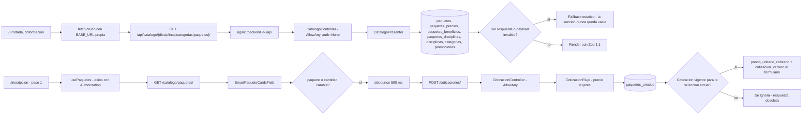
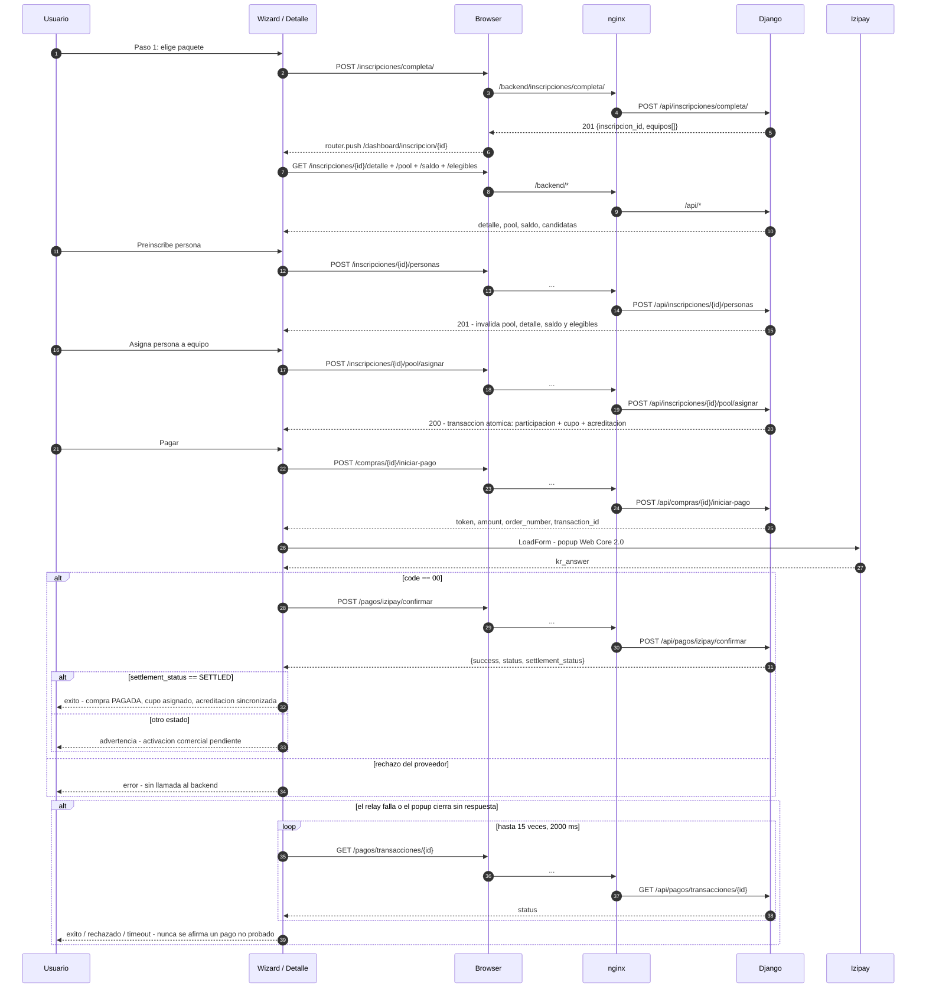
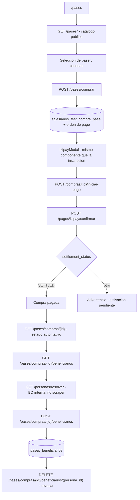
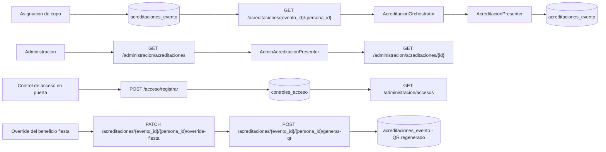
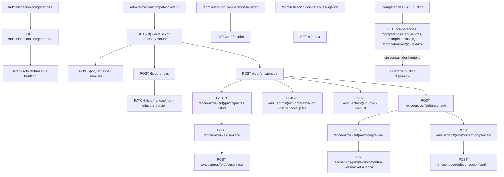
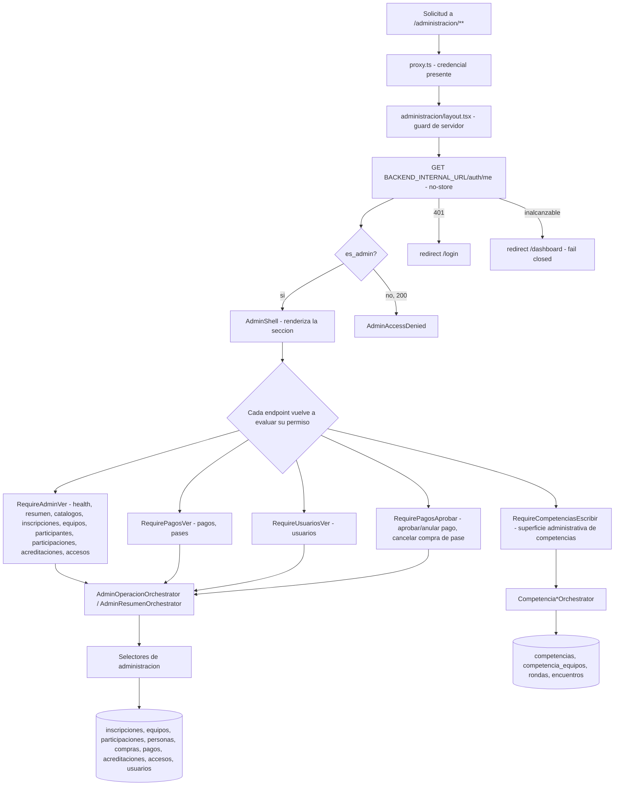
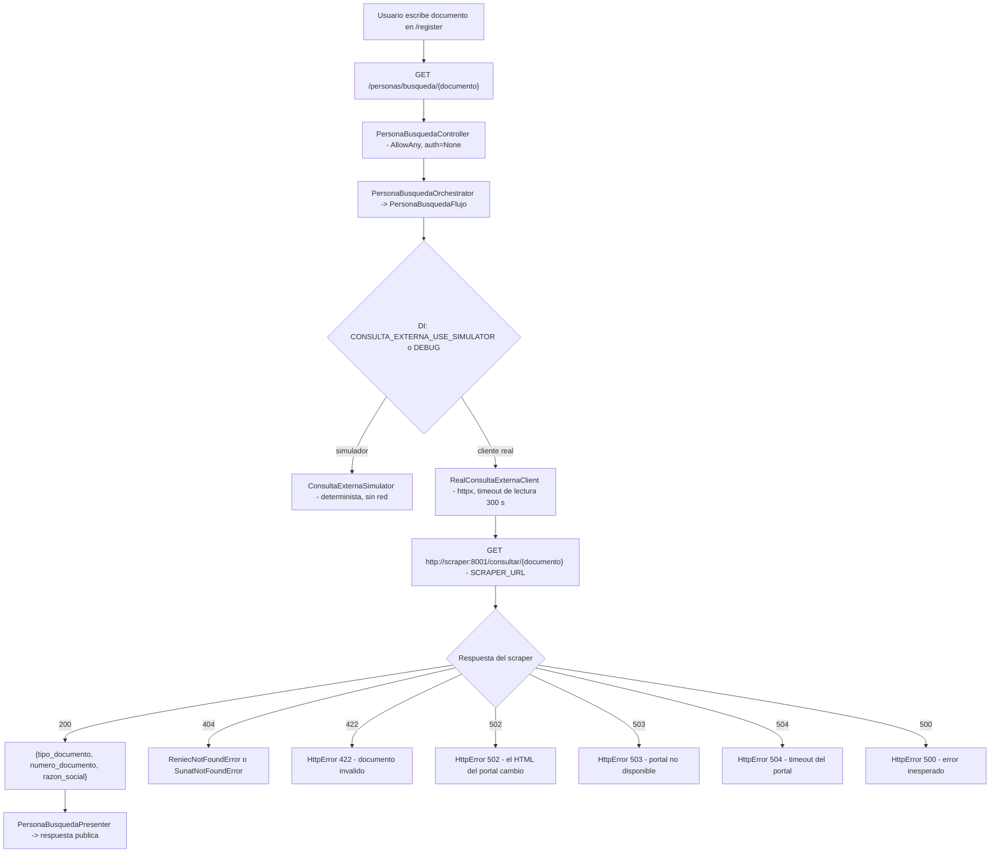

# 05a — Matriz Página → Flujo → Endpoint → Datos

> **Proyecto:** Salesianos FEST 2026 · **Repositorio:** `C:\Users\Usuario\Desktop\Aplicaciones\CST\Salesianos`
> **Tipo de artefacto:** Documento de trazabilidad funcional (reconstrucción E2E)
> **Fuente de verdad:** código fuente (`frontend/src`, `backend/modules`, `proxy/nginx.conf`, `worker/scraper`) — no resúmenes de dominio ni artefactos previos
> **Artefacto SDD:** `sdd/explore/page-flow-endpoint-data-traceability`
> **Alcance:** 20 rutas de página + 2 route handlers de Next · **113 acciones trazadas** (72 con llamada al backend, 41 sin llamada) · **112 definiciones de ruta de backend** inventariadas (111 alcanzables, 68 con consumidor frontend)

---

## 1. Propósito, método y convenciones

### 1.1 Propósito

Este documento reconstruye **qué hace realmente cada página** de la aplicación, acción por acción, y traza cada acción hasta:

- el control y el componente que la originan,
- el hook / store / service del frontend que la ejecuta,
- la llamada HTTP real (método, ruta, payload),
- el comportamiento del proxy nginx y de los route handlers de Next,
- el controller Django y el permiso que lo evalúa,
- el orquestador / flujo / selector / presenter del dominio,
- las tablas o el worker externo que se leen o escriben,
- los campos de la respuesta que el frontend consume,
- la transición exacta de UI,
- y las ramas de **carga, validación, negocio, autenticación, red, error, reintento y recuperación**.

No se documentan resúmenes de dominio: se documentan **páginas y acciones**. El documento es el insumo de aceptación de la reconstrucción: cada entrada corresponde a algo que un usuario puede hacer en pantalla.

### 1.2 Método de verificación

1. Se enumeraron las **20 rutas de página** reales desde `frontend/src/app/**/page.tsx` (no desde documentación previa).
2. Se enumeraron los **2 route handlers** de Next (`/api/auth/refresh`, `/api/auth/logout`).
3. Se extrajo el inventario de rutas del backend desde `backend/config/api.py` y los **25 controllers** (24 registrados + 1 no registrado), leyendo cada decorador `@route.*` en el código. **La regla es regenerar este inventario desde el código, nunca desde un artefacto de exploración** (H-5 del mapa de flujos previo).
4. Se cruzó cada URL consumida por el frontend (grep exhaustivo sobre `api.get/post/patch/delete` y `fetch`) contra ese inventario.
5. Se leyeron el proxy (`proxy/nginx.conf`), la resolución de URLs (`lib/server/backend-url.ts`), el cliente axios (`lib/api.ts`), el scraper (`worker/scraper/main.py`) y el cableado DI (`modules/usuarios/di.py`).

### 1.3 Notación de la traza

Cada acción se documenta con los **12 campos obligatorios**. Cuando un grupo de acciones comparte estructura idéntica (las 15 órdenes de competencias, las 8 lecturas de administración, etc.), se documenta en una **tabla matricial** con las mismas 12 columnas, para no perder exactitud por economía de texto.

| # | Campo | Contenido esperado |
|---|---|---|
| 1 | Intención y precondición | Qué quiere el usuario y qué debe cumplirse para que la acción sea posible |
| 2 | Página / componente / control | Ruta Next, componente raíz, control de formulario o botón |
| 3 | Hook / store / service / ruta | Cadena de código del frontend que dispara la llamada |
| 4 | HTTP método + ruta + payload | Verbo, ruta pública y cuerpo real |
| 5 | Proxy nginx / Next | Reescritura, timeouts, o ausencia de proxy (llamada interna) |
| 6 | Controller + permiso | Controller Django y permiso efectivo |
| 7 | Orquestador / flujo / selector / presenter | Cadena de dominio |
| 8 | Modelos / tablas / worker | Lecturas, escrituras y worker externo |
| 9 | Campos de respuesta consumidos | Campos que el frontend lee efectivamente |
| 10 | Transición de UI | Qué cambia y a dónde navega |
| 11 | Ramas | Carga, validación, negocio, autenticación, red, error, reintento, recuperación |
| 12 | Consecuencia operativa | Efecto en el negocio, en la base de datos o en el usuario |

### 1.4 Topología de referencia

```
Navegador
  │
  │  rutas de página  →  http(s)://<host>/...
  ▼
nginx (proxy, :7000 publicado)
  ├── location /backend/   → proxy_pass http://backend:8000/api/   (reescribe /backend/* → /api/*)
  ├── location = /api/auth/refresh  → frontend:3000   (route handler de Next)
  ├── location = /api/auth/logout   → frontend:3000   (route handler de Next)
  ├── location /admin/ /_nested_admin/ /static/ → backend:8000
  └── location /            → frontend:3000   (Next)
                                    │
                                    │  fetch server-side → BACKEND_INTERNAL_URL (http://backend:8000/api)
                                    ▼
                              Django 5.2 + Ninja Extra + ninja_jwt (:8000, gunicorn ×2)
                                    │
                                    ├── PostgreSQL 16 (:5432)
                                    └── worker scraper FastAPI (:8001)  ← dependencia dura del contenedor backend
```

`proxy_connect_timeout 10s`, `proxy_read_timeout 60s`.

### 1.5 Dos URLs base y por qué importan

`frontend/src/lib/server/backend-url.ts` define dos resoluciones distintas y **no intercambiables**:

| Función | Consumidor | Valor por defecto | Consecuencia |
|---|---|---|---|
| `backendPublicUrl()` | Navegador (axios, `typeof window !== "undefined"`) | `NEXT_PUBLIC_API_URL` → `/backend` | El navegador atraviesa nginx; nginx reescribe a `/api/*` |
| `backendInternalUrl()` | Servidor Next (Route Handlers, Server Components, guard de administración) | `BACKEND_INTERNAL_URL` → `http://backend:8000/api` → `http://localhost:8000/api` | El servidor **no** está detrás del proxy: usa `fetch` nativo, nunca el proxy nginx |

> **Riesgo activo:** una URL relativa (`/backend`) usada desde `fetch` de Node lanza `TypeError`. Por eso el guard de administración responde `unavailable` y redirige a `/dashboard` si se mezcla el lado servidor con la URL pública.

### 1.6 Envolvtorio, cookies y manejo de error

**Envolvtorio único** (`core/responses.py`): `{ success, data, error, message }`. Los errores públicos los construye exclusivamente `core/exceptions.py` a partir de un catálogo de códigos estables; nunca se interpolan UUID, IDs internos, constraints SQL, trazas ni texto crudo de excepción.

**Cookies de sesión** (prefijo efectivo `salesianos_auth`; por defecto de código `cam_auth`):

| Cookie | `httpOnly` | Escrita por | Leída por | Uso |
|---|---|---|---|---|
| `_access_token` | `false` | Navegador (`useLogin`, `useRegister`) y Next (refresh) | axios (inyección `Bearer`) | Credencial de autenticación |
| `_refresh_token` | `false` | Navegador y Next (rotación) | Solo el route handler de refresh | Renovación del access token |
| `_expires_at` | `false` | Navegador y Next | axios (`isTokenExpiringSoon`, umbral 5 min) | **Pista de UX**, nunca autoridad |
| `_user_session` | `false` | Navegador | Solo hidratación | **No es autoridad** |

`httpOnly:false` implica que `frontend/src/proxy.ts` es **una cortesía de UX, nunca un control de seguridad**. La autoridad real es `backend/core/permissions.py` (`RequireAdminVer`, `RequirePagosVer`, `RequirePagosAprobar`, `RequireUsuariosVer`, `RequireAcreditacionesEscribir`, `RequireCompetenciasEscribir`).

**Cadena de error del cliente** (`lib/api.ts` + `errors/error-handler.ts`):

1. `axios` con `timeout: 15000`.
2. Interceptor de petición: lee `_access_token`; si `expires_at` está a menos de 5 minutos → `POST /api/auth/refresh` (single-flight con `refreshPromise`) y relectura del token.
3. Interceptor de respuesta: ante `401` no reintentado (`_retry`), intenta el refresh y **repite la petición original una sola vez**.
4. `handleApiError` / `getErrorMessage` normalizan el mensaje; `notify` (adaptador de toast) lo presenta.

---

## 2. Matriz por ruta de frontend

### 2.1 `/` — Portada (marketing)

**Raíz:** `frontend/src/app/page.tsx` → `PortadaPage` (Server Component).
**Guard:** `proxy.ts` marca `/` como `PUBLIC_PATH`; nunca exige cookie.

| # | Acción | Traza resumida |
|---|---|---|
| A1 | Cargar catálogo de **disciplinas** (sección "El Campeonato") | `ChampionshipSection` → `useDisciplinas` (`features/portada/hooks/useCatalogo.ts`) → `fetch` crudo a `GET {BASE_URL}/catalogo/disciplinas/` → `CatalogoController.listar_disciplinas` (`AllowAny`, `auth=None`) → `CatalogoPresenter.present_disciplinas` → tabla `disciplinas`. Consume `id, nombre, sigla, modalidad, min_jugadores, max_jugadores`. Si la API no responde o el payload no valida → **fallback estático** `DISCIPLINAS_FALLBACK` (la sección nunca queda vacía). |
| A2 | Cargar catálogo de **categorías** (sección "Programa") | `ScheduleSection` → `useCategorias` → `GET /catalogo/categorias/` → `CatalogoController.listar_categorias` → tabla `categorias`. Consume `id, evento_id, evento_nombre, nombre, promocion_desde, promocion_hasta`. Fallback `CATEGORIAS_FALLBACK`. |
| A3 | Cargar **paquetes** (secciones "Tickets" y "Pase de fiesta") | `TicketsSection` / `PartyPassSection` → `useLandingPaquetes` → `features/landing/paquetes.service.ts` → `fetch` crudo a `GET {BASE_URL}/catalogo/paquetes/` → `CatalogoController.listar_paquetes` → tablas `paquetes`, `paquetes_precios`, `paquetes_beneficios`, `paquetes_disciplinas`. Consume nombre, tipo, precios preventa/regular, beneficios y `disciplinas_resumen`. |
| A4 | CTA "Preinscribirme" / "Inscribirme" | Sin llamada al backend: `router.push` a `/register` (sin sesión) o `/inscripcion` (con cookie `_access_token`). |
| A5 | Navegación por la navbar | Sin llamada al backend: enlaces a `/`, `/informacion`, `/pases` (o `/register` si no hay usuario — `components/landing/Navbar.tsx`). |
| A6 | Compartir promoción (`SharePromotionDialog`) | Sin llamada al backend: diálogo local con `navigator.share` / portapapeles. |
| A7 | Barra móvil de ticket (`MobileTicketBar`) | Sin llamada al backend: CTA de navegación. |

> **Hallazgo de cliente duplicado (H-9):** A1, A2 y A3 **no** usan la instancia axios. `features/portada/hooks/useCatalogo.ts` y `features/landing/paquetes.service.ts` resuelven su propia `BASE_URL` con `http://backend:8000/api` **hardcodeado**, ignoran `BACKEND_INTERNAL_URL`, y no inyectan `Authorization` ni aplican refresh/401-retry. Consecuencia: si el catálogo pasa a ser autenticado, estas tres acciones fallan; y cualquier cambio de URL base exige tocarlas.

### 2.2 `/informacion` — Landing informativa

**Raíz:** `frontend/src/app/informacion/page.tsx` → `HomePage` (Server Component). Ruta pública.

| # | Acción | Traza resumida |
|---|---|---|
| B1 | Cargar **paquetes** (`components/landing/Paquetes.tsx`) | `useLandingPaquetes` → `GET /catalogo/paquetes/` (mismo cliente crudo que A3). |
| B2 | Mostrar **disciplinas** (`components/landing/Disciplines.tsx`) | Datos estáticos del componente: **sin llamada al backend**. |
| B3 | Galería, hero y footer | **Sin llamada al backend**; enlaces externos a Facebook / Instagram / TikTok. |

### 2.3 `/login` — Autenticación

**Raíz:** `frontend/src/app/(auth)/login/page.tsx` → `LoginClientShell` (`features/auth/views/LoginClientShell.tsx`).
**Guard:** ruta pública; pero `proxy.ts` redirige a `/dashboard` si `/login` ya tiene cookie `_access_token`.

#### C1 — Iniciar sesión con **DNI** (pestaña por defecto)

| Campo | Traza |
|---|---|
| 1. Intención / precondición | El usuario conoce su DNI y contraseña. Zod (`LoginDniFormSchema`) exige DNI de 8 dígitos y contraseña no vacía. |
| 2. Página / componente / control | `LoginClientShell` → pestaña `DniTabForm` → `<Input id="tab-dni" maxLength={8}>` + `PasswordInputField` + botón `submit` "Ingresar". |
| 3. Hook / store / service | `useLogin()` (`features/auth/hooks/useLogin.ts`) → `resolveLogin()` discrimina el payload → `api.post` (axios) → `useAuthStore.setAuth(result.data)`. |
| 4 | `POST /auth/login/dni` — body `{ dni, password }`. El prefijo `/backend` lo añade `axios.baseURL`. |
| 5 | nginx: `location /backend/` → `proxy_pass http://backend:8000/api/` ⇒ Django recibe `POST /api/auth/login/dni`. Timeout de conexión 10 s / lectura 60 s. |
| 6 | `AuthLoginController` (`modules/usuarios/presentation/controllers/auth_controller.py`), `@api_controller("/auth/login")`, `permissions=[AllowAny]`, `auth=None` en la ruta. |
| 7 | `AuthOrchestrator.login_dni` → `AuthFlujo._proceso_login_dni` → `AuthCoreService.buscar_usuario_por_dni` (tabla `usuarios_usuario`) → `AuthPresenter.present_login`. |
| 8 | Lee `usuarios_usuario`; escribe el par de tokens en `ninja_jwt` (rotación habilitada: `ROTATE_REFRESH_TOKENS=True`, `BLACKLIST_AFTER_ROTATION=True`). |
| 9 | `access_token`, `refresh_token`, `expires_at`, `user.{id,email,username,nombres,apellidos,rol,persona_id,es_admin}`. |
| 10 | Toast de éxito con el `message` del servidor + `router.push(await resolverDeDestino())`. |
| 11 | **Carga:** botón con `Loader2` y texto "Verificando…" (`isSubmitting \|\| isLoading \|\| loginMutation.isPending`). **Validación:** Zod bloquea antes de la red; el error se pinta bajo el campo. **Negocio:** credenciales inválidas → `401` con mensaje del catálogo de errores → `toast.error(handleApiError(error).message)`. **Red:** `timeout` 15 s → `Network Error`. **Auth:** el interceptor axios, si el `/api/auth/refresh` falla, deja propagar el `401`. **Reintento:** el login NO se reintenta automáticamente; el usuario reintenta el envío. **Recuperación:** `resolverDeDestino()` cae a `/dashboard` si `GET /auth/me` falla (no bloquea el login). |
| 12 | Cookies `_access_token`, `_refresh_token`, `_expires_at`, `_user_session` escritas por el navegador con `maxAge` 7 días y `httpOnly:false`; el store Zustand `useAuthStore` queda sincronizado. |

#### C2 — Iniciar sesión con **correo**

Idéntico a C1 salvo: payload `{ email, password }` → `POST /auth/login/email` → `AuthOrchestrator.login_email` → `AuthFlujo._proceso_login_email` → `AuthCoreService` (busca por `email`). `LoginEmailFormSchema` exige formato de email.

#### C3 — Iniciar sesión con **usuario**

Payload `{ username, password }` → `POST /auth/login/username` → `AuthOrchestrator.login_username` → `AuthFlujo._proceso_login_username` → `AuthCoreService`.

#### C4 — Cambiar de pestaña (DNI / Email / Usuario)

**Sin llamada al backend.** Estado local `activeTab`; solo cambia el formulario renderizado.

#### C5 — Mostrar / ocultar contraseña

**Sin llamada al backend.** `useState(showPassword)` alterna `type="password"` ↔ `type="text"`.

#### C6 — Enlace "¿No tienes cuenta?" → `/register`

**Sin llamada al backend.** `next/link`.

#### C7 — Resolver el destino tras el login

| Campo | Traza |
|---|---|
| 1 | El login fue exitoso; hay que decidir a dónde lleva al usuario. |
| 2 | Llamador implícito en `DniTabForm` / `EmailTabForm` / `UsernameTabForm`: `router.push(await resolverDeDestino())`. |
| 3 | `features/auth/utils/resolver-destino.ts` → `consumePostAuthRedirect()` (URL guardada) → si no hay, `getAdminMe()` (`features/admin/services/admin.me.service.ts` → `api.get("/auth/me")`). |
| 4 | `GET /auth/me` (solo si no hay redirect pendiente). |
| 5 | axios navegador → `/backend/auth/me` → nginx reescribe a `/api/auth/me`. |
| 6 | `AuthMeController` (`modules/usuarios/presentation/controllers/me_controller.py`), `@api_controller("/auth")`, `auth=JWTAuth()`. |
| 7 | `AuthOrchestrator.me` → `AuthCoreService` (`Usuario` + `Persona` + perfiles) → `AuthPresenter.present_me`. |
| 8 | Lee `usuarios_usuario`, `usuarios_persona`. |
| 9 | `data.es_admin` (además de identidad y roles). |
| 10 | `es_admin === true` → `/administracion`; en cualquier otro caso → `/dashboard`. |
| 11 | **Red/timeout:** el `catch` del resolver devuelve `/dashboard` — un fallo de `/auth/me` **nunca** bloquea el acceso del usuario a su panel. **Auth:** un `401` produce el mismo fallback. |
| 12 | El destino elegido determina qué guard de servidor se evaluará después (administración revalida la sesión; el panel no). |

### 2.4 `/register` — Registro de cuenta

**Raíz:** `frontend/src/app/(auth)/register/page.tsx` → `RegisterClientShell` → `RegisterForm` (`features/auth/components/RegisterForm.tsx`). Ruta pública.

#### D1 — Consultar un documento (DNI/RUC) antes de registrar

| Campo | Traza |
|---|---|
| 1 | El usuario escribe su número de documento para autocompletar sus datos. Precondición: 8 dígitos (DNI) o 11 dígitos (RUC), solo numéricos. |
| 2 | `RegisterForm` → `DocumentoLookupSmartField` (input con botón "Consultar"). |
| 3 | `useDocumentoLookup()` (`features/inscripciones/hooks/useDocumentoLookup.ts`) → `consultarDocumento()` (`features/inscripciones/services/inscripcion.service.ts`). |
| 4 | `GET /personas/busqueda/{documento}` — sin payload. |
| 5 | nginx `/backend/` → `/api/personas/busqueda/{documento}`. |
| 6 | `PersonaBusquedaController` (`modules/usuarios/presentation/controllers/persona_busqueda_controller.py`), `@api_controller("/personas")`, `permissions=[AllowAny]`, `auth=None`. |
| 7 | `PersonaBusquedaOrchestrator.buscar_documento` → `PersonaBusquedaFlujo` → `IConsultaExternaClient` (implementación inyectada) → `PersonaBusquedaPresenter.present_documento`. |
| 8 | **Worker externo:** `RealConsultaExternaClient` (`modules/usuarios/infrastructure/services.py`) → `GET http://scraper:8001/consultar/{documento}` (o `SCRAPER_URL`). En `DEBUG` el binding de `modules/usuarios/di.py` sustituye el cliente real por `ConsultaExternaSimulator`. No hay escritura en base de datos. |
| 9 | `tipo_documento`, `numero_documento`, `razon_social`. `splitRazonSocial()` separa "apellidos, nombres" en los campos del formulario. |
| 10 | Rellena `nombres` y `apellidos` del formulario; el usuario continúa. |
| 11 | **Validación:** longitud/alfanumérico los valida el propio scraper (`422 INVALID_FORMAT` / `INVALID_LENGTH`). **Negocio:** documento inexistente → `404` → `ReniecNotFoundError` (8 dígitos) o `SunatNotFoundError` (11) → mensaje público por el handler global. **Worker:** `503 UNAVAILABLE` / `504 TIMEOUT` / `502 FORMAT_ERROR` se traducen a `HttpError` con el mismo status. **Red:** `httpx.ConnectError` → `503`. **Reintento:** no hay reintento automático; el usuario puede volver a pulsar "Consultar". **Recuperación:** el formulario permanece editable con los valores ya escritos. |
| 12 | Reduce el trabajo manual del alta; el documento no se persiste hasta D2. |

#### D2 — Crear la cuenta y la persona

| Campo | Traza |
|---|---|
| 1 | El usuario completa el formulario y acepta las declaraciones. Precondición: `RegisterFormSchema` (Zod) válido — correo, usuario, contraseña, confirmación, DNI, nombres, apellidos y las 3 declaraciones. |
| 2 | `RegisterForm` → botón `submit`. |
| 3 | `useRegister()` (`features/auth/hooks/useRegister.ts`) → `registerUser()` (`features/auth/services/register.service.ts`) → `persistAuthTokens()` → `useAuthStore.setAuth` → `consumePostAuthRedirect()`. |
| 4 | `POST /auth/register` — body con los campos del schema de registro (identidad, credenciales, datos de persona y aceptaciones). |
| 5 | nginx `/backend/` → `/api/auth/register`. |
| 6 | `RegistroController` (`modules/usuarios/presentation/controllers/registro_controller.py`), `@api_controller("/auth")`, `permissions=[AllowAny]`, `auth=None`. |
| 7 | `RegistroOrchestrator.registrar` → `RegistroFlujo` → `PersonaCoreService` + `AuthCoreService` (operaciones sync envueltas en `sync_to_async`) → `RegistroPresenter.present_registro`. |
| 8 | **Escribe:** `usuarios_persona`, `usuarios_usuario`, `aceptaciones_inscripcion` (declaraciones) y el par de tokens en `ninja_jwt`. |
| 9 | `access_token`, `refresh_token`, `expires_at`, `user.{id,email,username}`. |
| 10 | Cookies escritas con `maxAge` 7 días; toast de éxito con el `message` del servidor; `router.push(redirectTo)` y `router.refresh()`. `redirectTo` = `?nextUrl=` si existe, si no el redirect guardado, si no `/inscripcion`. |
| 11 | **Validación:** Zod + `field_validator` del backend (`password == password_confirm`). **Negocio:** usuario/correo duplicado → `409` con código estable → toast de error. **Auth:** el registro es público; no requiere token. **Red:** `timeout` 15 s. **Reintento:** reenvío manual del formulario. **Recuperación:** los valores escritos se conservan; solo el token no se emite si el alta falla. |
| 12 | La cuenta queda creada y lista para el flujo de inscripción (`/inscripcion`). |

### 2.5 `/dashboard` — Panel de la delegación

**Raíz:** `frontend/src/app/(app)/dashboard/page.tsx` → `DashboardPage` (Client Component, `useEffect` + `useState`, **no** TanStack Query). Ruta protegida por `proxy.ts` (cookie) y por el layout `(app)`.

| # | Acción | Traza resumida |
|---|---|---|
| E1 | **Cargar mis inscripciones** | `useEffect` → `getMisInscripciones()` (`features/inscripciones/services/inscripcion.service.ts`) → `GET /inscripciones/` → `InscripcionController.listar_mis_inscripciones` (`IsAuthenticated`, `auth=JWTAuth()`) → `InscripcionOrchestrator.listar_por_responsable_proceso` → `InscripcionPresenter.present_inscripcion` → tabla `inscripciones` filtrada por `responsable_id`. Consume `id, estado, paquete_nombre, promocion_nombre, cantidad_equipos, cantidad_participantes, created_at`. Estados: `BORRADOR/RECIBIDA/EN_REVISION/OBSERVADA/VALIDADA/CONFIRMADA/RECHAZADA/CANCELADA`. **Ramas:** carga → spinner "Cargando inscripciones…"; `success=false` → `res.error?.message`; excepción de red → "Error de conexion"; sin error y lista vacía → `EmptyState`; con datos → tarjetas `InscripcionCard`. **Reintento:** no hay botón; el usuario recarga la página. |
| E2 | **Crear inscripción** (botón del hero y del estado vacío) | Sin llamada al backend: `router.push("/inscripcion")`. |
| E3 | **Ver detalle de una inscripción** | Sin llamada al backend: `router.push(`/dashboard/inscripcion/${id}`)`. |
| E4 | **Ver el festival** | Sin llamada al backend: `Link href="/"`. |
| E5 | **Cerrar sesión** | El cierre de sesión se sirve desde `app/api/auth/logout` (§2.21). El botón vive en `components/AppShell.tsx` / `AppSidebar.tsx`. |

> **Brecha de robustez:** el panel usa `useEffect` + estado local en lugar de TanStack Query. No hay caché, no hay invalidación por prefijo y no hay reintento tras un error de red; cualquier fallo deja el panel en estado de error permanente hasta que el usuario recargue.

### 2.6 `/dashboard/inscripcion/[id]` — Detalle de inscripción

**Raíz:** `frontend/src/app/(app)/dashboard/inscripcion/[id]/page.tsx` → `InscripcionDetailView` (`features/inscripciones/views/InscripcionDetailView.tsx`).
Esta es **la página operativa central**: concentra pool, equipos, participantes y pago.

#### F1 — Cargar el detalle de la inscripción

| Campo | Traza |
|---|---|
| 1 | El usuario abrió el detalle de una inscripción propia. Precondición: cookie de acceso válida + `{id}` de la URL. |
| 2 | `InscripcionDetailView` → `useInscripcionDetalle(inscripcionId)`. |
| 3 | `features/inscripciones/hooks/useInscripcionDetalle.ts` → `features/inscripciones/services/inscripcion.service.ts` → `getInscripcionDetalle()`. |
| 4 | `GET /inscripciones/{id}/detalle` — sin payload. |
| 5 | nginx `/backend/` → `/api/inscripciones/{id}/detalle`. |
| 6 | `InscripcionController.obtener_inscripcion_detalle` — `IsAuthenticated`, `auth=JWTAuth()`. El controller **valida la pertenencia** (la inscripción debe ser del responsable autenticado). |
| 7 | `InscripcionOrchestrator.obtener_inscripcion_detalle_proceso` → selector de inscripción + eager loading de equipos, participaciones y personas → `InscripcionPresenter.present_inscripcion_detail`. |
| 8 | **Lee:** `inscripciones`, `equipos`, `participaciones`, `inscripciones_personas`, `usuarios_persona`, `disciplinas`, `categorias`, `paquetes`, `promociones` y el resumen de compra (`commerce_compra` / orden de pago). |
| 9 | `estado`, `paquete_nombre`, `promocion_nombre`, `resumen_pago.{total,moneda,estado_compra,estado_orden,compra_id,...}`, `equipos[]{id,nombre,disciplina,categoria,participantes[]{id,estado,persona,rol,talla_camiseta,aseguradora_*,inscripcion_persona_id}}`. |
| 10 | `loading` → `InscripcionSkeleton`; error → `InscripcionErrorState` con botón "Reintentar" (`refetch()`); éxito → hero + `EstadoProgresoCard` + `PaymentCallout` + pool + equipos + `ResumenPagoCard` + `DatosInscripcionCard`. |
| 11 | **Carga:** skeleton. **Validación:** n/a (lectura). **Auth:** `401` → el interceptor axios intenta `POST /api/auth/refresh` y reintenta una vez; si el refresh falla, el `401` se propaga → `InscripcionErrorState`. **Negocio:** inscripción de otro responsable → `404`/`403` → estado de error. **Red:** `timeout` 15 s → estado de error. **Reintento:** botón explícito `refetch`. **Recuperación:** `useInscripcionCacheSync` mantiene sincronizadas las cachés de detalle, pool, saldo y elegibles. |
| 12 | La página es el punto de partida de todas las acciones de capacidad, equipo y pago. |

#### F2 — Cargar el **pool** de preinscritos

| Campo | Traza |
|---|---|
| 1 | Conocer quién espera cupo. |
| 2 | `PoolParticipantesSeccion` ← `useInscripcionPool(inscripcionId)`. |
| 3 | `features/inscripciones/hooks/useInscripcionPool.ts` → `features/inscripciones/services/pool.service.ts` → `getPool()`. |
| 4 | `GET /inscripciones/{id}/pool`. |
| 5 | nginx → `/api/inscripciones/{id}/pool`. |
| 6 | `InscripcionController.obtener_pool` — `IsAuthenticated`, `JWTAuth()`. |
| 7 | `InscripcionOrchestrator.obtener_pool_proceso` → selector de `inscripciones_personas` (solo las **sin** participación activa) → `InscripcionPresenter.present_pool`. |
| 8 | Lee `inscripciones_personas` + `usuarios_persona`. |
| 9 | `inscripcion_id`, `pool[]{id, persona{id,nombre,nombres,apellidos,numero_documento}, estado, created_at}`. |
| 10 | Renderiza las tarjetas de preinscritos; si `loading` → skeletons; si `error` → mensaje en la sección. |
| 11 | **Auth:** `401` con refresh + reintento único. **Negocio:** el pool vacío no es error, es estado normal. **Red:** la sección muestra el error sin tumbar el resto de la página. **Reintento:** vía invalidación de la caché al mutar. |
| 12 | Alimenta los botones "Asignar" de la sección de pool. |

#### F3 — Consultar el **saldo de cupos**

| Campo | Traza |
|---|---|
| 1 | Saber si queda capacidad pagada para asignar un equipo. |
| 2 | `PoolParticipantesSeccion` ← `useInscripcionSaldo(inscripcionId)`. |
| 3 | `useInscripcionPool.ts` → `pool.service.ts` → `getSaldoInscripcion()`. |
| 4 | `GET /inscripciones/{id}/saldo`. |
| 5 | nginx → `/api/inscripciones/{id}/saldo`. |
| 6 | `InscripcionSaldoController` (`modules/salesianos_fest/presentation/controllers/asignacion_controller.py`), `@api_controller("/inscripciones")`, `IsAuthenticated`, `JWTAuth()`. |
| 7 | `AsignacionOrchestrator.obtener_saldo` → selector de asignaciones → `AsignacionPresenter.present_saldo`. |
| 8 | Lee `asignaciones_cupo` y la compra/orden de pago (cupos pagados vs. consumidos). |
| 9 | `cupos_pagados`, `cupos_asignados`, `cupos_disponibles` (nombres definidos por el presenter). |
| 10 | Se muestra junto a la sección de pool como contexto de disponibilidad. |
| 11 | **Negocio:** saldo 0 no es error; la UI bloquea la asignación con el motivo que devuelve el backend, no con un cálculo local. **Red/Auth:** degradación local: si falla, la sección de pool sigue operativa. |
| 12 | Es la única fuente de verdad de la capacidad; el frontend no recalcula cupos. |

#### F4 — Cargar los **elegibles por equipo**

| Campo | Traza |
|---|---|
| 1 | Saber a quién se puede asignar a un equipo concreto, con el motivo cuando no se puede. |
| 2 | `SelectorParticipanteModal` ← `useElegiblesEquipos(inscripcionId, equipos[])` (precarga todos los equipos de la inscripción). |
| 3 | `features/inscripciones/hooks/useElegiblesEquipo.ts` → `features/inscripciones/services/elegibles.service.ts` → `getElegiblesEquipo()`. |
| 4 | `GET /inscripciones/{id}/equipos/{equipo_id}/elegibles` (una llamada por equipo, en paralelo). |
| 5 | nginx → `/api/inscripciones/{id}/equipos/{equipo_id}/elegibles`. |
| 6 | `InscripcionController.obtener_elegibles_equipo` — `IsAuthenticated`, `JWTAuth()`. |
| 7 | `InscripcionOrchestrator.obtener_elegibles_equipo_proceso` → `InscripcionPresenter.present_elegibles_equipo`. |
| 8 | Lee `inscripciones_personas`, `participaciones`, `asignaciones_cupo`, `equipos`, `disciplinas`. |
| 9 | `elegibles[]{id, persona{...}, estado, tiene_cupo_activo, estado_pool, motivo_bloqueo, disciplinas_asignadas[]{disciplina,equipo_id,equipo_nombre}, ya_en_disciplina, asignable, motivo_no_asignable}`. `estado_pool` ∈ {LISTO, ESPERANDO_PAGO, SIN_CAPACIDAD, CUPO_POR_ASIGNAR}. |
| 10 | La tarjeta de cada equipo muestra el contador de asignables; el selector muestra los candidatos con su motivo de bloqueo. |
| 11 | **Negocio:** R11 (una persona no puede jugar dos veces en la misma disciplina) y el cupo pagado son reglas **del backend**; el frontend solo las refleja. **Red:** la precarga falla sin romper el detalle; el modal reintenta al abrirse. **Carga:** el modal muestra skeleton mientras resuelve. |
| 12 | Habilita o bloquea la acción "Asignar" con evidencia de negocio. |

#### F5 — **Preinscribir** a una persona en el pool

| Campo | Traza |
|---|---|
| 1 | Añadir un jugador que todavía no tiene equipo. Precondición: inscripción en estado que admite alta y capacidad vigente. |
| 2 | `AddParticipanteModal` → botón "Agregar al pool" → `handleAddToPool(data)`. |
| 3 | `usePreregistrarEnPool(inscripcionId)` (`features/inscripciones/hooks/usePreregistrarEnPool.ts`) → `pool.service.ts` → `preregistrarEnPool()`. |
| 4 | `POST /inscripciones/{id}/personas` — body `{ persona_id, rol?, talla_camiseta?, notas?, aceptaciones? }` **sin `equipo_id`** (esa es la diferencia con la asignación). |
| 5 | nginx → `/api/inscripciones/{id}/personas`. |
| 6 | `InscripcionController.agregar_persona` — `IsAuthenticated`, `JWTAuth()`. |
| 7 | `InscripcionOrchestrator.agregar_persona_proceso` → `AgregarPersonaFlujo` (`domain/services/flujos/agregar_persona_flujo.py`, abre `transaction.atomic`) → `InscripcionPresenter.present_participacion` + `present_inscripcion_persona`. |
| 8 | **Escribe:** `inscripciones_personas` (+ `aceptaciones_inscripcion` si llegan aceptaciones). **Lee:** inscripción, persona, cupo del responsable. |
| 9 | `participante` / `inscripcion_persona` (id, estado, persona, rol, aceptaciones) y `message`. |
| 10 | Se invalidan **cuatro** cachés: pool, detalle, saldo y elegibles por equipo; el nuevo candidato queda asignable de inmediato. Toast de éxito. |
| 11 | **Negocio (backend, no frontend):** `CUPO_CONTRATADO_EXCEDIDO`, `FECHA_LIMITE_EXCEDIDA`, estado de inscripción incompatible → `409` con código estable; el frontend lo muestra **verbatim** con `getErrorMessage(error)` y **no invalida** nada. **Validación:** Zod del formulario + `fieldErrors` del backend vía `setError`. **Auth:** `401` → refresh + reintento. **Red:** fallo ⇒ la lista del pool no cambia. **Reintento:** el modal permite reenviar. **Recuperación:** al reabrir, el pool se relee de la caché invalidada. |
| 12 | La persona queda esperando cupo; aparece en el pool y en los elegibles. |

#### F6 — **Autoinscribir** al responsable en el pool

| Campo | Traza |
|---|---|
| 1 | El responsable quiere figurar como jugador sin asignarse todavía a un equipo. Precondición: `user.persona_id` presente y la persona **no** está ya en el pool. |
| 2 | Botón "Agregarme" de `PoolParticipantesSeccion` → `handleAgregarmeAlPool()`. |
| 3 | `usePreregistrarEnPool` → `buildPreregistroSelfPayload(personaId)` (`features/inscripciones/utils/pool.preregistro.ts`). |
| 4 | `POST /inscripciones/{id}/personas` — body `{ persona_id: <persona_id del usuario> }`. |
| 5 | nginx → `/api/inscripciones/{id}/personas`. |
| 6 | `InscripcionController.agregar_persona` — `IsAuthenticated`, `JWTAuth()`. |
| 7 | `InscripcionOrchestrator.agregar_persona_proceso` → `AgregarPersonaFlujo`. |
| 8 | **Escribe:** `inscripciones_personas`. |
| 9 | Mismos campos que F5. |
| 10 | El botón desaparece: `responsableEnPool` pasa a `true` y la acción deja de ofrecerse (se evita una acción muerta). |
| 11 | **Validación de cliente:** si `user.persona_id` es `null` → `toast.error("No tienes una persona asociada. Completa tu registro primero.")` **sin** llamada al backend. **Negocio:** misma batería de códigos que F5. **Red/AUTH:** idénticos. |
| 12 | El responsable ocupa el mismo circuito que cualquier otro jugador. |

#### F7 — **Asignar** un preinscrito a un equipo

| Campo | Traza |
|---|---|
| 1 | Poner a una persona del pool en un equipo concreto. Precondición: `asignable === true` según el backend, cupo pagado vigente, R11 cumplido, plazo abierto. |
| 2 | `SelectorParticipanteModal` → botón "Asignar" (desde el pool se preselecciona el primer equipo asignable). |
| 3 | `useAsignarParticipanteAEquipo(inscripcionId)` (`features/inscripciones/hooks/useAsignarParticipanteAEquipo.ts`) → `pool.service.ts` → `asignarPoolAEquipo()`. |
| 4 | `POST /inscripciones/{id}/pool/asignar` — body `{ inscripcion_persona_id, equipo_id, rol (por defecto "J"), talla_camiseta (""), notas ("") }`. |
| 5 | nginx → `/api/inscripciones/{id}/pool/asignar`. |
| 6 | `InscripcionController.asignar_a_equipo` — `IsAuthenticated`, `JWTAuth()`. |
| 7 | `InscripcionOrchestrator.asignar_a_equipo_proceso` → `AsignarPersonaFlujo` (una transacción: crea la `Participacion`, consume el cupo y sincroniza la acreditación) → `InscripcionPresenter.present_participacion`. |
| 8 | **Escribe:** `participaciones`, `asignaciones_cupo` y sincroniza `acreditaciones_evento`. **Lee:** `inscripciones_personas`, `equipos`, `disciplinas`, `asignaciones_cupo`. |
| 9 | `participante` (`ParticipacionOut`: id, estado, rol, talla, equipo, disciplina, persona) y `message`. |
| 10 | Cierre del modal + invalidación de detalle, pool, saldo y elegibles; la persona pasa a la nómina del equipo. |
| 11 | **Negocio (backend, atómico):** sin cupo pagado → `409 CUPO_NO_DISPONIBLE`; R11 → conflicto de disciplina; roster excedido; plazo vencido. Todo en **una** transacción: o entra completo o no entra. **UI:** el frontend NO pre-valida; si el backend dice que no, el modal lo muestra y el candidato queda visible con su motivo. **Red:** un fallo deja la caché intacta. **Reintento:** el modal reenvía. |
| 12 | La capacidad pagada se materializa en una participación concreta. |

#### F8 — **Editar** un participante

| Campo | Traza |
|---|---|
| 1 | Corregir rol, talla, aseguradora, póliza o notas de un jugador ya asignado. |
| 2 | `EditParticipanteModal` (se abre desde `EquipoCard` → `onEditParticipante`). |
| 3 | `useEditarParticipante` → `editarParticipante()` (`features/inscripciones/services/inscripcion.service.ts`). |
| 4 | `PATCH /participaciones/{participacion_id}` — body `{ rol?, talla_camiseta?, aseguradora_nombre?, aseguradora_numero_poliza?, notas? }`. |
| 5 | nginx → `/api/participaciones/{id}`. |
| 6 | `ParticipacionController.actualizar_participacion` — `IsAuthenticated`, `JWTAuth()`; el controller ejecuta `_check_participacion_ownership(request, participacion_id)` antes de delegar. |
| 7 | `ParticipacionOrchestrator.actualizar_participacion_proceso` → `InscripcionPresenter.present_participacion`. |
| 8 | **Escribe:** `participaciones` (rol, talla, aseguradora, notas). |
| 9 | `ParticipacionOut` y `message`. |
| 10 | `onSuccess` → `cache.invalidate` (detalle, pool, saldo, elegibles); el modal se cierra. |
| 11 | **Validación:** Zod del modal; `fieldErrors` del backend aplicados con `setError`. **Auth:** `403` si la participación no pertenece al caller (ownership). **Negocio:** valores fuera de dominio → `422`. **Red:** el formulario conserva lo escrito. **Reintento:** manual. |
| 12 | La nómina refleja la corrección sin recalcular cupos. |

#### F9 — **Retirar** un participante

| Campo | Traza |
|---|---|
| 1 | Quitar a un jugador de un equipo. Precondición: confirmación explícita del usuario. |
| 2 | `EquipoCard` → `onRemoveParticipante` → `confirm()` nativo → `handleRemoveParticipante(p)`. |
| 3 | `eliminarParticipante()` (`inscripcion.service.ts`) — **sin** `useMutation`: es una llamada imperativa con actualización optimista de caché. |
| 4 | `PATCH /participaciones/{participacion_id}/retirar` — sin payload (no es borrado físico: `estado` pasa a `"R"`). |
| 5 | nginx → `/api/participaciones/{id}/retirar`. |
| 6 | `ParticipacionController.retirar_participacion` — `IsAuthenticated`, `JWTAuth()` + `_check_participacion_ownership`. |
| 7 | `ParticipacionOrchestrator.retirer_participacion_proceso` → `RetirarPersonaFlujo` → `InscripcionPresenter.present_participacion`. |
| 8 | **Escribe:** `participaciones.estado = "R"`; libera la ocupación del cupo según la regla del flujo. |
| 9 | `{ participante_id }` y `message`. |
| 10 | **Optimista:** `cache.removeParticipante(p.id)` borra la fila de la caché antes de la respuesta; si la llamada falla, `cache.invalidate()` revierte y se muestra un toast de error. |
| 11 | **Validación:** `confirm()` nativo cancela sin llamada. **Auth:** ownership → `403`. **Negocio:** retiro de una participación ya retirada → idempotencia del flujo. **Red:** la fila se revierte con `invalidate()`. **Reintento:** el usuario vuelve a pulsar. |
| 12 | El cupo liberado puede reasignarse a otra persona. |

#### F10 — **Pagar** la inscripción (apertura del checkout)

| Campo | Traza |
|---|---|
| 1 | Pagar la compra pendiente. Precondición: `compraPagableId(inscripcion.resumen_pago)` devuelve un id (compra `PENDIENTE` y orden de pago no pagada). |
| 2 | `PaymentCallout` → botón "Pagar" → `handleOpenPayment()` → `<IzipayModal isOpen compraId onSuccess onClose>`. |
| 3 | `features/pagos/components/IzipayModal.tsx` → `iniciarPagoIzipay()` (`features/pagos/services/pago.service.ts`). |
| 4 | `POST /compras/{compra_id}/iniciar-pago` — sin payload. |
| 5 | nginx → `/api/compras/{compra_id}/iniciar-pago`. |
| 6 | `CompraController.iniciar_pago` (`modules/salesianos_fest/presentation/controllers/compra_controller.py`), `@api_controller("/compras")`, `IsAuthenticated`, `JWTAuth()`. |
| 7 | `CompraOrchestrator.iniciar_pago` → `IniciarPagoFlujo` → `CompraPresenter.present_iniciar_pago`. |
| 8 | **Lee:** la compra y la orden de pago, y el `Persona` del comprador. **Escribe:** estado de la compra/orden y creación de la `TransaccionPago` (`pagos_transaccion_pago`). |
| 9 | `token` (token de sesión del proveedor), `merchant_code`, `amount`, `currency`, `order_number`, `transaction_id`, `buyer_name`, `buyer_surname`, `buyer_email`. |
| 10 | El modal pasa a fase `preparando` y luego `abierto`: se instancia el SDK Izipay y se abre el popup en el contenedor `#izipay-checkout`. |
| 11 | **Carga:** fase `preparando` con spinner. **Validación:** `!prepareRes.success \|\| !token` → fase `error` con el mensaje tipado de la envoltura. **Auth:** `401` → refresh + reintento. **Negocio:** compra no pagable → el backend responde `409`; el frontend además impide abrir el modal si `compraPagableId` es `null` (`toast.info("No hay compras pendientes de pago.")`). **Red:** `timeout` 15 s → fase `error`. **Reintento:** el usuario reabre el modal (guard `launchedRef` de una sesión por apertura). **Recuperación:** si el SDK no carga (`waitForIzipaySdk`) → fase `error` con "El SDK de Izipay no se ha cargado correctamente." |
| 12 | El popup del proveedor queda listo para el pago. |

#### F11 — **Confirmar** el pago (relay del navegador)

| Campo | Traza |
|---|---|
| 1 | El proveedor cerró el popup con un resultado. Precondición: `kr_answer` con `code === "00"`. |
| 2 | Callback `callbackResponsePayment` del SDK, invocado por Izipay. |
| 3 | `IzipayModal` → `confirmarPagoIzipay()` (`features/pagos/services/pago.service.ts`). |
| 4 | `POST /pagos/izipay/confirmar` — body `{ kr_answer: <payload completo del proveedor> }`. |
| 5 | nginx → `/api/pagos/izipay/confirmar`. |
| 6 | `PagosController.confirmar_pago` (`modules/pagos/presentation/controllers/pagos_controller.py`), `@api_controller("/pagos")`, `IsAuthenticated`, `JWTAuth()`. |
| 7 | `PagosOrchestrator.confirmar_pago_izipay` → verificación de la firma del comercio sobre `payloadHttp` y contraste de monto/orden contra la transacción persistida → `ConfirmadorOrdenPagoAdapter` → `ConfirmarPagoFlujo` → `IzipayPresenter.present_confirm`. |
| 8 | **Escribe:** `pagos_transaccion_pago` (estado `EXITO`), orden de pago (`PAGADA`), asignación de cupos y sincronización de acreditación. |
| 9 | `success`, `status`, `response_message`, `settlement_status` ∈ {`SETTLED`, `PENDING`, `NOT_APPLICABLE`}. |
| 10 | `settlementTone(settlement_status)`: `SETTLED` → toast de éxito; cualquier otro → toast de **advertencia** ("Pago confirmado. La activación comercial está pendiente."). Después `onSuccess()` (refresca el detalle) y `onClose()`. |
| 11 | **Rechazo del proveedor (`code !== "00"`):** sin llamada al backend; toast con el mensaje del proveedor y cierre del modal. **Validación:** el backend contrasta el payload contra la transacción persistida; un `kr_answer` manipulado → rechazo. **Negocio:** `settlement_status ≠ SETTLED` ⇒ la UI **nunca** afirma una activación completada. **Auth:** `401` → refresh + reintento. **Red:** el fallo del relay **no** se interpreta como pago fallido (ver F12). **Reintento:** el relay es de un solo intento (`relayedRef`). |
| 12 | El pago queda registrado y la capacidad se asigna en el backend. |

#### F12 — **Recuperar** un relay incierto (bounded poll)

| Campo | Traza |
|---|---|
| 1 | El relay no respondió: puede que el pago sí se haya registrado. Precondición: el modal sigue abierto y el relay no resolvió. |
| 2 | `IzipayModal` → `iniciarRecuperacion(transaction_id)`; se dispara por (a) excepción del relay o (b) el observador detecta que el popup dejó de renderizar sin relay (`observarCierreCheckout`). |
| 3 | `features/pagos/utils/checkout.recuperacion.ts` → `sondearEstadoTransaccion(transactionId, obtenerEstadoTransaccion, { cancelado })`. |
| 4 | `GET /pagos/transacciones/{transaction_id}` — repetido hasta **15** veces con **2000 ms** de intervalo (`INTERVALO_SONDEO_MS`, `MAX_SONDEOS` ⇒ 30 s como máximo). |
| 5 | nginx → `/api/pagos/transacciones/{transaction_id}`. |
| 6 | `PagosController.obtener_transaccion` — `IsAuthenticated`, `JWTAuth()`; el controller **comprueba que el caller es el dueño** de la orden (o administrador). |
| 7 | `PagosOrchestrator.obtener_transaccion` → `IzipayPresenter.present_transaccion`. |
| 8 | **Lee:** `pagos_transaccion_pago`. |
| 9 | `status` ∈ {`EXITO`, `FALLIDO`, `CANCELADO`, `PENDIENTE`, …}, `response_message`, `transaction_id`. |
| 10 | `exito` → toast "Pago confirmado. Actualizando tu inscripción..." + `onSuccess()` + cierre. `rechazado` → toast de error + cierre. `timeout` → fase `error` con "No se pudo verificar el pago. Revisa el estado de tu inscripción o inténtalo nuevamente." `cancelado` → no se hace nada. |
| 11 | **Regla clave:** *una lectura fallida NO es un pago fallido* — el bucle continúa hasta el límite. **Límite duro:** 30 s; después el estado es "no probado" y la decisión pasa al operador. **Cancelación:** el token de recuperación se invalida si el modal se cierra o si el relay resuelve (`relayResueltoRef`). **Red:** cada lectura fallida se trata como `{success:false,data:null}` y no aborta el bucle. **Reintento:** el usuario puede reabrir el checkout y repetir el ciclo. **Recuperación operativa:** si el relay se perdió y el navegador se cerró, la orden queda sin reconciliar hasta que un operador ejecute `manage.py reconciliar_pagos` — **no hay planificador**. |
| 12 | El estado del pago se vuelve a leer desde la fuente autoritativa; la UI nunca afirma un pago no probado. |

### 2.7 `/inscripcion` — Asistente de preinscripción (wizard)

**Raíz:** `frontend/src/app/(app)/inscripcion/page.tsx` → `InscripcionClientShell` → `InscripcionWizard` (`features/inscripciones/components/InscripcionWizard.tsx`).
Tres pasos: **1 Paquete · 2 Equipos y promoción · 3 Declaraciones**.

#### G1 — Cargar el catálogo de **paquetes** (paso 1)

| Campo | Traza |
|---|---|
| 1 | Saber qué paquetes existen y sus precios/beneficios. |
| 2 | `SmartPaqueteCardsField` → `usePaquetes()`; también `InscripcionWizard` y `StepDeclarations` consumen la misma caché. |
| 3 | `features/inscripciones/hooks/useInscripcionCatalogs.ts` → `fetchPaqueteList()` (`services/paquete.service.ts`) → `api.get`. |
| 4 | `GET /catalogo/paquetes/` — sin payload. |
| 5 | nginx → `/api/catalogo/paquetes/`. Cliente axios (a diferencia de la portada): sí inyecta `Authorization` y sí reintenta tras 401. |
| 6 | `CatalogoController.listar_paquetes` — `permissions=[AllowAny]`, `auth=None`. |
| 7 | `CatalogoPresenter.present_paquetes`. |
| 8 | Lee `paquetes`, `paquetes_precios`, `paquetes_beneficios`, `paquetes_disciplinas`. |
| 9 | `PaqueteListContract`: `id, evento_id, nombre, descripcion, tipo, modo_disciplinas, cantidad_disciplinas, cantidad_minima_compra, cantidad_maxima_equipos, precio_promocional, precio_regular, tiene_fiesta, tiene_box, tiene_cerveza, disciplinas_resumen, disciplinas[]`. Validado con Zod 1:1 contra el wrapper del backend. |
| 10 | Renderiza las tarjetas de paquete, con filtro `PACK` / `DISCIPLINA`; si el filtro queda vacío salta al primero con datos. |
| 11 | **Validación:** cada item se valida con `PaqueteListContractSchema.safeParse`; un fallo se registra en consola y el item se degrada, **no** se rompe la pantalla. **Carga:** `isLoading` → skeleton. **Red/Auth:** fallo → `QueryError` → estado de error. **Reintento:** reintento de TanStack Query. |
| 12 | Alimenta la selección de paquete, el cálculo de equipos y la cotización. |

#### G2 — Cargar el catálogo de **promociones** (paso 2)

| Campo | Traza |
|---|---|
| 1 | Elegir promoción y, opcionalmente, la fusión. |
| 2 | `InscripcionWizard` → `SmartSearchableSelectField name="promocion_id"` y `name="fusion_promocion_id"`. |
| 3 | `usePromociones()` (`useInscripcionCatalogs.ts`) → `getPromociones()` (`services/catalog.service.ts`) → `api.get`. |
| 4 | `GET /catalogo/promociones/`. |
| 5 | nginx → `/api/catalogo/promociones/`. |
| 6 | `CatalogoController.listar_promociones` — `AllowAny`, `auth=None`. |
| 7 | `CatalogoPresenter.present_promociones`. |
| 8 | Lee `promociones`. |
| 9 | `id`, `nombre`, `anio`. El selector etiqueta `"${nombre} · ${anio}"`. |
| 10 | Los dos desplegables se habilitan cuando termina la carga (`disabled={promocionesQuery.isLoading}`). |
| 11 | **Carga:** los selectores quedan deshabilitados. **Validación:** Zod (`promocion_id` obligatorio; `fusion_promocion_id` opcional). **Red:** la lista vacía deja el desplegable sin opciones y el paso 2 no se puede validar. |
| 12 | La promoción es un dato obligatorio del payload de inscripción. |

#### G3 — **Cotizar** el paquete seleccionado (paso 1, con debounce)

| Campo | Traza |
|---|---|
| 1 | Conocer el precio unitario vigente antes de enviar. Precondición: paquete seleccionado y cantidad ≥ `cantidad_minima_compra`. |
| 2 | `SmartPaqueteCardsField` → efecto con debounce de 500 ms sobre `paqueteId` y `cantidadSeleccionada`. |
| 3 | `useCotizacion()` (`features/inscripciones/hooks/useCotizacion.ts`) → `cotizarPaquete()` (`services/cotizacion.service.ts`). |
| 4 | `POST /cotizaciones/` — body `{ paquete_id, cantidad }`. |
| 5 | nginx → `/api/cotizaciones/`. |
| 6 | `CotizacionController.cotizar` (`modules/salesianos_fest/presentation/controllers/cotizacion_controller.py`), `@api_controller("/cotizaciones")`, `AllowAny`, `auth=None`. |
| 7 | `CotizacionFlujo` (`domain/services/flujos/cotizacion_flujo.py`) → precio vigente del catálogo → presenter de cotización. |
| 8 | **Lee:** `paquetes_precios`, `paquetes`, `eventos`. No escribe. |
| 9 | `paquete_id`, `cantidad_cotizada`, `precio_unitario`, `version`, `total` (según `CotizacionResponse`). |
| 10 | La tarjeta muestra el total proyectado; el `useEffect` publica en el formulario `precio_unitario_cotizado` y `cotizacion_version` **solo** si `paquete_id` y `cantidad_cotizada` coinciden con la selección actual (una respuesta obsoleta nunca llega al payload). |
| 11 | **Validación:** el backend puede rechazar una cantidad inferior al mínimo → `422`. **Negocio:** el precio y la versión los fija el servidor; el cliente no calcula importes. **Red:** un fallo de cotización **no** bloquea el envío (los campos quedan `null` y el backend usa el precio vigente). **Debounce:** una ráfaga de clics se colapsa en una sola petición. **Reintento:** el siguiente cambio de paquete/cantidad vuelve a cotizar. |
| 12 | El payload final lleva precio y versión cotizados, o `null` si no se pudo cotizar. |

#### G4 — Seleccionar paquete y ajustar cantidad (control local)

**Sin llamada al backend adicional** más allá de G1/G3. El `SmartPaqueteCardsField` escribe `paquete_id` en el formulario y mantiene el mapa de cantidades en estado local (`cantidades` + `cantidadesRef` para evitar perder un clic dentro del mismo lote de render).

#### G5 — Construir la lista de **equipos** (paso 2)

**Sin llamada al backend:** `SmartEquipoField` deriva el equipo a partir del `paqueteActual` ya presente en la caché de G1 (`cantidad_disciplinas`, `cantidad_maxima_equipos`, `modo_disciplinas`, `disciplinas`). El frontend **no** vuelve a pedir el detalle del paquete: es el contrato canónico ya cargado. El resultado es un array `{ disciplina_id, categoria_id, nombre }` por equipo.

#### G6 — Navegar entre pasos (Siguiente / Anterior)

**Sin llamada al backend**, pero sí con **validación por paso**: `stepFields` define los campos que cada paso debe validar (`1: ["paquete_id"]`, `2: ["promocion_id","equipos"]`, `3: []`). El botón "Siguiente" llama `methods.trigger(fields, { shouldFocus: true })`; si falla → `toast.error("Completa los campos obligatorios antes de continuar")` y **no** avanza. La animación de transición (GSAP) respeta `prefers-reduced-motion`.

#### G7 — Aceptar las **declaraciones** (paso 3)

**Sin llamada al backend en el paso 3**, y **no** forman parte del payload atómico. `StepDeclarations` mantiene tres `useState` locales: `bases`, `aptitudFisica`, `imagen`. `onSubmit` los valida manualmente antes de invocar la mutación; si falta alguno → `toast.error("Debes aceptar las 3 declaraciones para continuar")` y **no** se envía nada. El backend registra las aceptaciones por persona vía `POST /inscripciones/{id}/personas`, no en el alta de la inscripción.

#### G8 — **Enviar la inscripción** (cierre del wizard)

| Campo | Traza |
|---|---|
| 1 | Enviar la preinscripción con paquete, promoción y equipos. Precondición: pasos 1 y 2 validados + 3 declaraciones aceptadas + paquete encontrado en la caché. |
| 2 | Botón `type="submit"` del paso 3 → `GenericForm` → `onSubmit(data)`. |
| 3 | `useCreateInscripcionCompleta()` (`features/inscripciones/hooks/useCreateInscripcionCompleta.ts`) → `createInscripcionCompleta()` (`services/inscripcion.service.ts`). |
| 4 | `POST /inscripciones/completa/` — body `{ evento_id, paquete_id, promocion_id, fusion_promocion_id, delegado_id, cantidad, equipos:[{disciplina_id,categoria_id,nombre}], observacion, precio_unitario_cotizado, cotizacion_version }`. |
| 5 | nginx → `/api/inscripciones/completa/`. |
| 6 | `InscripcionController.crear_inscripcion_completa` — `IsAuthenticated`, `auth=JWTAuth()`; el responsable es el usuario autenticado (`request.auth`). |
| 7 | `InscripcionOrchestrator.crear_inscripcion_completa_proceso` → `CrearInscripcionCompletaFlujo` (`domain/services/flujos/crear_inscripcion_completa_flujo.py`) — **una transacción** que crea inscripción, compra, equipos y asignaciones de cupo → `InscripcionPresenter.present_inscripcion` + `present_equipo`. |
| 8 | **Escribe:** `inscripciones`, `equipos`, `commerce_compra` (compra `PENDIENTE`) y `asignaciones_cupo`. **Lee:** paquete, promoción, disciplina y precios vigentes. |
| 9 | `inscripcion_id` y la lista de `equipos` creados (`EquipoOut`). |
| 10 | `router.push(`/dashboard/inscripcion/${data.inscripcion_id}`)` — el usuario aterriza en el detalle, que ya muestra el equipo vacío y el flujo de pool/pago. |
| 11 | **Validación:** Zod (`InscripcionFormSchema`); el `onSubmit` añade dos comprobaciones manuales (paquete encontrado y 3 declaraciones). **Negocio:** cantidad inferior al mínimo, paquete incompatible con la promoción, equipos por encima del máximo → `409`/`422` con código estable; `showErrorsAsToasts` los muestra como toast. **Auth:** `401` → refresh + reintento. **Red:** `timeout` 15 s → el formulario conserva todo lo escrito. **Reintento:** botón "Enviar inscripción" de nuevo. **Atomicidad:** si algo falla, no queda inscripción a medias. |
| 12 | La inscripción existe con compra pendiente y sin personas: el siguiente acto es pagar y luego asignar jugadores. |

#### G9 — Consultar el detalle del paquete

`GET /catalogo/paquetes/{paquete_id}/` **existe** en el backend y el servicio `fetchPaqueteDetail` (`services/paquete.service.ts`) lo implementa, pero **ninguna vista lo consume**: el `SmartEquipoField` usa el `PaqueteListContract` canónico. Ver §5 (endpoint sin consumidor frontend).

### 2.8 `/pases` — Compra de pases de fiesta

**Raíz:** `frontend/src/app/(app)/pases/page.tsx` → `PaseCompraView` (`features/pases/views/PaseCompraView.tsx`).
Flujo **dedicado**, no una rama del wizard deportivo.

#### H1 — Cargar el catálogo de **pases**

| Campo | Traza |
|---|---|
| 1 | Ver los pases disponibles y sus precios. |
| 2 | `PaseCompraView` → `usePasesCatalogo()` → `PaseCatalogoCard` en grid. |
| 3 | `features/pases/hooks/usePasesCatalogo.ts` → `features/pases/services/pase.service.ts` → `api.get`. |
| 4 | `GET /pases/`. |
| 5 | nginx → `/api/pases/`. Cliente axios. |
| 6 | `PaseController.listar_pases` (`modules/salesianos_fest/presentation/controllers/pase_controller.py`), `@api_controller("/pases")`, `AllowAny`, `auth=None`. |
| 7 | `PaseOrchestrator.listar_catalogo` → `ListarPasesFlujo` → `PasePresenter.present_pases`. |
| 8 | Lee `pases`, `pases_precios`. |
| 9 | `PaseListOut`: id, nombre, descripcion, precio, moneda, cantidad incluida, vigencia, beneficios. |
| 10 | `isLoading` → 3 skeletons; `isError` → alerta roja "No se pudo cargar el catálogo de pases de fiesta."; `data.length === 0` → "Los pases de fiesta todavía no están disponibles."; si no → grid de tarjetas. |
| 11 | **Carga:** skeletons. **Validación:** n/a. **Auth:** el endpoint es público. **Red:** error con mensaje del servidor o del catálogo. **Reintento:** reintento de TanStack Query. **Recuperación:** sin estado parcial. |
| 12 | Alimenta la selección y el cálculo del importe. |

#### H2 — **Crear la compra** del pase

| Campo | Traza |
|---|---|
| 1 | Registrar la compra para poder pagarla. Precondición: pase seleccionado y cantidad válida (≤ `PASE_CANTIDAD_MAXIMA_POR_COMPRA`, y dentro del mínimo del pase). |
| 2 | `GenericForm` (modo manual) → `PaseCantidadPanel` → botón "Continuar al pago". |
| 3 | `useCrearCompraPase()` (`features/pases/hooks/useCompraPase.ts`) → `construirPayloadCompraPase()` → `crearCompraPase()` (`services/pase.service.ts`). |
| 4 | `POST /pases/comprar` — body `{ pase_id, cantidad }`. |
| 5 | nginx → `/api/pases/comprar`. |
| 6 | `PaseController.comprar_pases` — `permissions=[IsAuthenticated]` + `auth=JWTAuth()`. |
| 7 | `PaseOrchestrator.comprar_pases` → `CrearCompraPaseFlujo` (transacción) → `PasePresenter.present_compra_creada`. |
| 8 | **Escribe:** `salesianos_fest_compra_pase` + orden de pago y `pagos_transaccion_pago`. **Lee:** `pases`, `pases_precios`. |
| 9 | `compra_id`, `numero_orden`, `pase_nombre`, `cantidad`, `precio_unitario`, `total`, `moneda`, `estado_compra`, `estado_orden`. |
| 10 | Se muestra `PaseCompraResultado` y se abre `IzipayModal` automáticamente (`setModalPagoAbierto(true)`). |
| 11 | **Validación:** Zod (`paseCompraFormSchema`) + límite de cantidad (`paseCantidadLimite`). **Negocio:** la compra se registra en estado `PENDIENTE`; el precio lo fija el servidor, nunca el cliente. **Auth:** `401` → refresh + reintento. **Red:** el formulario conserva la selección. **Reintento:** botón "Continuar al pago" de nuevo. |
| 12 | La compra existe y es pagable; el checkout toma el relevo. |

#### H3 — Leer el **estado** de la compra

| Campo | Traza |
|---|---|
| 1 | Conocer el estado real (pago y activación) tras el checkout. |
| 2 | `useCompraPaseEstado(compraId)` → alimenta `PaseCompraResultado`. |
| 3 | `features/pases/hooks/useCompraPaseEstado.ts` → `obtenerCompraPase()` (`services/pase.service.ts`). |
| 4 | `GET /pases/compras/{compra_id}`. |
| 5 | nginx → `/api/pases/compras/{compra_id}`. |
| 6 | `PaseController.obtener_compra_pase` — `IsAuthenticated`, `JWTAuth()`; el controller verifica la **propiedad** de la compra. |
| 7 | `PaseOrchestrator.obtener_compra` → `ObtenerCompraPaseFlujo` → `PasePresenter.present_compra_estado`. |
| 8 | Lee `salesianos_fest_compra_pase`, orden de pago, transacción y beneficiarios. |
| 9 | `estado_compra`, `estado_orden`, `origen_pago`, `moneda`, `beneficiarios_asignados`, `beneficiarios_pendientes`. |
| 10 | `paseCompraPagada(...)` habilita el panel de beneficiarios; `paseCompraPagable(...)` habilita el botón "Pagar". |
| 11 | **Negocio:** el navegador **nunca** decide que una activación se completó: solo refleja `estado_compra`/`estado_orden`. **Auth:** `403` si la compra no es del caller. **Red:** si el `refetch` posterior al pago falla, el estado visible puede quedar desfasado y el usuario recarga. |
| 12 | Es la lectura autoritativa tras el pago. |

#### H4 — **Pagar** el pase (checkout compartido)

**Misma cadena que F10/F11/F12**, con `compraId` de la compra de pase:
`POST /compras/{compra_id}/iniciar-pago` → `CompraController.iniciar_pago` → `CompraOrchestrator` → `IniciarPagoFlujo`;
`POST /pagos/izipay/confirmar` → `PagosController.confirmar_pago` → `PagosOrchestrator` → `ConfirmarPagoFlujo`;
`GET /pagos/transacciones/{id}` → `PagosController.obtener_transaccion` → poll acotado de 15 × 2000 ms.
El `onSuccess` del modal hace `refetchCompra()`: el estado autoritativo de la compra de pase se relee del backend.

#### H5 — Listar los **beneficiarios** de la compra

| Campo | Traza |
|---|---|
| 1 | Ver a quién se asignó cada pase comprado. |
| 2 | `PaseBeneficiariosPanel` → `useBeneficiariosCompra(compraId)`. |
| 3 | `features/pases/hooks/useBeneficiariosCompra.ts` → `features/pases/services/pase.beneficiario.service.ts`. |
| 4 | `GET /pases/compras/{compra_id}/beneficiarios`. |
| 5 | nginx → `/api/pases/compras/{compra_id}/beneficiarios`. |
| 6 | `PaseController.listar_beneficiarios` — `IsAuthenticated`, `JWTAuth()`. |
| 7 | `PaseOrchestrator.listar_beneficiarios` → `ListarBeneficiariosPaseFlujo` → `PasePresenter.present_beneficiarios_lista`. |
| 8 | Lee `pases_beneficiarios`, `usuarios_persona`. |
| 9 | `beneficiarios[]{persona_id, nombre, estado, tipo_beneficiario?, asignado_en}`. |
| 10 | Renderiza la lista de beneficiarios con su estado. |
| 11 | **Auth:** propiedad de la compra. **Red:** el panel queda en error sin tumbar la vista. **Reintento:** invalidación por prefijo tras cualquier mutación de beneficiarios. |
| 12 | Es la lista de referencia para revocar. |

#### H6 — **Asignar** beneficiarios (nombramiento)

| Campo | Traza |
|---|---|
| 1 | Nombrar a las personas que usarán el pase. Precondición: compra pagada y beneficiario resoluble por documento. |
| 2 | `PaseBeneficiariosPanel` → `PaseLookupPersonaField` → `useResolverPersona` + `useAsignarBeneficiarios`. |
| 3 | `features/pases/hooks/useAsignarBeneficiarios.ts` → `features/pases/services/pase.beneficiario.service.ts` → `asignarBeneficiarios()`. |
| 4 | `POST /pases/compras/{compra_id}/beneficiarios` — body `{ persona_id, tipo_beneficiario? }` (lista de beneficiarios). |
| 5 | nginx → `/api/pases/compras/{compra_id}/beneficiarios`. |
| 6 | `PaseController.asignar_beneficiarios` — `IsAuthenticated`, `JWTAuth()`. |
| 7 | `PaseOrchestrator.asignar_beneficiarios` → `AsignarBeneficiariosPaseFlujo` (transacción) → `PasePresenter.present_beneficiarios_asignados`. |
| 8 | **Escribe:** `pases_beneficiarios`. |
| 9 | `beneficiarios_asignados`, `beneficiarios_pendientes`, `message`. |
| 10 | Se invalidan las lecturas de beneficiarios; el contador de pendientes baja. |
| 11 | **Validación:** Zod del formulario + resolución previa de la persona. **Negocio:** exceder la cantidad comprada, asignar a alguien ya asignado en la misma compra → `409`. **Auth:** `403` si la compra no es del caller. **Red:** la lista queda desactualizada y se reintenta. **Reintento:** manual. |
| 12 | Los pases quedan nominativamente vinculados. |

#### H7 — **Resolver** una persona por documento (búsqueda interna)

| Campo | Traza |
|---|---|
| 1 | Buscar una persona **ya registrada** en el sistema (no una consulta externa). |
| 2 | `PaseLookupPersonaField` → `useResolverPersona()`. |
| 3 | `features/pases/hooks/useResolverPersona.ts` → `features/pases/services/persona.resolucion.service.ts`. |
| 4 | `GET /personas/resolver` — query params: documento y (opcionalmente) criterio de coincidencia. |
| 5 | nginx → `/api/personas/resolver`. |
| 6 | `PersonaResolucionController` (`modules/usuarios/presentation/controllers/persona_resolucion_controller.py`), `@api_controller("/personas")`, `permissions=[IsAuthenticated]` + `auth=JWTAuth()`. |
| 7 | `PersonaResolucionOrchestrator.resolver_persona` → `PersonaResolucionFlujo` → `PersonaSelector` → `PersonaResolucionPresenter.present_persona`. |
| 8 | Lee `usuarios_persona` (y `usuarios_usuario` para la asociación). **No toca el scraper**: es una resolución **exacta** contra la base de datos, a diferencia de `GET /personas/busqueda/{documento}`. |
| 9 | `persona{id, nombres, apellidos, numero_documento, ...}` y el criterio de coincidencia aplicado. |
| 10 | Rellena el beneficiario seleccionado en el formulario. |
| 11 | **Negocio:** sin coincidencia exacta → `404` con mensaje público. **Auth:** requiere sesión (no es público, a diferencia de la búsqueda por documento). **Red:** el campo queda vacío y reintenta. **Reintento:** al volver a consultar. |
| 12 | Evita asignar un pase a una persona que no existe en el sistema. |

#### H8 — **Revocar** un beneficiario

| Campo | Traza |
|---|---|
| 1 | Quitar la asignación de un pase. Precondición: confirmación del usuario. |
| 2 | `PaseRevocarDialog` → `useRevocarBeneficiario()`. |
| 3 | `features/pases/hooks/useRevocarBeneficiario.ts` → `services/pase.beneficiario.service.ts` → `revocarBeneficiario()`. |
| 4 | `DELETE /pases/compras/{compra_id}/beneficiarios/{persona_id}` — sin payload. |
| 5 | nginx → `/api/pases/compras/{compra_id}/beneficiarios/{persona_id}`. |
| 6 | `PaseController.revocar_beneficiario` — `IsAuthenticated`, `JWTAuth()`. |
| 7 | `PaseOrchestrator.revocar_beneficiario` → `RevocarBeneficiarioPaseFlujo` → `PasePresenter.present_beneficiario_revocado`. |
| 8 | **Escribe:** `pases_beneficiarios` (estado revocado). |
| 9 | `persona_id`, `estado`, `message`. |
| 10 | El diálogo se cierra; `invalidarLecturasBeneficiarios` refresca la lista. |
| 11 | **Validación:** confirmación previa en el diálogo. **Auth:** propiedad de la compra. **Negocio:** revocar un beneficiario ya revocado → idempotencia. **Red:** la lista se conserva hasta el reintento. |
| 12 | El pase queda disponible para reasignar. |

#### H9 — "Comprar otro pase"

**Sin llamada al backend:** `reiniciar()` limpia `compraId`, `compraCreada` y el estado del modal, y vuelve a mostrar el formulario.

### 2.9 `/administracion` — Resumen operativo

**Raíz:** `frontend/src/app/(app)/administracion/page.tsx` → `AdminOverview`.
**Guard de servidor** (`app/(app)/administracion/layout.tsx`): `revalidateAdminSession()` → `GET {BACKEND_INTERNAL_URL}/auth/me` (fetch nativo, `cache:"no-store"`, envuelto en `cache()` de React) → cuatro desenlaces: `admin` / `forbidden` / `unauthenticated` / `unavailable`. `unauthenticated` → `redirect("/login")`; `unavailable` → `redirect("/dashboard")` (**fail closed**); `forbidden` → pantalla `AdminAccessDenied`.

| # | Acción | Traza resumida |
|---|---|---|
| I1 | **Cargar el resumen** | `useAdminResumen()` → `GET /administracion/resumen` → `AdminResumenController.resumen` (`RequireAdminVer`) → `AdminResumenOrchestrator.obtener_resumen` → `AdminResumenPresenter.present_resumen` → selector que agrega inscripciones, pagos, participantes, equipos y acreditaciones del evento activo. Consume KPIs de volumen, importes pagados y estados. |
| I2 | **Cargar los catálogos administrativos** | `useAdminCatalogos()` → `GET /administracion/catalogos` → `AdminResumenController.catalogos` (`RequireAdminVer`) → `AdminResumenOrchestrator.obtener_catalogos` → `AdminCatalogosPresenter.present_catalogos`. Alimenta los desplegables de filtro de todas las secciones. |
| I3 | **Navegar a una sección operativa** | Sin llamada: enlaces a `/administracion/inscripciones`, `/pagos`, `/participantes`, `/equipos`, `/competencias`, `/acreditaciones`, `/usuarios` (`features/admin/utils/admin.secciones.ts`). |
| I4 | **Atajo a un drilldown** | Sin llamada: los KPI son enlaces (`admin.resumen.utils.ts`). |

### 2.10 `/administracion/inscripciones` — Tabla de inscripciones (A3)

**Raíz:** `AdminInscripcionesLista` + `useAdminInscripciones`.

| # | Acción | Traza resumida |
|---|---|---|
| J1 | **Listar inscripciones** | `GET /administracion/inscripciones` con query `page`, `page_size` (≤100), `q` (≤120), `ordering` y filtros de recurso → `AdminInscripcionController.listar_inscripciones` (`RequireAdminVer`) → `AdminOperacionOrchestrator.listar_inscripciones` → `AdminInscripcionPresenter.present_listado` → `AdminInscripcionSelector` sobre `inscripciones`. Envolvtorio paginado `PaginatedData[AdminInscripcionListItemOut]`. |
| J2 | **Cambiar filtros / búsqueda / orden / página** | Sin llamada directa: el estado vive en la **URL** (`useAdminListaUrl`); el cambio de URL dispara la re-lectura de J1 con parámetros nuevos. `ordering` solo admite campos de la whitelist del backend. |
| J3 | **Abrir el drilldown** | Sin llamada: `router.push(`/administracion/inscripciones/${item.id}`)`. |
| J4 | **Refrescar** | Sin llamada: invalidación de la caché de la lista. |

### 2.11 `/administracion/inscripciones/[id]` — Drilldown de inscripción (A4)

| # | Acción | Traza resumida |
|---|---|---|
| K1 | **Cargar el detalle operativo** | `GET /administracion/inscripciones/{inscripcion_id}` → `AdminInscripcionController.obtener_inscripcion` (`RequireAdminVer`) → `AdminOperacionOrchestrator.obtener_inscripcion_detalle` → `AdminInscripcionPresenter.present_detalle`. Presenta los seis bloques documentados: equipos, personas, participaciones, saldo de cupos, importes y trazabilidad de pago. Lee `inscripciones`, `equipos`, `participaciones`, `inscripciones_personas`, `asignaciones_cupo`, `commerce_compra`, `pagos_transaccion_pago`. |
| K2 | **Volver a la tabla** | Sin llamada: enlaces `href="/administracion/inscripciones"`. |
| K3 | **Copiar identificadores / referencias** | Sin llamada: acción local de la interfaz. |

### 2.12 `/administracion/pagos` — Tabla de pagos y drilldown (A5/A6)

**Raíz:** `AdminPagosLista` + `useAdminPagos` + `AdminPagoManualDialog`.

| # | Acción | Traza resumida |
|---|---|---|
| L1 | **Listar pagos** | `GET /administracion/pagos` con `page`, `page_size`, `q`, `ordering`, filtros → `AdminPagoController.listar_pagos` (`RequirePagosVer`) → `AdminOperacionOrchestrator.listar_pagos` → `AdminPagoPresenter.present_listado` → `AdminPagoSelector`. El wrapper **nunca** expone `metadata`, `token_sesion`, `response_message` ni `transaction_id`. |
| L2 | **Abrir el drilldown de una orden** | `GET /administracion/pagos/{orden_pago_id}` → `AdminPagoController.obtener_pago` (`RequirePagosVer`) → `AdminOperacionOrchestrator.obtener_pago_detalle` → `AdminPagoPresenter.present_detalle`. El importe procede del **snapshot comercial congelado** de la compra, no de una recomputación. |
| L3 | **Aprobar un pago manual** | `POST /administracion/pagos/{orden_pago_id}/aprobar-manual` — body `{ canal, referencia, monto, moneda, motivo }` (construido en `useAdminPagosComandos.construirPayloadAprobarManual`, **nunca** en el formulario) → `AdminPagoController.aprobar_pago_manual` con `permissions=[RequirePagosAprobar]` → `AdminOperacionOrchestrator.aprobar_pago_manual` → `AdminPagoPresenter.present_aprobar_manual` → flujo `AprobarPagoManualFlujo` (`modules/pagos/domain/services/flujos/aprobar_pago_manual_flujo.py`) → escribe `pagos_aprobacion_pago_manual`. |
| L4 | **Anular la aprobación manual** | `POST /administracion/pagos/{orden_pago_id}/anular-manual` — body `{ motivo }` → `AdminPagoController.anular_pago_manual` (`RequirePagosAprobar`) → `AdminOperacionOrchestrator.anular_pago_manual` → `AdminPagoPresenter.present_anular_manual`. |
| L5 | **Filtrar / paginar / ordenar** | Sin llamada directa: estado en la URL; dispara L1/L2. |
| L6 | **Refrescar tras una decisión** | Sin llamada: `invalidarLecturasPago` invalida `["admin","pagos"]` (prefijo, todas sus variantes), `["admin","pago",{id}]` (exacta) y `["admin","resumen"]` (exacta). |

### 2.13 `/administracion/participantes` — Personas y nóminas (A8/A9)

**Raíz:** `AdminParticipantesLista`. Dos pestañas con **dos espacios de nombres** de URL independientes (`participantes` / `participaciones`), de modo que los filtros de una pestaña nunca llegan al endpoint de la otra.

| # | Acción | Traza resumida |
|---|---|---|
| M1 | **Listar personas registradas** | `GET /administracion/participantes` → `AdminOperacionController.listar_participantes` (`RequireAdminVer`) → `AdminOperacionOrchestrator.listar_participantes` → `AdminInscripcionPresenter.present_participante_listado`. Lee `inscripciones_personas` + `usuarios_persona`. |
| M2 | **Listar filas de nómina** | `GET /administracion/participaciones` → `AdminOperacionController.listar_participaciones` (`RequireAdminVer`) → `AdminOperacionOrchestrator.listar_participaciones` → `AdminInscripcionPresenter.present_participacion_listado`. Lee `participaciones`. |
| M3 | **Filtrar / paginar / ordenar** | Sin llamada directa: estado en la URL (por namespace). |
| M4 | **Cambiar de pestaña** | Sin llamada: cambia el namespace activo de la URL. |

> Los dos conjuntos **no son intercambiables**: un cupo pagado autoriza a una persona en **todas** las disciplinas contratadas, por lo que el número de personas y el de filas de nómina difieren. Ambos los calcula el backend.

### 2.14 `/administracion/equipos` — Tabla de equipos (A7)

| # | Acción | Traza resumida |
|---|---|---|
| N1 | **Listar equipos** | `GET /administracion/equipos` → `AdminOperacionController.listar_equipos` (`RequireAdminVer`) → `AdminOperacionOrchestrator.listar_equipos` → `AdminInscripcionPresenter.present_equipo_listado`. Lee `equipos` + `disciplinas` + `categorias` + `inscripciones`. |
| N2 | **Filtrar / paginar / ordenar** | Sin llamada directa: estado en la URL. |
| N3 | **Abrir la inscripción de un equipo** | Sin llamada: enlace a `/administracion/inscripciones/{id}`. |

### 2.15 `/administracion/acreditaciones` — Acreditaciones y accesos (A10/A11/A12)

**Raíz:** `AdminAcreditacionesLista`. Dos pestañas (`acreditaciones` / `accesos`) con namespaces separados.

| # | Acción | Traza resumida |
|---|---|---|
| O1 | **Listar acreditaciones** | `GET /administracion/acreditaciones` → `AdminOperacionController.listar_acreditaciones` (`RequireAdminVer`) → `AdminOperacionOrchestrator.listar_acreditaciones` → `AdminAcreditacionPresenter.present_listado`. Lee `acreditaciones_evento` + `usuarios_persona` + `eventos`. |
| O2 | **Ver el detalle de una acreditación** | `GET /administracion/acreditaciones/{acreditacion_id}` → `AdminOperacionController.obtener_acreditacion` (`RequireAdminVer`) → `AdminOperacionOrchestrator.obtener_acreditacion_detalle` → `AdminAcreditacionPresenter.present_detalle`. |
| O3 | **Listar el registro de accesos** | `GET /administracion/accesos` → `AdminOperacionController.listar_accesos` (`RequireAdminVer`) → `AdminOperacionOrchestrator.listar_accesos` → `AdminAcreditacionPresenter.present_listado_accesos`. Lee `controles_acceso`. |
| O4 | **Filtrar / paginar / ordenar** | Sin llamada directa: estado en la URL. |
| O5 | **Cambiar de pestaña** | Sin llamada: cambia el namespace activo. |

> La superficie de acreditación **de escritura** (`override-fiesta`, `generar-qr`, `registrar-acceso`) existe en el backend pero **no** tiene consumidor en el frontend de administración (§5).

### 2.16 `/administracion/usuarios` — Cuentas (A13/A14)

| # | Acción | Traza resumida |
|---|---|---|
| P1 | **Listar cuentas** | `GET /administracion/usuarios` → `AdminUsuarioController.listar_usuarios` (`RequireUsuariosVer`) → `AdminOperacionOrchestrator.listar_usuarios` → `AdminUsuarioPresenter.present_listado`. Lee `usuarios_usuario` + `usuarios_persona`. |
| P2 | **Ver el detalle de una cuenta** | `GET /administracion/usuarios/{usuario_id}` → `AdminUsuarioController.obtener_usuario` (`RequireUsuariosVer`) → `AdminOperacionOrchestrator.obtener_usuario_detalle` → `AdminUsuarioPresenter.present_detalle`. **Nunca** expone contraseña, hash, tokens ni `is_superuser`. Las inscripciones del drilldown sí están acotadas al evento activo. |
| P3 | **Filtrar / paginar / ordenar** | Sin llamada directa: estado en la URL. |

### 2.17 `/administracion/competencias` — Lista de competencias

**Raíz:** `CompetenciasLista` + `useCompetencias`.

| # | Acción | Traza resumida |
|---|---|---|
| Q1 | **Listar competencias** | `GET /administracion/competencias` → `AdminCompetenciasController.listar_competencias` (`RequireCompetenciasEscribir`) → `CompetenciaLecturaOrchestrator.listar_competencias` → `CompetenciasPresenter.present_listado`. Lee `competencias`. |
| Q2 | **Filtrar / paginar / ordenar** | Sin llamada directa: el estado de la lista vive en la URL (`claveCompetenciasLista(filtros)`), con `ordering` restringido a la whitelist del backend. |
| Q3 | **Abrir el detalle** | Sin llamada: enlace a `/administracion/competencias/{id}`. |

> **Brecha de superficie:** el backend expone `POST /administracion/competencias`, `PATCH /{id}`, `PATCH /{id}/estado` y `DELETE /{id}`, pero **el frontend no los consume**: el módulo de competencias del frontend solo escribe equipos, rondas y encuentros. La creación y el ciclo de vida de una competencia (alta, edición, cambio de estado, borrado) **no tienen hoy acción de usuario en pantalla** (§5).

### 2.18 `/administracion/competencias/[id]` — Detalle de competencia

**Raíz:** `CompetenciasDetalle` + `CompetenciasEditores` + `useCompetencias` + `useCompetenciasComandos`.
Esta página expone **16 endpoints** (1 lectura + 15 órdenes). Por homogeneidad, la lectura se documenta en R1 y las órdenes en R2–R16, con las 12 columnas.

#### Lectura

| # | Acción | 1. Intención / precondición | 2. Componente | 3. Hook / service | 4. HTTP | 5. Proxy | 6. Controller + permiso | 7. Dominio | 8. Datos | 9. Campos consumidos | 10. Transición | 11. Ramas | 12. Consecuencia |
|---|---|---|---|---|---|---|---|---|---|---|---|---|---|
| R1 | Cargar detalle de la competencia | Ver la configuración, sus equipos y sus rondas | `CompetenciasDetalle` | `useCompetencias` → `competencias.service.ts` (`getCompetenciaDetalle`) | `GET /administracion/competencias/{id}` | nginx `/backend/` → `/api/...` | `AdminCompetenciasController.obtener_competencia` — `RequireCompetenciasEscribir` | `CompetenciaLecturaOrchestrator.obtener_competencia` → `CompetenciasPresenter.present_detalle` | `competencias`, `competencia_equipos`, `rondas` | nombre, categoría, disciplina, estado, formato, fechas, sede, equipos y rondas | Renderiza el encabezado y las pestañas de editores | Carga → skeleton; `401` → refresh + reintento; `404` → estado de error; red → error con reintento | Base de la edición |

#### Órdenes (mutaciones)

| # | Acción | 4. HTTP método + ruta + payload | 6. Controller + permiso | 7. Orquestador → flujo | 8. Datos | 9. Campos consumidos | 10. Transición de UI | 11. Ramas | 12. Consecuencia |
|---|---|---|---|---|---|---|---|---|---|
| R2 | Incorporar equipo | `POST /administracion/competencias/{cid}/equipos` — body `{ nombre, orden_manual?, estado? }` | `AdminCompetenciasController.incorporar_equipo` — `RequireCompetenciasEscribir` | `CompetenciaEquipoOrchestrator.incorporar_equipo_proceso` → `CompetenciaEquipoFlujo` | `competencia_equipos` | `CompetenciaEquipoOut` | Añade la semilla y refresca R1 | 409 duplicado; 422 payload; 401 → refresh | Semilla creada con orden manual |
| R3 | Actualizar equipo | `PATCH /administracion/competencias/{cid}/equipos/{eid}` — body `{ orden_manual?, estado? }` | `AdminCompetenciasController.actualizar_equipo` — `RequireCompetenciasEscribir` | `CompetenciaEquipoOrchestrator.actualizar_equipo_proceso` | `competencia_equipos` | `CompetenciaEquipoOut` | Refresca R1 | 404 si no existe; 422 | Orden/estado del equipo actualizados |
| R4 | Crear ronda | `POST /administracion/competencias/{cid}/rondas` — body `{ etiqueta, orden, ... }` | `AdminCompetenciasController.crear_ronda` — `RequireCompetenciasEscribir` | `RondaOrchestrator.crear_ronda_proceso` → `RondaFlujo` | `rondas` | `RondaOut` | Refresca R1 | 409 duplicada; 422 | Nueva ronda en la pirámide |
| R5 | Actualizar ronda | `PATCH /administracion/competencias/{cid}/rondas/{rid}` — body `{ etiqueta?, orden? }` | `AdminCompetenciasController.actualizar_ronda` — `RequireCompetenciasEscribir` | `RondaOrchestrator.actualizar_ronda_proceso` | `rondas` | `RondaOut` | Refresca R1 | 404; 422 | Etiqueta/orden actualizados |
| R6 | Crear encuentro | `POST /administracion/competencias/{cid}/encuentros` — body `{ ronda_id, ... }` | `AdminCompetenciasController.crear_encuentro` — `RequireCompetenciasEscribir` | `EncuentroOrchestrator.crear_encuentro_proceso` → `EncuentroFlujo` | `encuentros` | `EncuentroOut` | Refresca R1 | 409 slot ocupado; 422 | Cruce creado |
| R7 | Asignar participantes del encuentro | `PATCH /administracion/competencias/encuentros/{eid}/participantes` — body con los dos slots | `AdminEncuentrosController.asignar_participantes` — `RequireCompetenciasEscribir` | `EncuentroOrchestrator.asignar_participantes_proceso` | `encuentros` | `EncuentroOut` | Refresca R1 | 409 slot ya ocupado por otro equipo | Equipos asignados a los slots |
| R8 | Programar encuentro | `PATCH /administracion/competencias/encuentros/{eid}/programacion` — body `{ fecha, hora, pista? }` | `AdminEncuentrosController.programar_encuentro` — `RequireCompetenciasEscribir` | `EncuentroOrchestrator.programar_encuentro_proceso` | `encuentros` | `EncuentroOut` | Refresca R1 y la agenda | 409 conflicto de pista/hora | Encuentro con fecha, hora y pista |
| R9 | Configurar **bye** manual | `POST /administracion/competencias/encuentros/{eid}/bye` — body con el equipo y el motivo | `AdminEncuentrosController.configurar_bye` — `RequireCompetenciasEscribir` | `EncuentroOrchestrator.configurar_bye_proceso` | `encuentros` | `EncuentroOut` | Refresca R1 | 409 slot no vacío | **El sistema nunca elige un bye por sí solo** |
| R10 | Enlazar con el siguiente cruce | `POST /administracion/competencias/encuentros/{eid}/enlace` — body con el destino | `AdminEncuentrosController.enlazar_siguiente` — `RequireCompetenciasEscribir` | `EncuentroOrchestrator.enlazar_siguiente_encuentro_proceso` | `encuentros` | `EncuentroOut` | Refresca R1 | 409 ya enlazado; 404 destino inexistente | Cadena del bracket |
| R11 | Desenlazar | `POST /administracion/competencias/encuentros/{eid}/desenlace` — body con el motivo auditado | `AdminEncuentrosController.desenlazar_siguiente` — `RequireCompetenciasEscribir` | `EncuentroOrchestrator.desenlazar_siguiente_encuentro_proceso` | `encuentros` | `EncuentroOut` | Refresca R1 | 409 destino ocupado | Enlace deshecho |
| R12 | Registrar **resultado** | `POST /administracion/competencias/encuentros/{eid}/resultado` — body con el marcador y el ganador | `AdminEncuentrosController.registrar_resultado` — `RequireCompetenciasEscribir` | `ResultadoOrchestrator.registrar_resultado_proceso` → `ResultadoFlujo` | `encuentros` | `EncuentroOut` | Refresca R1 | 409 estado no permite resultado; 422 marcador inválido | Resultado y avance del bracket |
| R13 | **Previsualizar avance** | `POST /administracion/competencias/encuentros/{eid}/avance/preview` — sin cuerpo | `AdminEncuentrosController.previsualizar_avance` — `RequireCompetenciasEscribir` | `AvanceOrchestrator.previsualizar_avance_proceso` → `AvanceFlujo` | `encuentros` (solo lectura) | `AvancePreviewOut` (efectos simulados) | Vista previa, **sin** escribir | 422 si el cruce no está resuelto | El operador ve el efecto antes de confirmar |
| R14 | **Confirmar avance** | `POST /administracion/competencias/encuentros/{eid}/avance/confirm` — body del avance | `AdminEncuentrosController.confirmar_avance` — `RequireCompetenciasEscribir` | `AvanceOrchestrator.confirmar_avance_proceso` | `encuentros`, `rondas` | `AvanceOut` | Refresca R1 y la agenda | 409 si el estado cambió entre preview y confirm | **El bracket avanza de verdad** |
| R15 | **Previsualizar corrección** | `POST /administracion/competencias/encuentros/{eid}/correccion/preview` — body con el ganador propuesto | `AdminEncuentrosController.previsualizar_correccion` — `RequireCompetenciasEscribir` | `CorreccionOrchestrator.previsualizar_correccion_proceso` → `CorreccionFlujo` | `encuentros` (solo lectura) | `CorreccionPreviewOut` | Vista previa, sin escribir | 422 | Vista previa del ganador corregido |
| R16 | **Confirmar corrección de ganador** | `POST /administracion/competencias/encuentros/{eid}/correccion/confirm` — body de la corrección | `AdminEncuentrosController.corregir_ganador` — `RequireCompetenciasEscribir` | `CorreccionOrchestrator.corregir_ganador_proceso` | `encuentros`, `rondas` | `CorreccionOut` | Refresca R1 y la agenda | 409 si el bracket ya avanzó | Ganador corregido y bracket recalculado |

> **Ramas comunes a R2–R16:** el payload se valida con su espejo Zod 1:1 **antes** de salir (`…PayloadSchema.parse(cuerpo)`), y la respuesta también se valida (`…EnvelopeSchema`); un desvío de contrato produce `ApiQueryError` con el mensaje público "La respuesta del servidor no coincide con el contrato de la vista de administración". El estado `ApiQueryError` conserva el HTTP status, de modo que el diálogo puede distinguir `403` (acceso denegado) de `409` (conflicto). La invalidación posterior (`invalidarLecturasCompetencia`) refresca la lista, el detalle, el cuadro y la agenda.

### 2.19 `/administracion/competencias/agenda` — Agenda del día

| # | Acción | Traza resumida |
|---|---|---|
| Q1 | **Cargar la agenda** | `GET /administracion/competencias/agenda?fecha=YYYY-MM-DD` (+ filtros) → `AdminCompetenciasController.obtener_agenda` (`RequireCompetenciasEscribir`) → `CompetenciaLecturaOrchestrator.obtener_agenda` → `CompetenciasPresenter.present_agenda`. Lee `competencias`, `rondas`, `encuentros`. |
| Q2 | **Cambiar de día** | Sin llamada directa: el día vive en la URL; su cambio dispara Q1. |
| Q3 | **Filtrar por categoría / disciplina** | Sin llamada directa: filtros en la URL → Q1. |

### 2.20 `/administracion/competencias/cuadro` — Cuadro de una competencia

| # | Acción | Traza resumida |
|---|---|---|
| Q1 | **Cargar el cuadro** | La competencia vive en el query `?id=`: `GET /administracion/competencias/{id}/cuadro` → `AdminCompetenciasController.obtener_cuadro` → `CompetenciaLecturaOrchestrator.obtener_cuadro` → `CompetenciasPresenter.present_cuadro`. Lee `competencias`, `rondas`, `encuentros`, `competencia_equipos`. Un cuadro vacío o parcial es una respuesta válida: **no se inventa nada**. |
| Q2 | **Ir a la lista de competencias** | Sin llamada: `href="/administracion/competencias"`. |
| Q3 | **Abrir el detalle de una competencia desde el cuadro** | Sin llamada: `href={`/administracion/competencias/${competenciaId}`}`. |

### 2.21 Route handlers de Next (no son páginas de usuario)

#### S1 — `POST /api/auth/refresh` (renovación de token)

| Campo | Traza |
|---|---|
| 1 | El access token está por expirar o el backend devolvió `401`. |
| 2 | Invocado por `lib/api.ts` (`refreshAccessToken()`) o por el interceptor de respuesta. |
| 3 | `frontend/src/app/api/auth/refresh/route.ts`. |
| 4 | `POST {BACKEND_INTERNAL_URL}/token/refresh` — body `{ refresh: <refresh_token de la cookie> }`. |
| 5 | **nginx: `location = /api/auth/refresh` → `frontend_upstream` (Next)** — el navegador llama a Next, **no** a Django. Next sí llama a Django por `backendInternalUrl()` (fetch nativo, sin proxy). |
| 6 | `NinjaJWTDefaultController` (`ninja_jwt`) — `POST /api/token/refresh`, sin permiso (portador del refresh token). |
| 7 | `ninja_jwt`: valida el refresh token; `ROTATE_REFRESH_TOKENS=True` ⇒ emite un refresh nuevo y **blacklistea el anterior** (`BLACKLIST_AFTER_ROTATION=True`). |
| 8 | Escribe en la tabla de blacklist de `ninja_jwt`. |
| 9 | `access`, `refresh` (opcional). |
| 10 | Reescribe las cookies `_access_token`, `_refresh_token` (si hubo rotación) y `_expires_at` (derivada del claim `exp` real del token; fallback de 60 min solo si el token es ilegible). Responde `{ success:true, data:{ expires_at } }`. |
| 11 | **Sin cookie de refresh** → `401 {"message":"Refresh token no encontrado"}`. **Backend no OK** → `401 "Refresh fallido"`. **Respuesta sin `access`** → `500 "Token de acceso no recibido"`. **Excepción** → `500 "Error interno del servidor"`. En el navegador, un refresh fallido deja propagar el `401` original; solo se reintenta **una** vez (`_retry`). |
| 12 | La sesión se prolonga sin que el usuario perciba ninguna interrupción. |

#### S2 — `POST /api/auth/logout` (cierre de sesión)

| Campo | Traza |
|---|---|
| 1 | El usuario cierra sesión. |
| 2 | Acción de navegación en `components/AppShell.tsx` / `AppSidebar.tsx`. |
| 3 | `frontend/src/app/api/auth/logout/route.ts` (8 líneas). |
| 4 | **No hay llamada al backend**: el handler solo limpia las cookies (`clearAuthCookies()`). |
| 5 | nginx `location = /api/auth/logout` → `frontend_upstream` (Next). |
| 6 | **Ninguno**: `ninja_jwt` no expone un endpoint de logout. |
| 7 | **Ninguno**. |
| 8 | **Ninguna**. |
| 9 | Sin cuerpo de negocio. |
| 10 | Se borran las cookies de sesión y el usuario vuelve al estado anónimo. |
| 11 | No hay rama de red porque no hay red. **Consecuencia de seguridad (H-1):** el refresh token **no** se blacklistea; como la rotación solo blacklista el token *anterior*, el refresh actual sigue siendo utilizable hasta que expire (7 días) o rote. Es una decisión, no un defecto de refactorización, pero debe resolverse antes de mover código. |
| 12 | El navegador queda sin credencial; `proxy.ts` volverá a redirigir a `/` cualquier ruta protegida. |

---

## 3. Diagramas de flujo de dominio

### 3.1 Autenticación y sesión

```mermaid
flowchart TD
  A[Visitante en / o /login] --> B{proxy.ts: existe _access_token?}
  B -- no --> C[Ruta pública: permitido]
  B -- sí y ruta != /login --> D[Ruta protegida: permitido]
  B -- sí y ruta == /login --> E[redirect /dashboard]

  F[Login: DNI / Email / Usuario] --> G["POST /backend/auth/login/{dni|email|username}"]
  G --> H[nginx: /backend/* -> /api/*]
  H --> I[AuthLoginController - AllowAny, auth=None]
  I --> J[AuthOrchestrator -> AuthFlujo -> AuthCoreService]
  J --> K[(usuarios_usuario)]
  K --> L[AuthPresenter -> {access_token, refresh_token, expires_at, user}]
  L --> M[Navegador escribe 4 cookies - httpOnly:false]
  M --> N[resolverDeDestino: GET /auth/me]
  N -- es_admin --> O[/administracion]
  N -- no --> P[/dashboard]

  Q[Guard /administracion] --> R[getAdminSession - cache de React, no-store]
  R --> S[GET BACKEND_INTERNAL_URL/auth/me]
  S -- admin --> T[AdminShell]
  S -- forbidden --> U[AdminAccessDenied]
  S -- 401 --> V[redirect /login]
  S -- no alcanzable --> W[redirect /dashboard - fail closed]

  X[axios detecta 401] --> Y[POST /api/auth/refresh - Next]
  Y --> Z[POST BACKEND_INTERNAL_URL/token/refresh]
  Z --> ZA[ninja_jwt rota + blacklistea el anterior]
  ZA --> ZB[Next reescribe cookies]
  ZB --> ZC[axios reintenta la petición original - 1 sola vez]
```

### 3.2 Catálogo y cotización



### 3.3 Inscripción, checkout, Izipay, confirmación y recuperación



### 3.4 Capacidad, equipo y participantes

```mermaid
flowchart TD
  A[Inscripcion creada - compra PENDIENTE] --> B{Origen de la persona}
  B -- responsable --> C["POST /inscripciones/{id}/personas - sin equipo_id"]
  B -- invitado --> D["POST /inscripciones/{id}/personas - sin equipo_id"]
  C --> E[(inscripciones_personas)]
  D --> E

  E --> F[GET /inscripciones/{id}/pool]
  F --> G[GET /inscripciones/{id}/saldo]
  G --> H{El backend dice asignable?}
  H -- "no: SIN_CAPACIDAD / ESPERANDO_PAGO" --> I[UI muestra motivo_bloqueo - no calcula nada]
  H -- "si: LISTO" --> J[POST /inscripciones/{id}/pool/asignar]

  J --> K{Reglas del backend, una transaccion}
  K --> K1[Cupo pagado vigente]
  K --> K2[R11 - una disciplina por persona]
  K --> K3[Roster dentro de min/max]
  K --> K4[Plazo abierto]
  K1 --> L[(participaciones)]
  K2 --> L
  K3 --> L
  K4 --> L
  L --> M[(asignaciones_cupo - cupo consumido)]
  M --> N[(acreditaciones_evento - sincronizada)]

  O[Edicion] --> P["PATCH /participaciones/{id}"]
  P --> Q[(participaciones - rol, talla, aseguradora, notas)]
  R[Retiro] --> S["PATCH /participaciones/{id}/retirar"]
  S --> T[estado = R - no es borrado fisico]
```

### 3.5 Pases de fiesta y beneficiarios



### 3.6 Acreditación y acceso



> Las tres acciones de escritura de acreditación y el registro de acceso **existen en el backend y no tienen consumidor en el frontend** (§5). El diagrama documenta el contrato disponible, no una acción disponible en pantalla.

### 3.7 Competencias



### 3.8 Administración operativa



### 3.9 Scraper (worker externo)



> El scraper es **dependencia dura del contenedor backend** (`backend.depends_on` requiere `scraper` con healthcheck). Si el scraper no está sano, el backend no arranca, aunque el scraper solo se use para el alta de cuenta.

---

## 4. Páginas y acciones sin llamada al backend

| # | Ubicación | Acción | Por qué no hay llamada |
|---|---|---|---|
| 1 | `/` | CTA "Preinscribirme" / navegación de la navbar | Navegación pura entre rutas Next |
| 2 | `/` | `SharePromotionDialog` | Diálogo local con `navigator.share` / portapapeles |
| 3 | `/` | `MobileTicketBar` | CTA de navegación |
| 4 | `/informacion` | Galería, hero, footer, enlaces a redes | Composición estática |
| 5 | `/informacion` | Sección de disciplinas (`components/landing/Disciplines.tsx`) | Datos embebidos en el componente |
| 6 | `/login` | Cambio de pestaña DNI/Email/Usuario | Estado local `activeTab` |
| 7 | `/login` | Mostrar/ocultar contraseña | Estado local `showPassword` |
| 8 | `/login` | Enlace a `/register` | `next/link` |
| 9 | `/register` | Validación del formulario en cliente | Zod, antes de la red |
| 10 | `/dashboard` | "Crear inscripción" / "Ver el festival" / abrir el detalle | Navegación |
| 11 | `/dashboard` | Pintado del diagrama de 4 pasos | Derivado de `inscripcion.estado` ya cargado |
| 12 | `/dashboard/inscripcion/[id]` | Expandir/contraer un equipo | Estado local `expandedEquipos` |
| 13 | `/dashboard/inscripcion/[id]` | Desplazarse a la sección de equipos | `scrollIntoView` |
| 14 | `/dashboard/inscripcion/[id]` | Abrir/cerrar modales (selector, alta, edición) | Estado local del diálogo |
| 15 | `/inscripcion` | Ajustar la cantidad por paquete | Estado local (`cantidades` + `cantidadesRef`) |
| 16 | `/inscripcion` | Construir la lista de equipos | Derivada del `PaqueteListContract` ya cargado |
| 17 | `/inscripcion` | Navegar entre pasos | `setCurrentStep`; la validación de paso es de cliente |
| 18 | `/inscripcion` | Aceptar las 3 declaraciones | `useState` local; no forman parte del payload atómico |
| 19 | `/inscripcion` | Animaciones de transición (GSAP) | Presentacional, respeta `prefers-reduced-motion` |
| 20 | `/pases` | "Comprar otro pase" | Limpieza de estado local |
| 21 | `/pases` | Filtrar el catálogo por tipo | Estado local |
| 22 | `/administracion/**` | Cambiar de pestaña (personas/nóminas, acreditaciones/accesos) | Cambio de namespace de la URL |
| 23 | `/administracion/**` | Paginación, orden, búsqueda y filtros | El estado vive en la URL; el efecto dispara la relectura |
| 24 | `/administracion/**` | Navegar a otra sección | Enlaces |
| 25 | `/administracion/competencias/**` | Previsualizar avance y previsualizar corrección | Endpoints **sí** existen: son preview sin escritura (R13, R15) |
| 26 | `/api/auth/logout` | Cerrar sesión | No hay backend: solo se limpian cookies (H-1) |

---

## 5. Endpoints sin consumidor frontend

Inventario extraído de `backend/config/api.py` y de los controllers registrados. El prefijo público es `/api` (el navegador usa `/backend`, reescrito por nginx). **43 rutas registradas carecen de consumidor en el frontend**, y 1 ruta adicional está definida en un controller que **no se registra** en la API.

### 5.1 Identidad, autenticación e inscripción (6)

| Método y ruta | Controller | Observación |
|---|---|---|
| `POST /api/token/pair` | `NinjaJWTDefaultController` | Emisión clásica de par de tokens; la aplicación usa los tres endpoints `/auth/login/*` |
| `GET /api/token/verify` | `NinjaJWTDefaultController` | Verificación de token; no se invoca |
| `GET /api/ingenieros/habilitados/{cip}` | `IngenieroHabilitadoController` | **Controller definido pero NO registrado** en `config/api.py`: la ruta no existe en la API (H-8) |
| `POST /api/inscripciones/` | `InscripcionController.crear_inscripcion` | El alta simple no tiene vista: el wizard usa `/inscripciones/completa/`. El hook `useCreateInscripcion` existe y se exporta, pero **ninguna vista lo consume** |
| `GET /api/inscripciones/{id}` | `InscripcionController.obtener_inscripcion` | La UI usa `/inscripciones/{id}/detalle`, que es más rico |
| `PATCH /api/inscripciones/{id}` | `InscripcionController.actualizar_inscripcion` | Sin vista de edición de la inscripción |

### 5.2 Personas y catálogo (2)

| Método y ruta | Controller | Observación |
|---|---|---|
| `PATCH /api/inscripciones/{id}/personas/{persona_id}/retirar` | `InscripcionController.retirar_persona` | El frontend retira por `/participaciones/{id}/retirar`; este camino queda huérfano |
| `GET /api/catalogo/paquetes/{paquete_id}/` | `CatalogoController.detalle_paquete` | El servicio `fetchPaqueteDetail` existe y valida con Zod, pero el `SmartEquipoField` deriva el paquete del listado canónico: **la vista nunca lo pide** |

### 5.3 Equipos, participaciones y compras (11)

| Método y ruta | Controller | Observación |
|---|---|---|
| `POST /api/equipos/` | `EquipoController.crear_equipo` | Los equipos se crean dentro de la inscripción atómica |
| `GET /api/equipos/{equipo_id}` | `EquipoController.obtener_equipo` | El detalle de la inscripción ya trae sus equipos |
| `GET /api/equipos/inscripcion/{inscripcion_id}` | `EquipoController.listar_por_inscripcion` | Ídem |
| `POST /api/participaciones/` | `ParticipacionController.crear_participacion` | La creación de participación ocurre en `/pool/asignar` |
| `GET /api/participaciones/{participacion_id}` | `ParticipacionController.obtener_participacion` | No hay vista unitaria |
| `GET /api/participaciones/equipo/{equipo_id}` | `ParticipacionController.listar_por_equipo` | La nómina llega anidada en el detalle |
| `PATCH /api/participaciones/{participacion_id}/mover` | `ParticipacionController.mover_participacion` | No hay acción de "mover entre equipos" |
| `POST /api/compras/` | `CompraController.crear_compra` | Las compras las crea el flujo atómico de inscripción o `/pases/comprar` |
| `GET /api/compras/{compra_id}` | `CompraController.obtener_compra` | El estado de la compra de pase se lee por `/pases/compras/{id}` |
| `GET /api/compras/inscripciones/{inscripcion_id}/compras` | `CompraController.listar_compras_inscripcion` | El resumen de pago viene en el detalle |
| `POST /api/compras/{compra_id}/cancelar` | `CompraController.cancelar_compra` | Sin acción de cancelación de compra en la UI |

### 5.4 Asignaciones de cupo (4)

| Método y ruta | Controller | Observación |
|---|---|---|
| `POST /api/asignaciones/` | `AsignacionController.asignar_persona` | La asignación ocurre vía `/inscripciones/{id}/pool/asignar` |
| `POST /api/asignaciones/liberar` | `AsignacionController.liberar_cupo` | La liberación ocurre por el flujo de retiro |
| `GET /api/asignaciones/{asignacion_id}` | `AsignacionController.obtener_asignacion` | Sin vista unitaria |
| `GET /api/asignaciones/inscripciones/{inscripcion_id}/asignaciones` | `AsignacionController.listar_asignaciones_inscripcion` | El saldo (`/inscripciones/{id}/saldo`) es lo que consume la UI |

### 5.5 Acreditación y acceso (4)

| Método y ruta | Controller | Observación |
|---|---|---|
| `GET /api/acreditaciones/{evento_id}/{persona_id}` | `AcreditacionController.obtener_acreditacion` | La administración lista acreditaciones, pero no consulta una por persona desde la UI |
| `PATCH /api/acreditaciones/{evento_id}/{persona_id}/override-fiesta` | `AcreditacionController.override_fiesta` | Superficie de escritura disponible, sin comando en el frontend |
| `POST /api/acreditaciones/{evento_id}/{persona_id}/generar-qr` | `AcreditacionController.generar_qr` | Ídem |
| `POST /api/acceso/registrar` | `AccesoController.registrar_acceso` | El registro de accesos es de un terminal operativo, no del navegador |

### 5.6 Pagos y administración (3)

| Método y ruta | Controller | Observación |
|---|---|---|
| `POST /api/pagos/izipay/notificacion` | `PagosController.recibir_notificacion` | **Consumidor externo por diseño**: el servidor de Izipay. `auth=None`, `permissions=[AllowAny]`; se acepta solo si el HMAC del comercio verifica, y con `IZIPAY_KEY_HASH` vacío falla cerrado |
| `GET /api/pagos/ordenes/{orden_id}` | `PagosController.obtener_orden` | El frontend consulta la **transacción**, no la orden |
| `GET /api/administracion/health` | `AdminFundacionController.health` | Sonda de salud; no la consume el frontend |

### 5.7 Competencias (14)

| Método y ruta | Controller | Observación |
|---|---|---|
| `GET /api/competencias` | `PublicCompetenciasController.listar_competencias` | Superficie pública de competencias **sin página pública**: la aplicación solo expone la superficie administrativa |
| `GET /api/competencias/encuentros` | `PublicCompetenciasController.listar_encuentros` | Ídem |
| `GET /api/competencias/{competencia_id}` | `PublicCompetenciasController.obtener_competencia` | Ídem |
| `GET /api/competencias/{competencia_id}/cuadro` | `PublicCompetenciasController.obtener_cuadro` | Ídem |
| `GET /api/administracion/competencias/{cid}/equipos` | `AdminCompetenciasController.listar_equipos` | El detalle (`GET /{cid}`) ya devuelve los equipos; no hay lectura separada |
| `GET /api/administracion/competencias/{cid}/rondas` | `AdminCompetenciasController.listar_rondas` | Ídem |
| `GET /api/administracion/competencias/{cid}/encuentros` | `AdminCompetenciasController.listar_encuentros` | Ídem |
| `POST /api/administracion/competencias` | `AdminCompetenciasController.crear_competencia` | **Sin alta de competencia en pantalla** |
| `PATCH /api/administracion/competencias/{cid}` | `AdminCompetenciasController.actualizar_competencia` | **Sin edición de competencia en pantalla** |
| `PATCH /api/administracion/competencias/{cid}/estado` | `AdminCompetenciasController.cambiar_estado_competencia` | **Sin cambio de estado en pantalla** |
| `DELETE /api/administracion/competencias/{cid}` | `AdminCompetenciasController.eliminar_competencia` | **Sin borrado en pantalla** |
| `PATCH /api/administracion/competencias/{cid}/rondas/{rid}/estado` | `AdminCompetenciasController.invalidar_ronda` | Sin comando de invalidación de ronda en el frontend |
| `PATCH /api/administracion/competencias/encuentros/{eid}/estado` | `AdminEncuentrosController.cambiar_estado_encuentro` | Sin comando de cambio de estado en el frontend |
| `DELETE /api/administracion/competencias/encuentros/{eid}` | `AdminEncuentrosController.eliminar_encuentro` | Sin comando de borrado en el frontend |

*(El bloque contiene 14 entradas: 4 públicas + 3 lecturas administrativas + 7 órdenes administrativas. El recuento global se consolida en §6.2.)*

---

## 6. Verificación de cobertura y brechas

### 6.1 Cobertura de páginas y acciones

| # | Ruta | Componente raíz | Acciones | Con llamada | Sin llamada | Endpoints referenciados |
|---|---|---|---|---|---|---|
| 1 | `/` | `PortadaPage` | 7 | 3 | 4 | 3 |
| 2 | `/informacion` | `HomePage` | 3 | 1 | 2 | 1 |
| 3 | `/login` | `LoginClientShell` | 7 | 4 | 3 | 4 |
| 4 | `/register` | `RegisterClientShell` | 2 | 2 | 0 | 2 |
| 5 | `/dashboard` | `DashboardPage` | 5 | 1 | 4 | 1 |
| 6 | `/dashboard/inscripcion/[id]` | `InscripcionDetailView` | 12 | 12 | 0 | 11 |
| 7 | `/inscripcion` | `InscripcionClientShell` → `InscripcionWizard` | 9 | 4 | 5 | 4 |
| 8 | `/pases` | `PaseCompraView` | 9 | 8 | 1 | 10 |
| 9 | `/administracion` | `AdminOverview` | 4 | 2 | 2 | 2 |
| 10 | `/administracion/inscripciones` | `AdminInscripcionesLista` | 4 | 2 | 2 | 2 |
| 11 | `/administracion/inscripciones/[id]` | `AdminInscripcionDetalle` | 3 | 1 | 2 | 1 |
| 12 | `/administracion/pagos` | `AdminPagosLista` | 6 | 4 | 2 | 4 |
| 13 | `/administracion/participantes` | `AdminParticipantesLista` | 4 | 2 | 2 | 2 |
| 14 | `/administracion/equipos` | `AdminEquiposLista` | 3 | 1 | 2 | 1 |
| 15 | `/administracion/acreditaciones` | `AdminAcreditacionesLista` | 5 | 3 | 2 | 3 |
| 16 | `/administracion/usuarios` | `AdminUsuariosLista` | 3 | 2 | 1 | 2 |
| 17 | `/administracion/competencias` | `CompetenciasLista` | 3 | 1 | 2 | 1 |
| 18 | `/administracion/competencias/[id]` | `CompetenciasDetalle` | 16 | 16 | 0 | 16 |
| 19 | `/administracion/competencias/agenda` | `CompetenciasAgenda` | 3 | 1 | 2 | 1 |
| 20 | `/administracion/competencias/cuadro` | `CompetenciasCuadro` | 3 | 1 | 2 | 1 |
| — | `/api/auth/refresh` (route handler) | `app/api/auth/refresh/route.ts` | 1 | 1 | 0 | 1 (`POST /api/token/refresh`) |
| — | `/api/auth/logout` (route handler) | `app/api/auth/logout/route.ts` | 1 | 0 | 1 | 0 |
| | **TOTAL** | **20 páginas + 2 handlers** | **113** | **72** | **41** | **73 referencias → 68 endpoints distintos** |

### 6.2 Cobertura de endpoints

> **Criterio de «consumidor frontend».** Una ruta cuenta como *con consumidor* cuando existe código de `frontend/src` que **emite la llamada** y ese código está **alcanzado por una vista renderizada** (o por un route handler de Next). Una función de servicio o un hook exportado **sin ninguna vista que lo use** no cuenta: es transporte preparado pero no conectado. Este criterio es el mismo que aplica [02b — Propósito y consumidores de endpoints](./02b-proposito-y-consumidores-de-endpoints.md) § 1.3; ambos documentos deben leerse con esta definición para que sus recuentos coincidan.

| Métrica | Valor | Observación |
|---|---|---|
| Definiciones de ruta en el código (controllers registrados + no registrado) | **112** | 111 registradas + 1 en `ingeniero_habilitado_controller.py` |
| Rutas realmente alcanzables en la API | **111** | El controller no registrado no se monta (H-8) |
| Rutas con consumidor frontend | **68** | 61,3 % de las alcanzables |
| Rutas registradas **sin** consumidor frontend | **43** | 38,7 % de las alcanzables |
| Definiciones sin consumidor frontend (incluida la no registrada) | **44** | 43 + 1 |
| Rutas con consumidor **indirecto** (no desde el navegador) | **2** | `POST /api/pagos/izipay/notificacion` (servidor del proveedor) y `POST /api/token/refresh` (invocado por el route handler de Next, no por el navegador) |
| Rutas consumidas **solo** por el servidor Next | **2** | `GET /api/auth/me` (guard de administración y `resolverDeDestino`) y `POST /api/token/refresh` |
| Rutas consumidas **solo** por el navegador | **66** | El resto |

Desglose de las 68 rutas con consumidor frontend:

| Módulo | Rutas | Detalle |
|---|---|---|
| `usuarios` | 7 | 3 logins, register, me, persona/busqueda, persona/resolver |
| `ninja_jwt` | 1 | token/refresh (vía Next) |
| `pagos` | 2 | izipay/confirmar, transacciones/{id} |
| `catalogo` | 4 | disciplinas, promociones, categorías, paquetes |
| `cotizaciones` | 1 | POST cotizaciones |
| `inscripciones` | 8 | completa, listar, detalle, pool, elegibles, pool/asignar, personas, saldo |
| `participaciones` | 2 | PATCH {id}, PATCH {id}/retirar |
| `compras` | 1 | iniciar-pago |
| `pases` | 6 | catálogo, comprar, compras/{id}, beneficiarios (listar/asignar/revocar) |
| `administracion` | 17 | resumen, catalogos, inscripciones (2), equipos, participantes, participaciones, acreditaciones (2), accesos, pagos (4), pases/cancelar, usuarios (2) |
| `competencias` | 19 | 4 lecturas + 15 órdenes |

### 6.3 Verificación de cobertura de los flujos

| Flujo | Página(s) de origen | Endpoints | Diagrama | Estado |
|---|---|---|---|---|
| Autenticación y sesión | `/login`, `/register`, guard de `/administracion` | `POST /auth/login/{dni,email,username}`, `POST /auth/register`, `GET /auth/me`, `POST /api/auth/refresh` | §3.1 | **Completo** |
| Catálogo y cotización | `/`, `/informacion`, `/inscripcion` | `GET /catalogo/{disciplinas,promociones,categorias,paquetes}/`, `POST /cotizaciones/` | §3.2 | **Completo** |
| Registro, checkout, Izipay, confirmación y recuperación | `/inscripcion`, `/dashboard/inscripcion/[id]`, `/pases` | `POST /inscripciones/completa/`, `POST /compras/{id}/iniciar-pago`, `POST /pagos/izipay/confirmar`, `GET /pagos/transacciones/{id}` | §3.3 | **Completo** |
| Capacidad, equipos y participantes | `/dashboard/inscripcion/[id]` | `GET /inscripciones/{id}/pool`, `/saldo`, `/equipos/{eid}/elegibles`, `POST /pool/asignar`, `POST /personas`, `PATCH /participaciones/{id}[/retirar]` | §3.4 | **Completo** |
| Pases de fiesta y beneficiarios | `/pases` | `GET /pases/`, `POST /pases/comprar`, `GET /pases/compras/{id}`, `/beneficiarios`, `POST`/`DELETE` beneficiarios, `GET /personas/resolver` | §3.5 | **Completo** |
| Acreditación y acceso | `/administracion/acreditaciones` | `GET /administracion/acreditaciones`, `/{id}`, `/accesos` | §3.6 | **Parcial**: la superficie de escritura (`override-fiesta`, `generar-qr`, `/acceso/registrar`) no tiene consumidor frontend |
| Competencias | `/administracion/competencias*` | 19 rutas administrativas | §3.7 | **Parcial**: falta el ciclo de vida de la competencia (alta, edición, estado, borrado) y el cambio de estado de ronda/encuentro |
| Administración operativa | `/administracion/**` | 17 rutas | §3.8 | **Completo** para lo expuesto |
| Scraper | `/register` | `GET /personas/busqueda/{documento}` → `GET http://scraper:8001/consultar/{documento}` | §3.9 | **Completo** |

### 6.4 Brechas detectadas (no corregidas — este documento es de solo lectura)

| # | Brecha | Evidencia | Impacto |
|---|---|---|---|
| B-1 | **Ciclo de vida de competencia sin UI** | `POST/PATCH/DELETE /administracion/competencias` y `PATCH /{cid}/estado` no tienen consumidor | El operador no puede crear ni administrationar competencias desde la aplicación; el bracket solo se puede poblar si las competencias ya existen |
| B-2 | **Estado de ronda y de encuentro sin UI** | `PATCH /{cid}/rondas/{rid}/estado`, `PATCH /encuentros/{eid}/estado`, `DELETE /encuentros/{eid}` no tienen consumidor | Un encuentro no puede pasar de estado ni eliminarse desde la aplicación |
| B-3 | **Superficie pública de competencias expuesta y sin página** | `PublicCompetenciasController` (4 rutas, `AllowAny`) sin vista | Contrato público disponible que la UI no consume; riesgo de divergencia si alguien lo consume |
| B-4 | **Superficie de acreditación de escritura sin UI** | `override-fiesta`, `generar-qr`, `/acceso/registrar` sin consumidor | El control de acceso en puerta no tiene cliente en el repositorio |
| B-5 | **Alta simple de inscripción sin UI** | `POST /inscripciones/` sin vista; `useCreateInscripcion` exportado y sin uso | Código muerto que sugiere una capacidad que la UI no expone |
| B-6 | **Detalle de paquete sin UI** | `GET /catalogo/paquetes/{id}/` sin vista; `fetchPaqueteDetail` sin uso | Riesgo de divergencia: el listado y el detalle pueden discrepar y la UI solo ve el listado |
| B-7 | **Dos clientes para un solo endpoint de catálogo** | `features/portada/hooks/useCatalogo.ts` y `features/landing/paquetes.service.ts` usan `fetch` crudo con URL hardcodeada | Si el catálogo pasa a exigir autenticación, portada e `/informacion` se rompen |
| B-8 | **Panel sin caché ni reintento** | `/dashboard` usa `useEffect` + estado local | Un error de red deja el panel muerto hasta la recarga manual |
| B-9 | **Cierre de sesión sin revocación del refresh token** | `app/api/auth/logout/route.ts` no llama al backend | Decisión de seguridad pendiente: el refresh sigue vivo hasta 7 días o hasta que rote |
| B-10 | **Sin planificador de reconciliación** | No hay `qcluster` consumer, `schedule`, `async_task` ni `cron` | Un relay perdido deja la orden sin reconciliar hasta que un operador ejecute `manage.py reconciliar_pagos` |
| B-11 | **Controller no registrado** | `modules/usuarios/presentation/controllers/ingeniero_habilitado_controller.py` | La ruta `GET /ingenieros/habilitados/{cip}` no existe; el flujo `IngenieroHabilitadoFlujo` queda inalcanzable |
| B-12 | **Endpoint de orden de pago sin consumidor** | `GET /pagos/ordenes/{orden_id}` | El frontend solo conoce la transacción; la orden no es observable desde la UI |

### 6.5 Advertencia metodológica

Este documento **no debe usarse como lista dereeze para reconstruir** sin antes regenerar el inventario de rutas desde `backend/config/api.py`. El mapa de flujos previo (`sdd/explore/rebuild-flows-infrastructure-map`) omitió `/compras/*` y `/asignaciones/*`, lo que habría eliminado de cualquier lista dereeze los endpoints de inicio de pago y liberación de cupo. La regla es: **el inventario de endpoints se extrae del código, nunca de un artefacto de exploración**.

### 6.6 Trazabilidad de este documento

| Elemento | Valor |
|---|---|
| Artefacto SDD | `sdd/explore/page-flow-endpoint-data-traceability` |
| Documento | `Aplicacion/documentacion/05a-matriz-pagina-flujo-endpoint-datos.md` |
| Documentos hermanos | `README.md`, `00-cobertura-y-trazabilidad.md`, `01-arquitectura-y-runtime.md`, `02-backend-y-api.md`, `02a-inventario-de-endpoints.md`, `02b-proposito-y-consumidores-de-endpoints.md`, `03-frontend.md`, `03a-paginas-publicas-y-compra.md`, `03b-paginas-administrativas-y-operativas.md`, `04-datos-y-dominio.md`, `04a-seeds-y-datos-iniciales.md`, `05-flujos-end-to-end.md`, `06-operacion-y-deuda-tecnica.md`, `07-guia-para-ui-ux.md` |
| Contratos aplicados | `contract/next-app-architecture-contract.md`, `contract/django-app-architecture-contract.md`, `contract/api-wrapper-presenter-contract.md`, `contract/PLAN_REFACTORIZACION.md`, `contract/SCHEMA_DRY_INTENTION.md`, `contract/smart.md`, `contract/TEST_ARCHITECTURE_CONTRACT.md` |
| Cambios de código | **Ninguno.** Documento de solo lectura; no se modificó código, configuración ni base de datos. |

