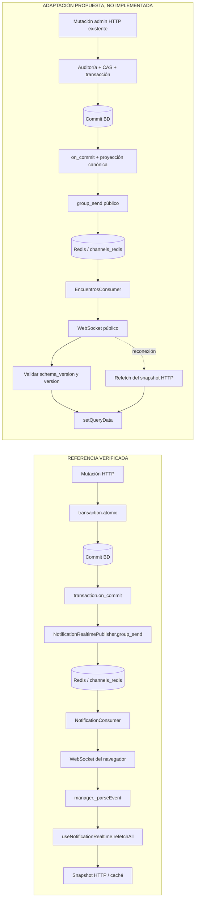

# 08 — Realtime de competencias por WebSocket

> **Estado:** ficha de referencia e implementación futura; el realtime **no está implementado** en Salesianos.
> **Objetivo:** explicar el endpoint WebSocket verificado en `mesa-de-partes-final` y convertirlo en una guía concreta para una adaptación posterior.
> **Ámbito:** competencias, ASGI, Redis, proxy, frontend y despliegue. No modifica contratos ni compromete un diseño.
> **Verificación de la referencia:** 2026-11-20, contra `C:\Users\Usuario\Desktop\Aplicaciones\CIP\mesa-de-partes-final`.
> **Árbol autoritativo de Salesianos:** `Aplicacion/**`.

---

## 1. Respuesta ejecutiva y estado real

> **“Daphne only” es inexacto.** Daphne sólo sirve la aplicación ASGI. El sistema verificado necesita **Daphne + Channels + channels-redis + Redis + enrutado y middleware ASGI propios**.

Este documento usa tres estados que no deben confundirse:

| Estado | Significado |
|---|---|
| **REFERENCIA VERIFICADA ✅** | Comportamiento comprobado en `mesa-de-partes-final`; incluye rutas y líneas exactas. |
| **SALESIANOS ACTUAL 🔴** | Estado comprobado en `Aplicacion/**`; la pieza no existe o todavía opera sólo por HTTP/WSGI. |
| **ADAPTACIÓN PROPUESTA 🔍** | Dirección técnica para una futura propuesta SDD; **no existe y no es todavía un diseño comprometido**. |

| Tema | REFERENCIA VERIFICADA ✅ | SALESIANOS ACTUAL 🔴 | ADAPTACIÓN PROPUESTA 🔍 |
|---|---|---|---|
| Transporte inicial | HTTP para obtener la verdad actual | No existe lectura pública de encuentros | Crear primero un snapshot HTTP público |
| Cambios posteriores | WebSocket push-only en `/ws/notificaciones/` | No hay ruta WebSocket | Canal público de sólo lectura en `/ws/encuentros/` |
| Mutaciones | HTTP transaccional; publica tras commit | HTTP transaccional, auditado y con CAS | Mantener las mutaciones actuales; añadir publicación posterior al commit |
| Runtime | ASGI con Daphne y Channels | WSGI con Gunicorn, 2 workers | Elegir servidor ASGI en la propuesta; la elección sigue abierta |
| Distribución | `channels_redis` sobre Redis | No hay Redis | Redis obligatorio fuera de pruebas aisladas |
| Cliente | `WebSocket` nativo, reconexión y refetch | No hay cliente WebSocket | Aplicar deltas canónicos y resincronizar por HTTP al reconectar |

**Dependencia dura:** el snapshot HTTP público es predecesor del realtime. Sin snapshot no hay carga inicial, recuperación de eventos perdidos ni resync después de una reconexión.

---

## 2. La pila completa: no es sólo Daphne

| # | Pieza | REFERENCIA VERIFICADA ✅ | SALESIANOS ACTUAL 🔴 | ADAPTACIÓN PROPUESTA 🔍 |
|---|---|---|---|---|
| 1 | Servidor ASGI | `daphne==4.1.2` en `backend/pyproject.toml:26`; sirve HTTP y WebSocket | `gunicorn>=23.0.0`; `entrypoint.sh:47` ejecuta WSGI con `--workers 2` | Servidor ASGI por decidir: Daphne monoproceso, Uvicorn con workers o réplicas |
| 2 | Framework WebSocket | `channels==4.2.0` en `backend/pyproject.toml:24`; aporta router, consumer, grupos y validadores | No instalado | Incorporar Channels; Daphne solo no ofrece estas piezas |
| 3 | Channel layer distribuido | `channels_redis==4.2.1` en `backend/pyproject.toml:25` | No instalado | Usarlo en cualquier entorno con más de un proceso o instancia |
| 4 | Broker | `redis:7-alpine` en `docker-compose.yml:2-13`, con `redis-cli ping` | No existe servicio Redis | Añadir Redis con healthcheck y dependencia saludable del backend |
| 5 | ASGI propio | `config/asgi.py`, router de notificaciones y middleware JWT propio | `config/asgi.py:16` sólo ejecuta `get_asgi_application()` | Crear routing de competencias; el canal público no debe copiar la autenticación privada |

`"daphne"` también está en `INSTALLED_APPS` de la referencia (`backend/config/settings/base.py:34`). `gunicorn` sigue declarado allí, pero el contenedor ya no lo ejecuta: es una dependencia residual, no una convivencia de servidores.

---

## 3. Anatomía exacta de la referencia

La ruta completa verificada es `/ws/notificaciones/`. Es un canal privado por usuario y push-only; **no** es todavía el modelo de competencias.

### 3.1 Backend y publicación

| Ruta y línea de la referencia | Símbolo | REFERENCIA VERIFICADA ✅ | SALESIANOS ACTUAL 🔴 | ADAPTACIÓN PROPUESTA 🔍 |
|---|---|---|---|---|
| `backend/config/asgi.py:21` | `django_asgi` | Ejecuta `get_asgi_application()` antes de importar código que puede tocar modelos | ASGI sólo HTTP | Conservar ese orden de inicialización |
| `backend/config/asgi.py:24,27,29-42` | `application` | `ProtocolTypeRouter`: HTTP a Django; WS a `AllowedHostsOriginValidator` → `AuthMiddlewareStack` → `JWTOKCookieMiddleware` → `URLRouter` | No hay `ProtocolTypeRouter` ni router WS | `AllowedHostsOriginValidator(URLRouter(...))`; sin auth para el canal público |
| `backend/modules/notificaciones/routing.py:14-16` | `websocket_urlpatterns` | Enruta `^ws/notificaciones/$` a `NotificationConsumer.as_asgi()` | No hay patrones WS | Enrutar `^ws/encuentros/$` al consumer público |
| `backend/modules/notificaciones/consumers.py:35-49` | `connect()` | Exige usuario autenticado; agrega el socket a `notifications.user.{user.id}` y acepta | No hay consumer | Agregar a `competencias.encuentros.public` sin exigir sesión |
| `backend/modules/notificaciones/consumers.py:51-55` | `disconnect()` | Ejecuta `group_discard` | No existe | Desregistrar siempre el canal |
| `backend/modules/notificaciones/consumers.py:58-95` | `notification_created`, `notification_read` | Serializa el evento de grupo y lo envía al navegador | No existe | Handler único para `encuentro.actualizado`; sin comandos entrantes |
| `backend/core/middleware/jwt_cookie_websocket.py:66-153` | `JWTOKCookieMiddleware` | Lee JWT de cookie, valida firma/expiración y crea `JWTTokenUser` sin consulta de BD | No existe middleware WS | **No copiar** al canal público; revisar blacklist/usuario activo si se crea otro canal privado |
| `backend/modules/notificaciones/infrastructure/services/notification_realtime_publisher.py:33` | `user_channel_group()` | Construye el mismo nombre de grupo privado que el consumer | No hay publicador | Nombre de grupo público constante y compartido |
| `notification_realtime_publisher.py:58-168` | `publish_created*()` | Ejecuta `group_send`, en sync con `async_to_sync`; registra y absorbe fallos | No existe | Adapter de infraestructura; un fallo de Redis no revierte el negocio ya confirmado |
| `notification_realtime_publisher.py:171-207` | `publish_created_batch*()` | Deduplica usuarios y emite N envíos | No aplica | Un broadcast público por actualización de encuentro |
| `backend/modules/notificaciones/domain/services/core/notificacion_service.py:84-124` | `_emitir_realtime_si_commit()` | Registra `transaction.on_commit`; el callback publica sólo después del commit | Las mutaciones de competencias ya son transaccionales, pero no publican | Registrar la publicación dentro de la transacción; ejecutar sólo tras commit |
| `backend/modules/notificaciones/domain/events/notification_events.py:21-97` | `NotificationCreatedEvent` | Payload con `type`, `notification_id`, `occurred_at` y `version=1` | No hay evento realtime | Separar `schema_version` de la `version` CAS del encuentro y llevar la proyección canónica |
| `backend/config/settings/base.py:195,199,203-210` | `ASGI_APPLICATION`, `REDIS_URL`, `CHANNEL_LAYERS` | Configura ASGI y `channels_redis.core.RedisChannelLayer` | Sólo `WSGI_APPLICATION` (`Aplicacion/backend/config/settings/base.py:162`) | Añadir configuración ASGI/Redis sin eliminar la configuración WSGI hasta decidir el runtime final |
| `backend/config/settings/development.py:59-64` y `test.py:47-52` | `CHANNEL_LAYERS` | Sustituye Redis por `InMemoryChannelLayer` | No hay channel layer | Reservar InMemory para pruebas aisladas; no usarlo como sustituto de Redis en integración |

El orden del middleware de la referencia importa: el validador de origen es externo; `AuthMiddlewareStack` crea primero el usuario de sesión y el middleware JWT puede sobrescribir `scope["user"]`. Además, ese middleware no consulta la blacklist ni comprueba que el usuario siga activo. Ese riesgo sólo sería relevante si Salesianos implementara un canal autenticado posterior.

### 3.2 Payload y política de caché

```json
{
  "type": "notification.created",
  "notification_id": "<uuid>",
  "occurred_at": "<iso-8601>",
  "version": 1
}
```

| Aspecto | REFERENCIA VERIFICADA ✅ | SALESIANOS ACTUAL 🔴 | ADAPTACIÓN PROPUESTA 🔍 |
|---|---|---|---|
| Contenido | Sólo identifica la notificación | No hay evento | Incluir la proyección completa del encuentro |
| Verdad | HTTP; el socket sólo invalida | Proyección canónica sólo en endpoints administrativos | El snapshot y el evento reutilizan `EncuentroResult`/`proyectar_encuentro` |
| Por evento | `refetchAll()` de lista y resumen | No aplica | `setQueryData` para el delta; evitar un GET completo por cada cambio |
| Reconexión | `refetchAll()` al volver a `connected` | No aplica | Un refetch del snapshot para recuperar eventos perdidos |
| Orden | No hay secuencia ni deduplicación | CAS `version` ya existe en encuentros | Descartar `evento.version <= versionActual` |

El patrón útil de la referencia es **“el socket avisa; HTTP sigue siendo la verdad”**. Lo que no escala a marcadores es el payload sólo-id seguido de un refetch completo por cada evento.

### 3.3 Frontend de la referencia

| Ruta y línea | Símbolo | REFERENCIA VERIFICADA ✅ | SALESIANOS ACTUAL 🔴 | ADAPTACIÓN PROPUESTA 🔍 |
|---|---|---|---|---|
| `frontend/src/features/notificaciones/services/notification-websocket.manager.ts:63-68` | singleton/factory | Un manager por aplicación, con factory inyectable para pruebas | No hay manager | Manager pequeño dentro de `features/competencias/realtime/` |
| Mismo archivo `:55-59,357-373` | backoff | 1 s a 30 s, jitter ±30 % | No existe | Reutilizar la política de reconexión |
| Mismo archivo `:206-227` | `_resolveUrl()` | `NEXT_PUBLIC_WS_URL`; si falta, deriva `ws:`/`wss:` same-origin | No existe | Mismo criterio con `/ws/encuentros/` |
| Mismo archivo `:298-321` | `_handleClose()` | No reconecta en 4401/4403; el backend sólo emite 4401 | No existe | Definir códigos antes de programar ramas de cliente |
| Mismo archivo `:397-429` | `_parseEvent()` | Descarta JSON inválido, tipo desconocido y `version !== 1` | No existe | Validar esquema, tipo y versión; descartar eventos obsoletos por CAS |
| `frontend/src/features/notificaciones/hooks/useNotificationRealtime.ts:70-91` | evento recibido | Fuerza refetch HTTP | No existe | Aplicar delta canónico a la caché |
| Mismo archivo `:101-112` | transición a conectado | Fuerza resync HTTP | No existe | Conservar este patrón |
| `providers/NotificationRealtimeProvider.tsx` y `app/(protected)/NotificationRealtimeBootstrap.tsx` | montaje | Monta una única suscripción en el layout protegido | No existe | Montar en la superficie pública que consume el snapshot |
| `frontend/scripts/ws-probe.ts` | sonda | Usa `ws` sólo para diagnóstico; el navegador usa API nativa | No existe | Diferir; no añadir una librería cliente sin necesidad |

---

## 4. Flujo extremo a extremo

La mitad superior es el flujo comprobado en la referencia. La inferior es la adaptación mínima propuesta; en Salesianos actual esa cadena termina en el commit porque todavía no existe publicación realtime.



**Punto crítico:** `transaction.on_commit` separa persistencia y notificación. Un rollback no emite. Si Redis falla después del commit, el negocio no se revierte; el cliente recupera la verdad mediante el siguiente snapshot o resync.

---

## 5. Copiar, adaptar o rechazar

| Elemento de referencia | Decisión | Motivo | Destino propuesto en Salesianos |
|---|---|---|---|
| `ProtocolTypeRouter` y orden de inicialización | **ADAPTAR** | HTTP y WS deben compartir ASGI sin importar modelos demasiado pronto | `Aplicacion/backend/config/asgi.py` |
| `AllowedHostsOriginValidator` | **COPIAR** | Protege el handshake contra orígenes no permitidos | Envoltura externa del router WS |
| Middleware JWT + `AuthMiddlewareStack` | **RECHAZAR** para el canal público | El espectador no tiene sesión; el middleware de referencia no comprueba blacklist | Sólo reconsiderar para un canal privado futuro |
| Grupo `notifications.user.{id}` | **RECHAZAR** | Es privado por usuario; los encuentros requieren broadcast público | `competencias.encuentros.public` |
| Consumer push-only | **COPIAR el principio** | El navegador no debe mutar el dominio por WebSocket | `infrastructure/realtime/consumers.py` |
| `transaction.on_commit` | **COPIAR** | Impide avisar de datos que luego hacen rollback | Adapter de publicación realtime |
| Dominio importando infraestructura | **RECHAZAR** | Viola las capas del proyecto | Port en `domain/ports/` + adapter en `infrastructure/` |
| Evento sólo con id | **RECHAZAR** | Provoca un refetch completo por actualización | Evento con proyección canónica |
| Un único campo `version` para el esquema | **ADAPTAR** | Mezcla forma y orden | `schema_version` + `version` CAS |
| Singleton, factory y backoff del manager | **ADAPTAR** | Evita sockets duplicados y permite pruebas | `features/competencias/realtime/encuentros-websocket.manager.ts` |
| Resync al reconectar | **COPIAR** | Recupera eventos perdidos | Hook de realtime de encuentros |
| Redis 7 con healthcheck | **COPIAR** | Hace visible la disponibilidad del channel layer | `Aplicacion/docker-compose.yml` |
| Bloque nginx `/ws/` | **COPIAR y adaptar** | Preserva `Upgrade` y timeout largo | `Aplicacion/proxy/nginx.conf` |
| Daphne reemplazando Gunicorn | **NO decidir aquí** | Cambia el paralelismo HTTP de 2 procesos a 1 | Resolver en proposal/spec/design |

---

## 6. Qué NO copiar

1. **No copiar el grupo privado `notifications.user.{id}`** para encuentros públicos.
2. **No copiar autenticación JWT por cookie** en un socket público. Si aparece un canal autenticado, debe alinearse con el JWT real de Salesianos y comprobar revocación/usuario activo.
3. **No copiar el payload sólo-id** cuando cada evento obligaría a descargar de nuevo toda la vista.
4. **No usar `InMemoryChannelLayer` fuera de pruebas aisladas.** En procesos o instancias distintos, cada memoria es una isla y los mensajes se pierden.
5. **No importar infraestructura desde dominio.** El publicador debe entrar por un port y un adapter.
6. **No copiar ramas de cierre sin emisor.** La referencia trata 4403 en cliente, pero su backend sólo emite 4401.
7. **No asumir que los tests “real channel layer” prueban Redis.** La configuración de test de la referencia los ejecuta con InMemory.
8. **No conservar Gunicorn como dependencia muerta** si el runtime final deja de usarlo.
9. **No asumir que `config.settings` carga desarrollo.** En la referencia carga `base` y, por tanto, Redis.
10. **No asumir que `NEXT_PUBLIC_WS_URL` llega al bundle por estar en Compose.** Si es una variable de build de Next, debe hornearse como tal; el fallback same-origin evita esa dependencia.
11. **No copiar las suposiciones de despliegue.** Cloudflare, TLS externo, un solo backend y puertos internos son condiciones verificadas de la referencia, no garantías universales.
12. **No añadir un reloj cosmético.** Sin tiempo autoritativo de servidor y semántica de pausa, la UI sólo muestra horario y estado.
13. **No derivar el ganador desde el marcador.** Esta prohibición es una invariante de Salesianos, no una preferencia visual.

---

## 7. Invariante del ganador

> **`puntaje_1`, `puntaje_2` y `marcador_detalle` son informativos. `ganador` es la autoridad para la progresión del cuadro.**

| Superficie | Regla obligatoria |
|---|---|
| Mutación administrativa | El operador envía el ganador explícito; el backend valida que ocupe un slot y nunca lo infiere del puntaje |
| Evento WebSocket | Publica `ganador` y `puntaje_*` como campos independientes de la proyección canónica |
| Cliente | No calcula, propone ni corrige el ganador a partir del marcador |
| Cuadro | Avanza exclusivamente con el `ganador` autoritativo confirmado por el backend |
| Tabla futura | Si existe, sus resultados se derivan de `ganador`, no de comparar puntajes |

Esta regla ya está implementada en `resultado_core_service.py`, en la restricción `competencia_encuentro_ganador_en_slot` y en `proyeccion.py`. El realtime sólo debe transportarla; nunca redefinirla.

---

## 8. Arquitectura mínima propuesta para Salesianos

Todo lo listado en esta sección es **ADAPTACIÓN PROPUESTA 🔍** y permanece sin implementar.

### 8.1 Orden funcional obligatorio

1. Crear la lectura HTTP pública bajo un prefijo separado de `/api/competencias/`.
2. Reutilizar `EncuentroResult`/`proyectar_encuentro` como snapshot canónico.
3. Añadir ASGI, channel layer y transporte de despliegue.
4. Publicar deltas sólo después del commit de las mutaciones administrativas existentes.
5. Aplicar deltas en el frontend y resincronizar el snapshot al conectar o reconectar.

### 8.2 Piezas por capa

| Pieza | SALESIANOS ACTUAL 🔴 | ADAPTACIÓN PROPUESTA 🔍 | Regla |
|---|---|---|---|
| Snapshot HTTP público | No existe | Controller público fuera de `/api/competencias/` | Es predecesor duro del realtime |
| Mutaciones admin | Ya existen | No cambiar sus endpoints ni autoridad | Siguen auditadas, con CAS y transacción |
| Port de publicación | No existe | `modules/competencias/domain/ports/publicador_realtime.py` | Dominio no importa Channels |
| Adapter | No existe | `modules/competencias/infrastructure/realtime/publicador_encuentros.py` | `group_send` después del commit; fallo no revierte negocio |
| Evento | No existe | `infrastructure/realtime/eventos.py` | Construido desde la proyección canónica |
| Consumer | No existe | `infrastructure/realtime/consumers.py` | Público, push-only, grupo `competencias.encuentros.public` |
| Routing | No existe | `infrastructure/realtime/routing.py` | Ruta `/ws/encuentros/` |
| Manager frontend | No existe | `features/competencias/realtime/encuentros-websocket.manager.ts` | Socket único, backoff y parseo defensivo |
| Hook/provider | No existe | `useEncuentrosRealtime.ts` + provider público | Delta con `setQueryData`; resync por HTTP |

### 8.3 Contrato mínimo del evento

```json
{
  "type": "encuentro.actualizado",
  "schema_version": 1,
  "encuentro_id": "<uuid>",
  "version": 7,
  "occurred_at": "2026-11-20T22:31:05+00:00",
  "encuentro": { "...": "proyección canónica EncuentroResult" }
}
```

| Campo | Propósito | Regla del cliente |
|---|---|---|
| `type` | Vocabulario cerrado del evento | Ignorar tipos desconocidos |
| `schema_version` | Versión de la forma del payload | Ignorar versiones no soportadas y resincronizar |
| `encuentro_id` | Identidad estable | Localizar la entrada de caché |
| `version` | Versión CAS monótona del encuentro | Descartar si `version <= versionActual` |
| `occurred_at` | Diagnóstico y observabilidad | No usar como fuente de orden frente a `version` |
| `encuentro` | Estado proyectado completo | Aplicar sin recalcular reglas de dominio |

No se propone replay ni log durable de eventos. La recuperación es el snapshot HTTP; por eso la reconexión siempre debe disparar resync.

---

## 9. Despliegue y operación

### 9.1 Cambio de servidor: decisión abierta

| Opción | Efecto | Riesgo / coste | Estado |
|---|---|---|---|
| Daphne monoproceso | Replica exactamente la referencia | Reemplaza los **2 workers** actuales de Gunicorn por **1 proceso**; Daphne no ofrece `--workers` | No decidido |
| Uvicorn con `--workers N` | Conserva multiproceso bajo ASGI | Añade una elección distinta a la referencia y exige pruebas operativas | No decidido |
| Réplicas de Daphne | Escala horizontalmente | Requiere balanceo, channel layer Redis común y eliminar supuestos como `container_name` fijo | No decidido |

La propuesta/spec/design deben resolver esta elección. Este documento no autoriza reemplazar `entrypoint.sh`.

La línea verificada en la referencia es:

```bash
exec gosu appuser uv run daphne -b 0.0.0.0 -p ${BACKEND_INTERNAL_PORT:-8000} config.asgi:application
```

En Salesianos actual se ejecuta `gunicorn config.wsgi:application --bind 0.0.0.0:8000 --workers 2`. El cambio no es cosmético: modifica concurrencia HTTP, healthchecks, observabilidad y estrategia de escalado.

### 9.2 Redis y multi-instancia

- Añadir un servicio `redis:7-alpine`, sólo en la red interna, con healthcheck `redis-cli ping`.
- Hacer que backend dependa de `redis: service_healthy`.
- Usar `channels_redis` en desarrollo integrado, staging y producción.
- Todas las instancias deben apuntar al mismo Redis. Una instancia con InMemory no recibe eventos publicados por las demás.
- Probar Redis real: los tests de la referencia no lo hacen aunque algunos nombres indiquen lo contrario.

### 9.3 Proxy, TLS y Cloudflare

El bloque verificado de la referencia es pequeño pero imprescindible:

```nginx
location /ws/ {
    proxy_pass http://backend_upstream;
    proxy_http_version 1.1;
    proxy_set_header Host $http_host;
    proxy_set_header X-Real-IP $remote_addr;
    proxy_set_header X-Forwarded-For $proxy_add_x_forwarded_for;
    proxy_set_header X-Forwarded-Proto $scheme_alt;
    proxy_set_header Upgrade $http_upgrade;
    proxy_set_header Connection "upgrade";
    proxy_read_timeout 86400s;
}
```

| Tema | REFERENCIA VERIFICADA ✅ | SALESIANOS ACTUAL 🔴 | ADAPTACIÓN PROPUESTA 🔍 |
|---|---|---|---|
| Upgrade | nginx reenvía `Upgrade` y `Connection` | No hay `location /ws/` | Añadir ruta WS antes del fallback general |
| TLS | Cloudflare termina TLS; nginx recibe HTTP | Mismo mapa `$http_cf_visitor`/`$scheme_alt`, sin WS | Navegador usa `wss://` cuando la página usa HTTPS |
| Timeout | nginx usa 86400 s para `/ws/` | Timeout general, sin excepción WS | Mantener timeout largo, sin asumir que controla el borde de Cloudflare |
| Idle | Keepalive de protocolo de Daphne: ping 20 s, timeout 30 s por defecto | No aplica | Probar frente a Cloudflare; su cierre ocioso aproximado de 100 s ocurre antes que nginx |
| Origen | `AllowedHostsOriginValidator` | `ALLOWED_HOSTS=salesianosfest.pe,www.salesianosfest.pe` | Incluir cada host real de producción/staging/preview o el handshake será 403 |

No se propone ping de aplicación: duplicaría el keepalive de protocolo. Si el servidor ASGI elegido cambia, sus defaults de ping deben verificarse explícitamente.

### 9.4 Variables requeridas

| Variable | Uso | Estado actual | Decisión futura |
|---|---|---|---|
| `DJANGO_SETTINGS_MODULE` | Selecciona settings de producción/desarrollo/test | Ya existe | Verificar que la variante productiva usa Redis |
| `REDIS_URL` | URL base de Redis | No existe | `redis://redis:6379/0` en Compose |
| `CHANNEL_LAYER_REDIS_URL` | Override específico del channel layer | No existe | Opcional; si falta, heredar `REDIS_URL` |
| `NEXT_PUBLIC_WS_URL` | URL absoluta del navegador | No existe | Vacía en producción para same-origin o declarada como build arg |
| `ALLOWED_HOSTS` | Hosts aceptados y orígenes WS permitidos | Dominio productivo estricto | Añadir explícitamente cada entorno real |
| `BACKEND_INTERNAL_PORT` | Puerto de escucha ASGI | El backend usa 8000 | Mantener 8000 salvo decisión operativa distinta |
| `PROXY_PORT` | Puerto publicado local | 7000 | No cambia por WebSocket |

---

## 10. Pruebas y verificación

| Nivel | Caso mínimo | Qué demuestra | Referencia actual | Salesianos futuro |
|---|---|---|---|---|
| Consumer | conecta por ruta pública, se une al grupo y descarta al desconectar | Routing y ciclo de vida | Hay pruebas de conexión autenticada | Adaptar a canal público |
| Auth/origen | origen permitido conecta; origen no permitido falla | `AllowedHostsOriginValidator` efectivo | Sin prueba específica | Obligatoria con hosts reales |
| Sólo lectura | mensajes entrantes no mutan ni ejecutan comandos | Frontera de autoridad | Consumer sin `receive()` | Obligatoria |
| Publicación | commit emite exactamente una vez | `on_commit` conectado | Cubierto con InMemory | Repetir con evento de encuentro |
| Rollback | rollback no emite | No hay eventos fantasma | `test_service_crear_notificacion_usuario_no_emit_on_rollback` | Obligatoria |
| Orden | versión igual, menor o duplicada se descarta | UI no retrocede | No existe | Obligatoria en backend/frontend |
| Reconexión | volver a `connected` fuerza un snapshot | Recuperación de pérdidas | Cubierto en hook | Obligatoria |
| Redis real | producer y consumer en procesos distintos intercambian evento | Channel layer distribuido | **No cubierto** | Prueba de integración obligatoria |
| nginx | handshake y frames atraviesan `/ws/` | Headers Upgrade correctos | No cubierto | Prueba live obligatoria |
| Compose | Redis saludable precede al backend y el stack levanta | Dependencias operativas | No cubierto | `docker compose config` + arranque limpio |
| Dominio productivo | `wss://salesianosfest.pe/ws/encuentros/` conecta y sobrevive al idle | TLS, Cloudflare, host/origin y keepalive | No aplica | Smoke test obligatorio |

Secuencia de aceptación operativa:

1. Ejecutar pruebas unitarias de esquema, orden y manager.
2. Ejecutar pruebas de consumer/publicador con InMemory para aislamiento.
3. Ejecutar una integración con Redis real y procesos separados.
4. Verificar `docker compose config` y healthchecks.
5. Probar el Upgrade a través de nginx.
6. Probar `wss://` desde el dominio de producción, incluida una conexión ociosa superior al límite esperado del borde.

---

## 11. Secuencia de trabajo y puerta SDD

La documentación y la exploración pueden preceder la propuesta porque no modifican runtime, contratos ni dependencias. La implementación del mismo cambio no puede hacerlo.

| Orden | Fase | Puede avanzar ahora | Dependencia |
|---|---|---|---|
| 1 | Exploración y este documento | Sí | Evidencia de referencia y estado actual |
| 2 | Fase A: operación administrativa | Sí, como cambio independiente | Endpoints administrativos ya existentes |
| 3 | Fase B: lectura pública | Sí, como cambio independiente | Política de exposición y contrato HTTP |
| 4 | Fase C: “mis partidos” | Sí, como cambio independiente | Identidad por cuenta; no depende del realtime |
| 5 | Realtime | No aplicar todavía | **Requiere Fase B entregada** |
| 6 | Apply de `partidos-marcadores-competencias` | Bloqueado | Proposal → spec → design → tasks completos |

Antes de aplicar realtime para este cambio, proposal/spec/design/tasks deben resolver como mínimo:

- servidor ASGI y paralelismo;
- contrato del snapshot HTTP público;
- esquema de evento y códigos de cierre;
- port/adapter y puntos exactos de publicación;
- política ante fallo de Redis;
- variables, Compose, nginx, TLS, hosts y orígenes;
- matriz de pruebas con Redis/nginx/dominio reales;
- fragmentación en unidades revisables.

---

## 12. Checklist de implementación futura

- [ ] La lectura pública HTTP existe y usa la proyección canónica.
- [ ] `puntaje_*` sigue siendo informativo y `ganador` autoritativo.
- [ ] El canal es público, push-only y no acepta mutaciones.
- [ ] Cada evento se registra con `transaction.on_commit` dentro de la transacción de negocio.
- [ ] Un rollback no publica y una caída de Redis no revierte el commit.
- [ ] El payload separa `schema_version` de la `version` CAS.
- [ ] El cliente descarta eventos obsoletos y resincroniza al reconectar.
- [ ] No se añadió reloj cosmético.
- [ ] Redis real, nginx, Compose y `wss://` productivo están probados.
- [ ] La elección de servidor ASGI y su paralelismo quedó documentada en la spec/design.

---

## 13. Evidencia y documentos relacionados

Los artefactos Engram sustentan las decisiones y la trazabilidad de esta ficha; **no sustituyen la verificación del código** al implementar. Antes de editar runtime se deben releer los archivos citados porque pueden haber cambiado.

| Evidencia | Uso en este documento |
|---|---|
| Engram **#11829**, `sdd/partidos-marcadores-competencias/realtime-reference` | Trazado verificado de backend, frontend, Docker, nginx, Redis y pruebas |
| Engram **#11831**, `sdd/partidos-marcadores-competencias/realtime-reference-blueprint` | Estructura, riesgos, secuencia y matriz de verificación |
| Engram **#11820**, `sdd/partidos-marcadores-competencias/explore` | Estado de Salesianos, fases A/B/C y la invariante del ganador |
| Engram **#11828**, decisión de producto realtime | Snapshot HTTP inicial, cambios posteriores por WS y publicación tras commit |

Documentos locales relacionados:

- [01 — Arquitectura y runtime](./01-arquitectura-y-runtime.md) — topología actual de servicios y proxy.
- [02 — Backend y API](./02-backend-y-api.md) — capas, transacciones y contratos HTTP.
- [03 — Frontend](./03-frontend.md) — caché, features y transporte cliente.
- [04 — Datos y dominio](./04-datos-y-dominio.md) — propiedad del modelo de competencias.
- [06 — Operación y deuda técnica](./06-operacion-y-deuda-tecnica.md) — operación actual y riesgos conocidos.
