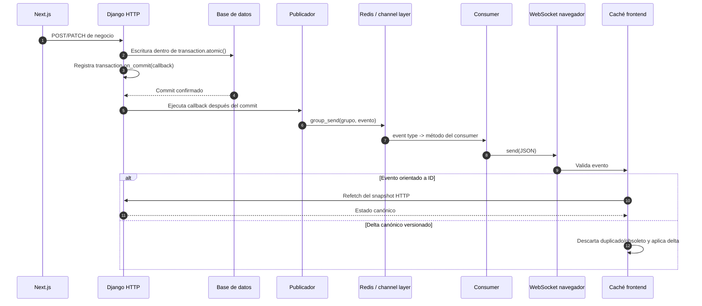

# Arquitectura WebSocket con Django Channels, Daphne, Redis y Next.js

## Propósito y alcance

Esta guía explica cómo funciona una arquitectura WebSocket comprobada en una aplicación Django + Next.js y cómo reproducir sus principios en otra aplicación. Está dirigida a personas responsables del backend, frontend y despliegue que necesiten entender el recorrido completo de un evento, no solo levantar un servidor ASGI.

El documento distingue dos tipos de contenido:

- **Referencia verificada:** comportamiento, rutas, símbolos y decisiones observados en `mesa-de-partes-final`.
- **Receta de replicación:** estructura genérica y adaptable para otra aplicación Django + Next.js.

Esta guía no afirma que la arquitectura esté instalada en otra aplicación, no prescribe nombres de dominio y no sustituye el diseño de autenticación ni las reglas de negocio de cada sistema. Los fragmentos son representativos: deben adaptarse los nombres, permisos, payloads, grupos, cookies y variables de entorno.

> **Idea central:** Daphne por sí solo no constituye esta arquitectura. La solución completa combina Daphne, Django Channels, `channels_redis`, Redis, enrutado y middleware ASGI, un proxy compatible con Upgrade y un cliente WebSocket en el navegador.

## Vista general

La arquitectura conserva dos caminos con responsabilidades distintas:

1. **HTTP escribe y consulta el estado autoritativo.** Las mutaciones validan reglas de negocio y persisten en la base de datos.
2. **WebSocket anuncia cambios confirmados.** El navegador recibe una señal o un delta y sincroniza su caché sin convertir el socket en fuente de verdad.

```text
Navegador Next.js
   |  POST/PATCH + GET
   v
Proxy nginx ---- HTTP ----> Daphne ----> Django ----> Base de datos
   ^                               |
   |                               | transaction.on_commit
   |                               v
   +---- WebSocket <---- Consumer <---- Channels <---- Redis
```

### Responsabilidad de cada componente

| Componente | Responsabilidad | Lo que no hace |
|---|---|---|
| **Daphne** | Ejecuta la aplicación ASGI y mantiene conexiones HTTP/WebSocket. | No define rutas WebSocket, grupos, autenticación ni fan-out. |
| **Django Channels** | Proporciona `ProtocolTypeRouter`, `URLRouter`, consumers, grupos y la API de channel layer. | No reemplaza Redis cuando hay varios procesos o instancias. |
| **`channels_redis`** | Implementa el channel layer de Channels sobre Redis. | No es el servidor Redis ni persiste el estado de negocio. |
| **Redis** | Transporta mensajes entre publicadores, procesos e instancias conectadas al mismo channel layer. | No es la fuente de verdad del dominio. |
| **Enrutado ASGI** | Separa tráfico HTTP y WebSocket y asigna cada ruta a su consumer. | No autoriza por sí solo. |
| **Middleware ASGI** | Valida origen y, para canales privados, autentica la conexión. | No sustituye la autorización del consumer. |
| **Consumer** | Acepta o rechaza el handshake, administra grupos y serializa eventos hacia el socket. | En un canal push-only no procesa comandos de dominio. |
| **Publicador** | Traduce un cambio confirmado a `group_send`. | No debe decidir reglas de negocio ni invalidar una transacción correcta si Redis falla. |
| **nginx/proxy** | Conserva HTTP/1.1, `Upgrade`, `Connection` y tiempos de espera adecuados. | No crea soporte WebSocket si el backend sigue siendo WSGI. |
| **Cliente Next.js** | Abre el socket, valida eventos, reconecta y actualiza o refresca la caché. | No debe inventar transiciones de negocio ni asumir entrega exacta una vez. |

## Flujo de un evento de extremo a extremo

El orden correcto protege al cliente contra estados que finalmente no llegaron a la base de datos:

1. El navegador envía una mutación HTTP.
2. Django autentica, autoriza y valida la operación.
3. El servicio ejecuta la escritura dentro de `transaction.atomic()`.
4. Dentro de esa transacción se registra un callback con `transaction.on_commit(...)`.
5. Si el commit falla o hay rollback, el callback no se ejecuta y no se publica nada.
6. Tras un commit correcto, el callback construye el evento y llama a `group_send`.
7. `channels_redis` publica el mensaje en Redis para el grupo correspondiente.
8. Channels entrega el mensaje al método del consumer asociado al campo `type`.
9. El consumer serializa el evento y lo envía al navegador.
10. El gestor WebSocket valida el esquema y notifica a sus suscriptores.
11. El frontend refresca por HTTP o aplica un delta canónico a su caché.



La entrega no debe tratarse como **exactamente una vez** ni como una cola transaccional para el navegador. Puede haber mensajes perdidos durante desconexiones y duplicados originados por reintentos en capas de aplicación. El snapshot HTTP inicial, el versionado y la resincronización al reconectar cierran esa brecha.

## Referencia verificada: `mesa-de-partes-final`

La implementación verificada usa:

| Pieza | Versión o forma observada |
|---|---|
| Daphne | `daphne==4.1.2` |
| Django Channels | `channels==4.2.0` |
| Backend del channel layer | `channels_redis==4.2.1` |
| Redis | `redis:7-alpine` |
| Cliente | API `WebSocket` nativa del navegador |
| Endpoint | `/ws/notificaciones/` |
| Grupo | `notifications.user.{id}` |
| Modalidad | Privada por usuario y push-only |

### Entrada ASGI y routing

| Ruta | Símbolo | Comportamiento verificado |
|---|---|---|
| `backend/config/asgi.py` | `application` | Crea `django_asgi` antes de importar routing que pueda tocar modelos. Usa `ProtocolTypeRouter` para HTTP y WebSocket. |
| `backend/config/asgi.py` | `AllowedHostsOriginValidator` | Capa más externa del camino WebSocket; valida el origen contra la configuración de hosts permitidos. |
| `backend/config/asgi.py` | `AuthMiddlewareStack` | Aporta usuario de sesión como respaldo. |
| `backend/config/asgi.py` | `JWTOKCookieMiddleware` | Sobrescribe `scope["user"]` con el usuario derivado del JWT en cookie cuando el token es válido. |
| `backend/config/asgi.py` | `URLRouter(websocket_urlpatterns)` | Delega la resolución de la ruta al módulo de notificaciones. |
| `backend/modules/notificaciones/routing.py` | `websocket_urlpatterns` | Registra exactamente `re_path(r"^ws/notificaciones/$", NotificationConsumer.as_asgi())`. |

El orden de inicialización es relevante: `get_asgi_application()` se ejecuta antes de importar módulos que podrían acceder al registro de aplicaciones o al ORM.

### Consumer, grupos y dirección del canal

En `backend/modules/notificaciones/consumers.py`, `NotificationConsumer` hereda de `AsyncWebsocketConsumer`:

- `connect()` exige `scope["user"].is_authenticated`; si falla, cierra con código `4401`.
- Para una conexión válida usa `notifications.user.{user.id}`.
- Ejecuta `group_add(...)` antes de `accept()`.
- `disconnect()` ejecuta `group_discard(...)` cuando se había creado el grupo.
- `notification_created(event)` y `notification_read(event)` convierten mensajes de grupo a JSON.
- No implementa `receive()`: el socket es **push-only** y no acepta comandos de dominio del navegador.

Channels transforma el `type` de un mensaje de grupo en el nombre del método del consumer. Por ejemplo, `notification.created` se entrega a `notification_created`.

### JWT por cookie y autorización

`backend/core/middleware/jwt_cookie_websocket.py` contiene `JWTOKCookieMiddleware` y `JWTTokenUser`:

1. Lee el encabezado `cookie` del scope ASGI.
2. Obtiene el nombre de cookie desde `settings.NINJA_JWT["WS_COOKIE_NAME"]`, configurado a partir del prefijo de almacenamiento de autenticación.
3. Decodifica el JWT con `settings.SECRET_KEY`, el algoritmo configurado y verificación de expiración.
4. Construye `JWTTokenUser` desde `user_id` sin consultar la base de datos.
5. Ante cualquier error asigna `AnonymousUser`; el consumer toma la decisión final de rechazo.

La autorización efectiva tiene dos niveles: el middleware establece identidad y el consumer decide si esa identidad puede conectarse y a qué grupo pertenece. El nombre de grupo no proviene del cliente, lo que evita que un usuario solicite arbitrariamente el grupo de otro.

La implementación tiene una limitación importante: no comprueba blacklist, existencia actual ni estado activo del usuario. Un token revocado o perteneciente a un usuario desactivado puede seguir autenticando el socket hasta expirar. Ese comportamiento no debe copiarse sin evaluar el modelo de revocación requerido.

### Publicador y frontera transaccional

| Ruta | Símbolo | Comportamiento verificado |
|---|---|---|
| `backend/modules/notificaciones/infrastructure/services/notification_realtime_publisher.py` | `user_channel_group(user_id)` | Produce `notifications.user.{user_id}`; debe coincidir exactamente con el consumer. |
| Mismo archivo | `NotificationRealtimePublisher.publish_created(...)` | Construye el evento, obtiene el channel layer y usa `async_to_sync(channel_layer.group_send)` desde código síncrono. |
| Mismo archivo | `publish_created_async(...)` | Variante asíncrona que espera `group_send` directamente. |
| Mismo archivo | `publish_created_batch(...)` | Deduplica IDs de usuario y publica una vez por grupo. |
| `backend/modules/notificaciones/domain/services/core/notificacion_service.py` | `NotificacionService._emitir_realtime_si_commit(...)` | Registra `_on_commit_callback` mediante `transaction.on_commit`. |

El publicador trata el realtime como best effort: si no hay channel layer o `group_send` falla, registra el error y no propaga la excepción al flujo de negocio. El estado ya confirmado en la base de datos no debe revertirse porque el canal de notificación esté temporalmente caído.

La referencia importa el publicador de infraestructura directamente desde un servicio de dominio. Ese acoplamiento funciona, pero no es una frontera reusable recomendable. Una réplica con arquitectura por capas debería definir un puerto en dominio o aplicación e inyectar el adaptador de Channels desde infraestructura.

### Evento y modelo de actualización del frontend

`backend/modules/notificaciones/domain/events/notification_events.py` define:

```json
{
  "type": "notification.created",
  "notification_id": "<uuid-como-string>",
  "occurred_at": "<ISO-8601>",
  "version": 1
}
```

Los símbolos principales son `NotificationCreatedEvent`, `build_notification_created_event`, `EVENT_TYPE_NOTIFICATION_CREATED` y `CURRENT_EVENT_VERSION`.

El payload está orientado al ID: no incluye la notificación canónica. Este modelo es adecuado cuando los eventos son poco frecuentes, el recurso debe releerse por permisos o consistencia, y el coste del GET posterior es aceptable. No es eficiente para señales de alta frecuencia o muchas entidades simultáneas; en esos casos conviene enviar deltas canónicos con versión de entidad.

El campo `version` de la referencia representa la versión del **esquema del evento**, no una secuencia ni la versión del agregado. Por ello no permite deduplicar ni ordenar cambios de la misma entidad.

El consumer también expone un handler `notification_read(event)` que serializa `notification.read` con `notification_id`. Sin embargo, el módulo de eventos y el gestor frontend verificados tipan y procesan `notification.created`; el cliente descarta tipos desconocidos. La réplica debe mantener alineados publicador, consumer y parser, en lugar de asumir que la existencia de un handler completa el contrato extremo a extremo.

### Gestor, hooks, provider y bootstrap de Next.js

| Ruta | Símbolo | Comportamiento verificado |
|---|---|---|
| `frontend/src/features/notificaciones/services/notification-websocket.manager.ts` | `NotificationWebSocketManager` | Singleton testeable mediante `createWithFactory(factory)`. Usa la API `WebSocket` nativa. |
| Mismo archivo | `_resolveUrl()` | Prioridad: `NEXT_PUBLIC_WS_URL`; después same-origin con `ws:`/`wss:`; finalmente `BACKEND_HOST` en servidor. |
| Mismo archivo | `_handleMessage()` / `_parseEvent()` | Parsea JSON, rechaza formas y tipos desconocidos y acepta solo `version === 1`. |
| Mismo archivo | `_handleClose()` | No reconecta tras `4401` ni `4403`; la referencia backend solo emite `4401`, por lo que la rama `4403` no tiene emisor comprobado. |
| Mismo archivo | `_scheduleReconnect()` / `_computeBackoffDelay()` | Backoff exponencial de 1 s a 30 s con jitter de ±30 %. Pausa sin conectividad y reanuda con el evento `online`. |
| Mismo archivo | `disconnect()` | Desactiva callbacks antes de cerrar para evitar reentrada y reconexión accidental. |
| `frontend/src/features/notificaciones/hooks/useNotificationWebSocket.ts` | `useNotificationWebSocket(...)` | Expone estado, último evento, suscripción, conexión y desconexión; puede conectar al montar. |
| `frontend/src/features/notificaciones/hooks/useNotificationRealtime.ts` | `useNotificationRealtime()` | Ante `notification.created` ejecuta `refetchQueries` de lista y resumen. Al entrar en `connected` ejecuta un refetch único de recuperación. |
| `frontend/src/features/notificaciones/providers/NotificationRealtimeProvider.tsx` | `NotificationRealtimeProvider` | Monta el hook una vez y no renderiza interfaz. |
| `frontend/src/app/(protected)/NotificationRealtimeBootstrap.tsx` | `NotificationRealtimeBootstrap` | Inserta el provider en el layout protegido desde un componente cliente. |

En esta referencia, **el socket es una señal y HTTP es la verdad**. Cada evento creado provoca una lectura HTTP real; la misma lectura se repite después de cada reconexión para recuperar eventos perdidos.

### Settings de desarrollo, pruebas y producción

`backend/config/settings/base.py` configura:

- `ASGI_APPLICATION = "config.asgi.application"`.
- `REDIS_URL`, con valor por defecto `redis://localhost:6379/0`.
- `CHANNEL_LAYERS["default"]` con `channels_redis.core.RedisChannelLayer`.
- `CHANNEL_LAYER_REDIS_URL` como override opcional de `REDIS_URL`.
- `"daphne"` en `INSTALLED_APPS`, antes de `django.contrib.staticfiles`.

`backend/config/settings/development.py` y `backend/config/settings/test.py` reemplazan el backend por `channels.layers.InMemoryChannelLayer`. Esto simplifica pruebas unitarias y locales de un solo proceso, pero **no es seguro para producción ni representa fan-out entre procesos**.

Existe una trampa de configuración: `backend/config/settings/__init__.py` importa `base`, de modo que `DJANGO_SETTINGS_MODULE=config.settings` usa Redis. El backend en memoria solo se activa al seleccionar explícitamente `config.settings.development` o `config.settings.test`.

### Despliegue de la referencia

#### Backend y Daphne

`backend/docker/entrypoint.sh` espera a PostgreSQL, ejecuta migraciones y `collectstatic`, y termina con:

```bash
exec gosu appuser uv run daphne \
  -b 0.0.0.0 \
  -p ${BACKEND_INTERNAL_PORT:-8000} \
  config.asgi:application
```

Daphne reemplaza por completo a Gunicorn en ese contenedor. Aunque `gunicorn` sigue declarado como dependencia, no participa en el arranque observado.

La CLI de Daphne usada en la referencia no ofrece `--workers`. Esa invocación crea un proceso servidor. Migrar desde `gunicorn --workers N` a ese comando puede reducir el paralelismo HTTP; para escalar se requieren réplicas externas o una estrategia ASGI multiproceso compatible, siempre compartiendo Redis.

#### Redis y orden de arranque

`docker-compose.yml` define `redis:7-alpine`, expone `6379` solo en la red interna y comprueba salud con `redis-cli ping`. El backend recibe `REDIS_URL=redis://redis:6379/0` y depende de Redis saludable, además de las demás dependencias de arranque.

`backend/Dockerfile` contiene un healthcheck basado en `manage.py check`. El Compose tiene healthchecks explícitos para dependencias como Redis y PostgreSQL, pero no añade un healthcheck propio separado para frontend; la cadena completa debe validarse con una prueba de humo, no solo con salud de procesos.

#### nginx y Cloudflare

`proxy/nginx.conf` reenvía `/ws/` al upstream del backend con HTTP/1.1, encabezados de Upgrade y `proxy_read_timeout 86400s`. El proxy recibe tráfico detrás de Cloudflare y calcula el esquema reenviado mediante `$http_cf_visitor`.

```nginx
location /ws/ {
    proxy_pass http://backend_upstream;
    proxy_http_version 1.1;
    proxy_set_header Host $http_host;
    proxy_set_header X-Real-IP $remote_addr;
    proxy_set_header X-Forwarded-For $proxy_add_x_forwarded_for;
    proxy_set_header X-Forwarded-Proto $scheme_alt;
    proxy_set_header Upgrade $http_upgrade;
    proxy_set_header Connection "upgrade";
    proxy_read_timeout 86400s;
}
```

TLS termina antes de nginx; el navegador usa `wss://` cuando la página se sirve por HTTPS y el tramo interno puede seguir usando HTTP con Upgrade. El consumer no requiere que el tramo interno esté cifrado si se encuentra dentro de una red privada controlada.

La referencia no implementa ping de aplicación. Daphne mantiene keepalive de protocolo con valores observados de 20 s para ping y 30 s para timeout. Los límites de inactividad de Cloudflare u otros proxies pueden variar: deben comprobarse con la configuración y las condiciones reales antes de cambiar esos valores.

### Pruebas observadas

| Área | Cobertura verificada |
|---|---|
| Consumer | `test_valid_jwt_cookie_connects`, rechazo sin cookie, rechazo con JWT inválido, entrega al grupo correcto y aislamiento entre usuarios. |
| Publicador | Entrega al consumer, aislamiento entre grupos, dos usuarios, deduplicación de destinatarios y ausencia de emisión sin destinatarios. |
| Transacción | `test_service_crear_notificacion_usuario_emits_via_on_commit` y `test_service_crear_notificacion_usuario_no_emit_on_rollback`. |
| Frontend | `notification-websocket.manager.test.ts` mediante factory inyectada y `useNotificationRealtime.test.ts`. |
| Diagnóstico | `frontend/scripts/ws-probe.ts`, que usa la dependencia de desarrollo `ws` para conectar con una cookie JWT fuera del navegador. |

Los tests backend que contienen `via_real_channel_layer` se ejecutan con `InMemoryChannelLayer` por la configuración de pruebas. Por tanto, no demuestran integración real con Redis. Tampoco se observó cobertura automatizada del Upgrade de nginx, Compose, `AllowedHostsOriginValidator`, duplicados o eventos fuera de orden.

## Receta de replicación

Esta receta conserva el patrón operativo sin imponer el dominio de notificaciones de la referencia.

### Backend

#### 1. Incorporar la pila completa

La aplicación necesita, como mínimo:

- Un servidor ASGI, por ejemplo Daphne.
- Django Channels.
- `channels_redis` fuera de pruebas aisladas.
- Un servicio Redis accesible por todos los procesos e instancias.

No basta con instalar o ejecutar Daphne: sin Channels no existen router ni consumers, y sin un channel layer compartido no hay fan-out confiable entre procesos.

#### 2. Configurar settings

Definir `ASGI_APPLICATION`, `CHANNEL_LAYERS` y las variables de conexión a Redis. Si se usa `InMemoryChannelLayer`, limitarlo a pruebas unitarias o desarrollo monoproceso y seleccionar explícitamente ese módulo de settings.

#### 3. Crear el enrutado ASGI

El siguiente ejemplo muestra un canal privado. Los nombres de middleware, routing y autenticación son deliberadamente genéricos:

```python
# config/asgi.py
import os

from channels.auth import AuthMiddlewareStack
from channels.routing import ProtocolTypeRouter, URLRouter
from channels.security.websocket import AllowedHostsOriginValidator
from django.core.asgi import get_asgi_application

os.environ.setdefault("DJANGO_SETTINGS_MODULE", "config.settings")
django_asgi = get_asgi_application()

from realtime.middleware import TokenCookieMiddleware
from realtime.routing import websocket_urlpatterns

application = ProtocolTypeRouter({
    "http": django_asgi,
    "websocket": AllowedHostsOriginValidator(
        AuthMiddlewareStack(
            TokenCookieMiddleware(URLRouter(websocket_urlpatterns))
        )
    ),
})
```

Para un canal público, puede omitirse la autenticación, pero no la validación de origen ni la autorización de acceso que corresponda. Debe conservarse la inicialización temprana de Django antes de importar módulos que accedan al ORM.

#### 4. Definir una ruta estable y un consumer push-only

```python
# realtime/routing.py
from django.urls import re_path
from .consumers import EntityEventsConsumer

websocket_urlpatterns = [
    re_path(r"^ws/events/$", EntityEventsConsumer.as_asgi()),
]
```

```python
# realtime/consumers.py
import json
from channels.generic.websocket import AsyncWebsocketConsumer

class EntityEventsConsumer(AsyncWebsocketConsumer):
    async def connect(self):
        user = self.scope.get("user")
        if not user or not user.is_authenticated:
            await self.close(code=4401)
            return

        self.group_name = f"events.user.{user.id}"
        await self.channel_layer.group_add(self.group_name, self.channel_name)
        await self.accept()

    async def disconnect(self, close_code):
        if hasattr(self, "group_name"):
            await self.channel_layer.group_discard(
                self.group_name, self.channel_name
            )

    async def entity_updated(self, event):
        await self.send(text_data=json.dumps({
            key: value for key, value in event.items()
        }))
```

No se implementa `receive()`: el socket solo difunde cambios. Para un canal público, use un grupo fijo controlado por el servidor. Para un canal por tenant o recurso, derive y autorice el grupo desde datos confiables; nunca acepte un nombre de grupo arbitrario enviado por el navegador.

#### 5. Publicar después del commit

```python
from asgiref.sync import async_to_sync
from channels.layers import get_channel_layer
from django.db import transaction
import logging

logger = logging.getLogger(__name__)

def publish_after_commit(*, group_name: str, event: dict) -> None:
    def send() -> None:
        try:
            channel_layer = get_channel_layer()
            if channel_layer is not None:
                async_to_sync(channel_layer.group_send)(group_name, event)
        except Exception:
            logger.exception("WebSocket publication failed after commit")

    transaction.on_commit(send)
```

El callback debe registrarse dentro del alcance transaccional de la mutación. El evento debe tener un `type` compatible con el método del consumer, por ejemplo `entity.updated` → `entity_updated`.

En una arquitectura por capas, el caso de uso depende de un puerto de publicación y el adaptador de infraestructura encapsula `get_channel_layer`, `async_to_sync` y Redis. El tratamiento best effort debe ser explícito y observable mediante logs y métricas.

#### 6. Elegir el modelo de evento

Hay dos modelos válidos, con costes diferentes:

| Modelo | Payload | Acción del frontend | Adecuado cuando |
|---|---|---|---|
| Señal orientada a ID | `type`, `entity_id`, `occurred_at`, `schema_version` | Refetch HTTP del recurso o colección. | La frecuencia es baja, el payload depende de permisos o se prioriza simplicidad. |
| Delta canónico | Campos anteriores, `aggregate_version` y representación canónica o cambios suficientes. | Descarta eventos obsoletos y actualiza caché; refetch al reconectar. | Hay alta frecuencia, muchas entidades o el refetch por evento sería costoso. |

No mezcle versión de esquema y versión de entidad:

```json
{
  "type": "entity.updated",
  "schema_version": 1,
  "entity_id": "<uuid>",
  "aggregate_version": 27,
  "occurred_at": "<ISO-8601>",
  "entity": { "id": "<uuid>", "status": "active" }
}
```

### Frontend

#### 1. Crear un gestor único y testeable

El gestor debe encapsular URL, conexión, parseo, suscripciones, cierre intencional y reconexión. Una factory inyectable permite probarlo sin red real.

```typescript
const MAX_DELAY = 30_000;
let attempt = 0;
let socket: WebSocket | null = null;

export function connect(onEvent: (value: unknown) => void, resync: () => void) {
  const protocol = location.protocol === "https:" ? "wss:" : "ws:";
  const url = process.env.NEXT_PUBLIC_WS_URL
    ?? `${protocol}//${location.host}/ws/events/`;

  socket = new WebSocket(url);
  socket.onopen = () => {
    attempt = 0;
    resync(); // Recupera eventos perdidos durante la desconexión.
  };
  socket.onmessage = (message) => onEvent(JSON.parse(message.data));
  socket.onclose = (event) => {
    if (event.code === 4401 || event.code === 4403) return;
    const base = Math.min(1_000 * 2 ** attempt++, MAX_DELAY);
    const delay = base * (0.7 + Math.random() * 0.6);
    window.setTimeout(() => connect(onEvent, resync), delay);
  };
}
```

El ejemplo debe endurecerse con validación de esquema, escucha `online`/`offline`, cancelación de timers, cierre intencional y protección contra sockets duplicados. Adapte los códigos de cierre únicamente si el backend realmente los emite.

#### 2. Separar transporte de sincronización

El gestor no debería conocer claves de caché ni reglas de dominio. Un hook de integración debe:

- Suscribirse al gestor.
- Validar `type` y `schema_version`.
- Para eventos orientados a ID, ejecutar un refetch HTTP dirigido.
- Para deltas, comparar `aggregate_version` con la versión local y usar la API de actualización de caché.
- Ejecutar un refetch de snapshot cada vez que la conexión pasa a `connected`.
- Descartar eventos duplicados, obsoletos o incompatibles.

#### 3. Montar una sola conexión

Use un provider o bootstrap cliente en el layout que cubra a los consumidores reales. El singleton evita sockets duplicados, pero el ciclo de montaje debe revisarse en navegación, desarrollo con recarga rápida y pruebas.

### Despliegue

#### 1. Ejecutar ASGI, no WSGI

Gunicorn apuntando a `config.wsgi:application` no atiende WebSockets. La referencia ejecuta Daphne contra `config.asgi:application` y deja de usar Gunicorn en runtime.

Una invocación Daphne como la verificada es monoproceso porque no existe un flag `--workers` equivalente. Si la aplicación dependía de varios workers HTTP, debe elegir conscientemente entre réplicas de Daphne, otro esquema ASGI multiproceso compatible o separación de cargas. Todas las instancias WebSocket deben compartir el mismo Redis.

#### 2. Añadir Redis y salud operativa

- Ejecute Redis en una red privada.
- Use `redis-cli ping` o una comprobación equivalente.
- Haga que el backend arranque después de Redis saludable cuando el orquestador lo permita.
- Añada healthchecks del backend que prueben la aplicación, no solo que el proceso existe.
- Supervise errores de publicación, conexiones activas, reconexiones y latencia.
- No convierta una caída de Redis en rollback de una transacción ya confirmada.

#### 3. Configurar nginx para Upgrade

```nginx
location /ws/ {
    proxy_pass http://backend_upstream;
    proxy_http_version 1.1;
    proxy_set_header Host $http_host;
    proxy_set_header X-Real-IP $remote_addr;
    proxy_set_header X-Forwarded-For $proxy_add_x_forwarded_for;
    proxy_set_header X-Forwarded-Proto $scheme;
    proxy_set_header Upgrade $http_upgrade;
    proxy_set_header Connection "upgrade";
    proxy_read_timeout 86400s;
}
```

Si TLS termina en Cloudflare u otro proxy, adapte `X-Forwarded-Proto` a la fuente confiable usada por ese entorno. `proxy_read_timeout` no anula límites de inactividad impuestos por intermediarios anteriores; valide los pings de protocolo de extremo a extremo.

#### 4. Configurar protocolo y variables

| Variable | Uso recomendado |
|---|---|
| `DJANGO_SETTINGS_MODULE` | Selecciona explícitamente settings de desarrollo, prueba o producción. |
| `REDIS_URL` | URL principal de Redis, por ejemplo `redis://redis:6379/0` en la red de contenedores. |
| `CHANNEL_LAYER_REDIS_URL` | Override opcional y explícito para el channel layer. |
| `NEXT_PUBLIC_WS_URL` | URL WebSocket absoluta cuando no se desea same-origin. Debe estar disponible durante el build si Next.js la incorpora al bundle. |
| `BACKEND_HOST` | Fallback de servidor para código que resuelve la URL fuera del navegador. |
| `ALLOWED_HOSTS` | Hosts válidos usados también por la validación de origen de Channels. |
| Cookie/JWT settings | Nombre de cookie, algoritmo, duración y política de revocación para canales privados. |

Use `ws://` solo sobre HTTP local o redes confiables. Una página HTTPS debe conectar mediante `wss://`; los navegadores bloquean contenido mixto. La derivación same-origin reduce diferencias entre entornos y permite que el proxy concentre HTTP y WebSocket en el mismo host.

## Reglas de fiabilidad

1. **La base de datos permanece como fuente de verdad.** Redis y el socket son transporte efímero.
2. **Publicar solo después del commit.** Un rollback no debe producir un evento visible.
3. **Cargar un snapshot HTTP inicial.** El socket no garantiza el estado completo al conectarse.
4. **Resincronizar después de cada reconexión.** Pueden haberse perdido eventos durante la interrupción.
5. **Versionar el esquema del evento.** `schema_version` determina si el cliente entiende la forma del payload.
6. **Versionar el agregado o entidad.** `aggregate_version` debe crecer de forma monótona por entidad.
7. **Descartar duplicados, obsoletos y fuera de orden.** No aplicar un evento cuya versión sea menor o igual que la versión local.
8. **No ejecutar transiciones optimistas ciegas.** La respuesta HTTP y el estado confirmado gobiernan las reglas de negocio.
9. **Mantener eventos idempotentes.** Reprocesar el mismo evento no debe corromper la caché.
10. **Observar fallos best effort.** Que el negocio continúe no significa que el error de publicación deba quedar invisible.

## Reglas de seguridad

### Canal público o privado

Defina primero la audiencia:

| Tipo de canal | Requisito mínimo |
|---|---|
| Público | Origen validado, payload mínimo, grupos controlados por servidor y ausencia de comandos. |
| Privado por usuario | Autenticación en handshake, autorización del grupo y aislamiento probado entre usuarios. |
| Privado por tenant/recurso | Autenticación, autorización contextual y prohibición de nombres de grupo arbitrarios. |

### Autenticación y cookies JWT

- Una cookie `HttpOnly` reduce exposición a JavaScript, pero se envía automáticamente durante el handshake cuando aplican dominio, path, `Secure` y `SameSite`.
- La validación del token debe incluir firma, expiración y la política real de revocación.
- Si el middleware no consulta la base de datos, debe aceptarse explícitamente que no detectará usuarios desactivados hasta expirar el token.
- Los códigos de cierre de autenticación deben ser conocidos por el cliente para evitar bucles de reconexión.
- `AllowedHostsOriginValidator` protege contra conexiones desde orígenes no permitidos, pero exige mantener correctamente `ALLOWED_HOSTS` para producción, staging y dominios de prueba autorizados.

### Payload y superficie de ataque

- Envíe solo campos que el receptor está autorizado a conocer.
- No incluya secretos, datos internos ni objetos completos por comodidad.
- Mantenga un vocabulario cerrado de tipos de evento.
- Valide forma, tamaño y versión antes de tocar la caché.
- Un socket de broadcast de solo lectura no debe ejecutar comandos recibidos. La ausencia de `receive()` en la referencia materializa esta regla.
- Las mutaciones siguen pasando por endpoints HTTP autenticados, autorizados, validados y auditables.

## Matriz de pruebas

| Nivel | Caso | Evidencia esperada |
|---|---|---|
| Consumer | Conexión autorizada | Handshake aceptado y alta en el grupo correcto. |
| Consumer | Conexión anónima o inválida | Rechazo con el código previsto, sin reconexión infinita del cliente. |
| Routing | Ruta válida e inválida | Solo el path documentado llega al consumer. |
| Autorización | Aislamiento entre grupos | Un usuario o tenant no recibe eventos de otro. |
| Transacción | Commit correcto | Se publica exactamente después del commit. |
| Transacción | Rollback | No se invoca `group_send`. |
| Esquema | Versión compatible e incompatible | El cliente acepta la conocida y descarta la desconocida. |
| Orden | Duplicado, obsoleto y fuera de orden | La caché conserva la versión más reciente. |
| Frontend | Cierre anormal | Reconecta con backoff y jitter. |
| Frontend | Reconexión | Ejecuta un único resync HTTP al volver a `connected`. |
| Frontend | Offline/online | Pausa y reanuda sin crear sockets duplicados. |
| Integración Redis | Dos procesos o instancias | Un publicador alcanza un consumer conectado a otra instancia. |
| Integración Redis | Redis no disponible | La escritura de negocio permanece confirmada y el fallo queda observable. |
| Proxy | Upgrade nginx | El handshake atraviesa `/ws/` y permanece abierto. |
| Compose | Orden y salud | Redis está saludable antes del backend y los servicios resuelven sus hosts internos. |
| Producción | Dominio real | `wss://`, origen, host, cookies y TLS funcionan detrás del proxy/CDN real. |
| Recuperación | Evento perdido | El refetch posterior restablece el estado canónico. |

Las pruebas con `InMemoryChannelLayer` son útiles para lógica de consumer, pero no reemplazan al menos una prueba de integración con Redis real y procesos separados.

## Qué copiar, qué adaptar y qué no copiar

| Elemento verificado | Decisión | Motivo |
|---|---|---|
| `ProtocolTypeRouter` con ramas HTTP y WebSocket | **Copiar el patrón** | Separa protocolos sin perder la aplicación HTTP de Django. |
| Inicializar `django_asgi` antes de routing con acceso a modelos | **Copiar el patrón** | Evita acceso prematuro al registro de aplicaciones. |
| `AllowedHostsOriginValidator` como capa externa | **Copiar el patrón** | Reduce riesgo de Cross-Site WebSocket Hijacking. |
| Ruta `/ws/notificaciones/` | **Adaptar** | El path debe describir el dominio de la aplicación receptora. |
| Grupo `notifications.user.{id}` | **Adaptar** | Es correcto para privacidad por usuario, no para broadcast público o tenant. |
| Consumer sin `receive()` | **Copiar para broadcast push-only** | Reduce superficie de escritura y separa comandos HTTP de notificaciones. |
| JWT por cookie sin consulta de blacklist o usuario activo | **No copiar sin corregir** | La revocación y desactivación no tienen efecto inmediato. |
| `transaction.on_commit` | **Copiar el patrón** | Impide anunciar estados revertidos. |
| Fallo de realtime que no revierte negocio | **Copiar con observabilidad** | El transporte no debe invalidar datos ya confirmados. |
| Dominio importando directamente el publicador de infraestructura | **No copiar** | Acopla reglas de negocio a Channels y Redis. |
| Evento orientado a ID | **Adaptar según frecuencia** | Es simple, pero provoca HTTP adicional por evento. |
| `version` usado solo como versión de esquema | **No copiar literalmente** | Deben separarse `schema_version` y `aggregate_version`. |
| Singleton WebSocket con factory inyectable | **Copiar el patrón** | Evita conexiones duplicadas y facilita pruebas. |
| Backoff 1-30 s con jitter ±30 % | **Copiar o ajustar con métricas** | Evita tormentas de reconexión. |
| Refetch al volver a `connected` | **Copiar el patrón** | Recupera eventos perdidos. |
| Refetch completo ante cada evento | **Adaptar** | Es apropiado con baja frecuencia; para alta frecuencia convienen deltas versionados. |
| `InMemoryChannelLayer` en pruebas | **Copiar solo para pruebas aisladas** | No demuestra fan-out ni seguridad multiproceso. |
| Redis con healthcheck y dependencia saludable | **Copiar el patrón** | Reduce arranques con transporte indisponible. |
| Daphne monoproceso reemplazando workers Gunicorn | **Adaptar conscientemente** | Puede reducir el paralelismo HTTP disponible. |
| Dependencia `gunicorn` sin uso en runtime | **No copiar** | Introduce ambigüedad operativa. |
| nginx `/ws/` con Upgrade | **Copiar y adaptar upstream/esquema** | Es necesario para atravesar el proxy. |
| Rama cliente para cierre `4403` sin emisor backend | **No copiar** | El contrato de códigos debe tener emisor y receptor comprobados. |

## Fallos frecuentes

### El socket conecta, pero los eventos no llegan

- Producción usa `InMemoryChannelLayer` y el publicador/consumer viven en procesos distintos.
- Redis no está disponible o la URL apunta a `localhost` dentro de un contenedor.
- El nombre del grupo del publicador no coincide exactamente con el del consumer.
- El `type` del mensaje no corresponde al método del consumer.
- El módulo de settings seleccionado no es el esperado.

### El cliente ve un cambio que la base de datos no contiene

El evento se emitió antes del commit. La solución es registrar `transaction.on_commit` dentro de la transacción y probar explícitamente el rollback.

### El handshake falla detrás de nginx

Faltan `proxy_http_version 1.1`, `Upgrade` o `Connection "upgrade"`; el path `/ws/` va al upstream equivocado; o el proxy/CDN no permite WebSockets.

### El handshake devuelve 403 en un entorno válido

`AllowedHostsOriginValidator` compara el origen con una lista estricta y el host de staging, preview, puerto o dominio público no está autorizado. No debe resolverse usando `ALLOWED_HOSTS=*` indiscriminadamente; se debe declarar el entorno correcto y probarlo.

### Daphne está instalado, pero no existe WebSocket funcional

Daphne solo sirve ASGI. Faltan Channels, routing, consumer, channel layer, Redis o proxy de Upgrade. Instalar el servidor no crea la arquitectura.

### La migración reduce el rendimiento HTTP

Se reemplazó `gunicorn --workers N` por una sola invocación Daphne sin analizar concurrencia. Daphne no ofrece `--workers` en la CLI observada; el paralelismo debe recuperarse mediante réplicas o una estrategia ASGI multiproceso compatible.

### Las conexiones se cierran periódicamente

El timeout de nginx, Cloudflare u otro intermediario es menor que el período efectivo de actividad. Deben verificarse `proxy_read_timeout`, pings de protocolo, timeouts de Daphne y límites reales del proveedor. Un timeout largo de nginx no controla un proxy anterior.

### La interfaz queda obsoleta después de reconectar

El cliente reconecta, pero no ejecuta un snapshot HTTP. El backoff recupera transporte; el resync recupera estado. Se necesitan ambos.

### Aparecen estados antiguos o parpadeos

Los eventos no llevan versión de agregado o el cliente no descarta duplicados y mensajes fuera de orden. `occurred_at` no sustituye una versión monotónica por entidad.

### El canal privado acepta tokens revocados

El middleware valida firma y expiración, pero no blacklist ni comprueba si el usuario continúa activo. La autenticación WebSocket debe respetar la misma política de revocación que el resto de la aplicación.

### La URL pública no cambia entre entornos

`NEXT_PUBLIC_WS_URL` se definió solo al ejecutar el contenedor, pero Next.js la necesitaba durante el build. Use derivación same-origin o inyecte correctamente la variable pública en la etapa de build.

## Lista técnica de verificación

- [ ] La aplicación ejecuta `config.asgi:application`, no solo WSGI.
- [ ] Daphne, Channels, `channels_redis` y Redis tienen responsabilidades explícitas y están configurados.
- [ ] `ProtocolTypeRouter` conserva HTTP y enruta WebSocket.
- [ ] La ruta WebSocket y el nombre de grupo coinciden entre router, consumer y publicador.
- [ ] El canal está clasificado como público, privado por usuario o privado por recurso.
- [ ] La autenticación, autorización y validación de origen se prueban por separado.
- [ ] Un canal push-only no procesa comandos recibidos.
- [ ] Toda publicación se registra con `transaction.on_commit`.
- [ ] Un rollback no produce eventos.
- [ ] El payload minimiza datos y declara `type` y `schema_version`.
- [ ] Los deltas declaran una versión monotónica del agregado o entidad.
- [ ] El cliente descarta eventos incompatibles, duplicados, obsoletos y fuera de orden.
- [ ] La interfaz carga un snapshot HTTP inicial.
- [ ] Cada reconexión ejecuta una resincronización HTTP única.
- [ ] El backoff tiene límite, jitter y conciencia de `online`/`offline`.
- [ ] Los códigos de cierre tratados por el cliente tienen emisores backend definidos.
- [ ] Producción usa Redis compartido; `InMemoryChannelLayer` queda limitado a pruebas aisladas.
- [ ] Redis tiene healthcheck y el backend usa el host interno correcto.
- [ ] nginx reenvía HTTP/1.1, `Upgrade` y `Connection` para `/ws/`.
- [ ] HTTPS usa `wss://` y no genera contenido mixto.
- [ ] Los timeouts y keepalives se verifican a través de toda la cadena de proxies.
- [ ] La estrategia de procesos conserva el paralelismo HTTP necesario.
- [ ] Existe una prueba con Redis real y procesos o instancias separados.
- [ ] Existe una prueba de humo contra el dominio de producción detrás del proxy/CDN real.
