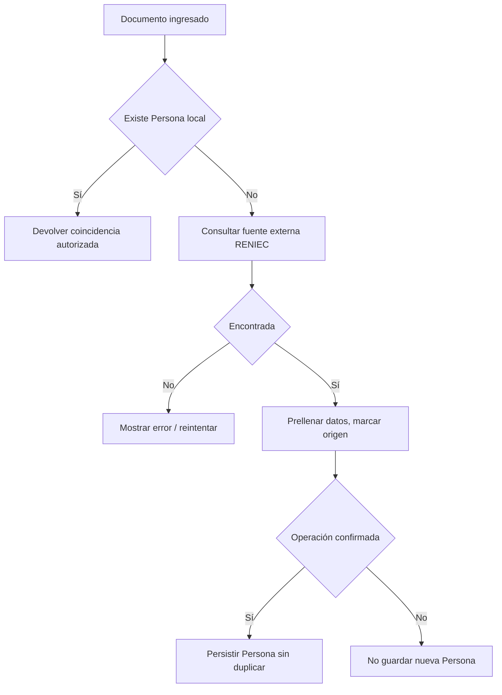

# Contratos 02 — Personas, autenticación, roles y titularidad

**Base [ACORDADO]:** `Persona` separada de `Usuario`; dos grupos Django funcionales Normal y Administrador; Django Ninja/JWT; superusuario técnico; compras invitadas donde corresponda.

## 1. Identidad y cuenta

- **Persona:** identidad civil (tipo/número de documento, nombres y atributos apropiados). Única por `(tipo_documento, numero_documento)`. Puede participar, comprar o recibir pase sin cuenta.
- **Usuario:** credenciales/sesión, grupo(s) Django, referencia a Persona cuando aplique. No crear cuenta automática por consultar DNI o asignar un pase.
- **Comprador:** puede ser Persona; compra conserva email de contacto confirmado/solicitado según flujo, sin obligar usuario.
- **Responsable:** persona legitimada para gestionar inscripción o compra; debe verificarse su acceso con identidad/titularidad, no inferirse de DNI.

## 2. Autenticación vs autorización

| Caso | Autenticación | Autorización adicional |
|---|---|---|
| Ver catálogo público | Ninguna | Edición/módulo publicado |
| Inscribir equipo | Cuenta de responsable inicialmente | Titularidad y reglas deportivas |
| Gestionar inscripción | Cuenta o canal autorizado | Ser responsable o administrador |
| Comprar pase/tienda invitado | Puede ser anónimo en checkout | Datos mínimos y protección del flujo |
| Recuperar compra invitada | Vínculo seguro/token vigente | Scope limitado a esa compra |
| Asignar beneficiarios de un lote | Cuenta titular o vínculo seguro | Titularidad, compra pagada, cupos libres |
| Cambiar rol de usuario | Cuenta admin autorizada | Control de elevación, auditoría |
| Validar ticket | Operador autenticado | Permiso operativo y derecho validable |
| Administración general | Grupo Administrador | Comando autorizado y reglas de negocio |

**[PENDIENTE]** Decidir si operadores de validación usan grupo Administrador o una política interna posterior. No crear tercer grupo por defecto si no es necesario.

## 3. Grupos Django

- `Usuario` / `Normal`: accede a sus operaciones.
- `Administrador`: administra las operaciones previstas.
- `is_superuser`: soporte técnico/administración crítica, no escalón cotidiano del negocio.
- Puede usarse `auth.Group` y permisos Django. La implementación final en Ninja/Ninja Extra dependerá del proyecto local; **no confiar en una cookie de rol**.

**[REFERENCIA ACTUAL]** La versión documentada usa `is_staff/is_superuser`, 11 capacidades y 5 capacidades sin consumidores. El rediseño busca simplificar roles y hacer que las operaciones reales estén completas; no portar todas las capacidades a ciegas.

## 4. Resolución local → RENIEC

**Seguridad:** limitar consultas automáticas, registrar fallos cuando corresponda, no exponer bases masivas de DNI ni hacer validación de titularidad por simple conocimiento del documento. Respetar tratamiento de datos personales y condiciones del servicio externo aplicable, a validar por el responsable del proyecto.

## 5. Compra sin cuenta y recuperación

1. Recoger documento, email y datos necesarios en checkout especializado.
2. Confirmar compra y pago en backend; email no activa el derecho.
3. Proveer acceso limitado mediante vínculo privado enviado al contacto.
4. Vínculo con token suficientemente aleatorio, vencimiento, ámbito por compra y revocabilidad.
5. Reenvío no revela si existe compra para un DNI; limitar abuso.
6. Un invitado nunca puede consultar historial completo de otra persona únicamente por documento.

**[PENDIENTE]** Política exacta de expiración, rotación de enlaces y verificación de contacto. SMTP diferido.

## 6. Control de acciones y auditoría

- Verificación de grupo en backend; titularidad por operación; restricciones de edición.
- Comandos sensibles: actor, timestamp, motivo, antes/después cuando aplique.
- Un ticket/entrada **no es un permiso Django**. El grupo autoriza a operar el sistema; el derecho autoriza a participar/ingresar/canjear.
- Las acciones disponibles en respuesta son UX, no sustituyen controles por operación.
