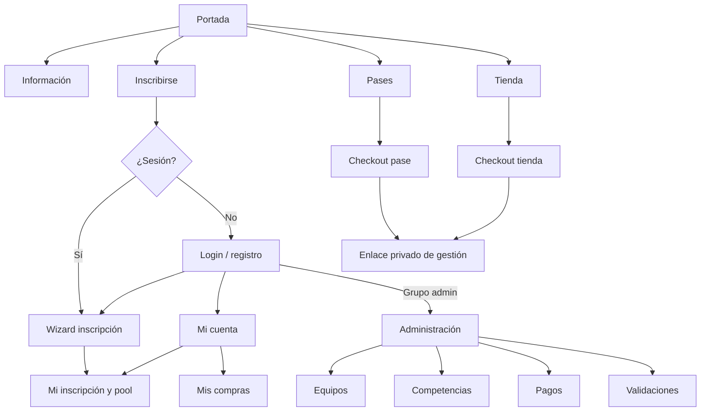

# Frontend 01 — Mapa objetivo de rutas, navegación y experiencias

**PRIORIDAD MÁXIMA.** No copiar el árbol Next actual; el presente mapa es **propuesta funcional** de reconstrucción. Las rutas son provisionales, y no equivalen aún a tickets de implementación. El usuario quiere comprender qué hace cada página antes de cerrar endpoints.

## 1. Principios UX acordados

1. Una página debe responder a **una tarea principal**. Evitar pantallas que mezclen pagos, entradas, equipos y detalle técnico sin jerarquía.
2. El público puede ver información, productos y pases sin autenticarse.
3. Comprar un pase/tienda no obliga a crear `Usuario`; recuperar compras requiere vínculo seguro, nunca DNI solo.
4. El responsable deportivo ve sus inscripciones y su pool, no los conceptos internos del proveedor de pago.
5. El administrador ve **estado operativo legible** y acciones pertinentes a la tarea.
6. El frontend representa resultados del backend: no calcula cupos, elegibilidad, precio vigente ni si un pago fue exitoso.
7. El lector QR es reutilizable; las pantallas de ingreso/entrega son separadas.
8. **No hay carrito combinado** entre inscripciones, pases y productos.

## 2. Inventario de páginas — visitante, cuenta y responsable

| ID | Ruta propuesta | Acceso | Propósito | Acción principal | Destinos |
|---|---|---|---|---|---|
| PUB-01 | `/` | Público | Portada de edición y módulos habilitados | Explorar / CTA inscribir | `/informacion`, `/inscripcion`, `/pases`, `/tienda` |
| PUB-02 | `/informacion` | Público | Detalles de edición, disciplinas, reglamentos | Elegir módulo o conocer reglas | `/inscripcion` |
| AUTH-01 | `/login` | Anónimo | Iniciar sesión de cuenta | Autenticar | `/mi-cuenta` o `/administracion` |
| AUTH-02 | `/registro` | Anónimo | Crear cuenta cuando es útil | Resolver DNI y registrar | `/mi-cuenta` o `/inscripcion` |
| ACCOUNT-01 | `/mi-cuenta` | Cuenta | Resumen de operaciones propias | Ir a inscripción/compra | `/mis-inscripciones`, `/mis-compras` |
| ACCOUNT-02 | `/mis-inscripciones` | Cuenta responsable | Lista y estado de inscripciones | Abrir detalle / crear | `/mis-inscripciones/[id]`, `/inscripcion` |
| ACCOUNT-03 | `/mis-inscripciones/[id]` | Propietario/admin | Gestionar inscripción, equipos, pool y ampliaciones | Asignar/mover/agregar cupos | Subvistas internas, checkout propio |
| ACCOUNT-04 | `/mis-compras` | Cuenta | Vista de compras asociadas a su persona | Abrir comprobante/detalle | `/mis-compras/[id]` |
| ACCOUNT-05 | `/mis-compras/[id]` | Titular/administrador | Estado legible y destino de la compra | Consultar derecho o entrega | Módulo de origen |
| SPORT-01 | `/inscripcion` | Responsable autenticado inicialmente | Wizard deportivo, paquete/equipos/cupos | Confirmar y crear compra | `/mis-inscripciones/[id]` |
| PASS-01 | `/pases` | Público | Listado de pases de fiesta | Comprar pase | Checkout especializado |
| PASS-02 | `/pases/gestionar/[token]` | Link privado | Gestionar lote/beneficiarios de compra invitado | Asignar personas | Comprobante, estado |
| SHOP-01 | `/tienda` | Público | Catálogo/categorías/filtros | Elegir producto | `/tienda/[slug]` |
| SHOP-02 | `/tienda/[slug]` | Público | Galería, precio, disponibilidad | Crear pedido | Checkout tienda |
| SHOP-03 | `/tienda/pedidos/[token]` | Link privado | Consultar estado/recogida de pedido invitado | Ver ticket/entrega | Estado del pedido |
| REC-01 | `/recuperar-compra` | Público | Solicitar reenvío seguro al email registrado | Solicitar acceso | Aviso neutro, sin filtrar existencia |

**Notas:** `/registro` sustituye conceptualmente `/register` y `/mi-cuenta` al antiguo `/dashboard` como propuesta UX, no obligación técnica. El token de enlace **no tiene por qué viajar en la ruta** (podría ser mecanismo de sesión temporal); definir con el agente de arquitectura. Los flujos de inscripciones sin sesión quedan abiertos (`PD-07`). No crear todas las rutas de detalle si un drawer accesible resuelve la tarea.

## 3. Inventario de páginas — administración

| ID | Ruta propuesta | Tarea principal | Subtareas y navegación |
|---|---|---|---|
| ADM-01 | `/administracion` | Resumen de la edición | Pendientes de acción, métricas, accesos rápidos |
| ADM-02 | `/administracion/ediciones` | Crear/publicar ediciones | Estado, módulos habilitados, fechas |
| ADM-03 | `/administracion/personas` | Buscar personas por documento | Ver ficha, cuentas y relaciones |
| ADM-04 | `/administracion/usuarios` | Gestionar cuentas/grupos | Grupo normal/admin, habilitación, historial |
| ADM-05 | `/administracion/inscripciones` | Gestionar inscripciones | Lista, filtros, incidencias, estado |
| ADM-06 | `/administracion/inscripciones/[id]` | Operar una inscripción | Pool, compras de cupos, equipos, responsable |
| ADM-07 | `/administracion/equipos` | Buscar y gestionar equipos | Estado de plantilla, elegibilidad, cupos |
| ADM-08 | `/administracion/equipos/[id]` | Operar equipo individual | Jugadores, inscripción, disciplina, acciones |
| ADM-09 | `/administracion/participantes` | Buscar personas/participaciones | Historial, duplicados, elegibilidad |
| ADM-10 | `/administracion/competencias` | Seleccionar y administrar competencias | Crear/editar, agenda, cuadro |
| ADM-11 | `/administracion/competencias/[id]` | Ficha operativa de competencia | Equipos, rondas, encuentros, estado |
| ADM-12 | `/administracion/competencias/[id]/cuadro` | Visualizar/operar bracket | Avances, resultados, correcciones |
| ADM-13 | `/administracion/competencias/agenda` | Consultar programación | Día, disciplina, estado, detalle de partido |
| ADM-14 | `/administracion/pagos` | Investigar compras/pagos | Veredicto, detalle, reintentos y acciones |
| ADM-15 | `/administracion/pases` | Gestionar pases y cortesías | Comprar/otorgar/cancelar/revisar asignaciones |
| ADM-16 | `/administracion/pases/validar` | Control de ingreso | Escanear/código, veredicto, confirmar ingreso |
| ADM-17 | `/administracion/marketplace` | Gestionar tienda | Productos, pedidos, existencias |
| ADM-18 | `/administracion/marketplace/productos/[id]` | Editar producto | Galería y oferta, disponibilidad |
| ADM-19 | `/administracion/marketplace/inventario` | Registrar stock | Movimientos, reposición, ajustes, salidas sin pago |
| ADM-20 | `/administracion/marketplace/entregas` | Validar recogidas | Escanear/código, confirmar entrega |
| ADM-21 | `/administracion/patrocinadores` | Gestionar patrocinadores | Logo, imágenes, relación con edición |
| ADM-22 | `/administracion/validaciones` | Auditoría transversal | Ver ingresos, entregas, duplicados, incidencias |

**Propuesta de UX:** las 22 entradas son **destinos conceptuales**. Algunas pueden convertirse en pestañas o paneles dentro de la misma ruta; evitar fragmentar navegación sin necesidad. Solo separar páginas cuando tengan tareas, permisos o estado de navegación distintos.

## 4. Navegación por actor

## 5. Qué cambia respecto al frontend auditado

**[REFERENCIA ACTUAL]** La auditoría (`03a`, `03b`) documenta `/`, `/informacion`, `/login`, `/register`, `/dashboard`, `/dashboard/inscripcion/[id]`, `/inscripcion`, `/pases` y 12 páginas administrativas. El dashboard concentra ~499 líneas y algunas acciones administrativas son solo lectura. `/administracion/equipos` carece de drilldown; pagos mezcla muchas capas; edición de encuentros se dispersa entre cuadro y detalle.

**[PROPUESTO]** Reordenar por tarea, unificar portada/información coherentemente, convertir dashboard a `mi-cuenta` y `mis-inscripciones`, mejorar detalles operativos, añadir rutas de marketplace, patrocinadores, enlaces invitados, validaciones y gestión administrativa necesaria. **No crear pantallas por simetría técnica.**

## 6. Plantilla obligatoria de ficha por página

Cada página de documentos 02 a 05 debe indicar: `ID`, ruta propuesta, actor, objetivo, precondiciones, secciones visibles, componentes importantes, acciones, navegación, información/contratos, estados (loading/empty/error/success/timeout), accesibilidad, permisos, casos de aceptación y decisiones abiertas. Cada acción importante debe tener al menos un flujo `FL` y una tarea `TASK`.

## 7. Prioridades de diseño

1. **Alta:** inscripción/wizard + detalle de inscripción, pagos administrativos, equipos administrativos, competencias/encuentros, pases y comprador invitado.
2. **Media:** marketplace producto/pedido/inventario, administración de cortesías/tickets, control de entradas, patrocinadores.
3. **Baja o diferido:** branding, páginas institucionales sofisticadas, extensiones no solicitadas.

Antes de programar un flujo, su ficha y su contrato operativo deben estar revisados. El backend no tiene que estar terminado para elaborar wireframes y estados de interfaz.
