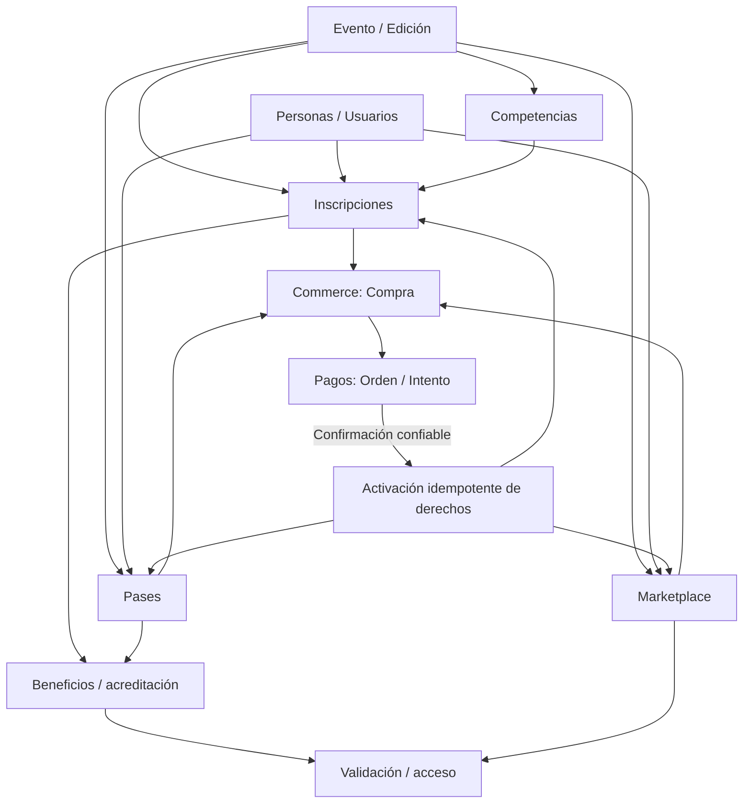

# Funcional 01 — Módulos y responsabilidades

**Estado:** límites funcionales acordados; empaquetado físico a definir por el agente de arquitectura.

## 1. Mapa de responsabilidades

| Módulo lógico | Es dueño de | No debe decidir |
|---|---|---|
| `eventos` | Evento, edición, calendario, estado, funcionalidades opcionales | Precios concretos de otros dominios |
| `usuarios` | Persona, Usuario, documento, consulta RENIEC, grupos Django, autenticación | Derechos deportivos o de entrada |
| `inscripciones` | Paquetes de inscripción, equipos, participantes, pool y asignación de cupos, promociones/categorías deportivas según diseño | Confirmar pagos de Izipay o consumir ticket |
| `competencias` | Competición, ronda, encuentro, ganador, cuadro, agenda y resultados | Vender cupos o gestionar pedidos de tienda |
| `pases` | Catálogo de pases individuales, lotes comprados, beneficiarios, cortesías/entradas | Gestión del pago en proveedor |
| `beneficios/acreditaciones` | Interpretar beneficios asignados y derecho de acceso efectivo, preservando origen | Autorizar mediante un grupo Django por cada entrada |
| `commerce` | Compra genérica, precio/total congelados, estado comercial, comprador, relación con orden | Reglas de participantes, asignación de entradas o stock |
| `pagos` | Orden, intento, confirmación, conciliación Izipay y evidencia administrativa | Crear o consumir cupos, pases o productos |
| `marketplace` | Producto, categoría, imágenes, pedido/detalle, stock, entregas | Inscribir deportistas, tener vendedores terceros |
| `patrocinadores` | Ficha, logo, imágenes, vínculo con evento/edición | Ventas o facturación de terceros (no pedidas) |
| `validaciones` | Identificar tickets/códigos, verificar derechos con el módulo propietario, registrar controles/canjes | Inventar permisos o reimplementar las reglas del dominio |
| `administracion` | Vistas operativas agregadas, búsqueda, herramientas de gestión autorizada | Duplicar servicios de cada módulo |
| `notificaciones` | Plantillas, cola/reintentos, envíos vía proveedor configurable | Marcar compras como pagadas |

La existencia de un módulo **lógico** no obliga a crear una aplicación Django separada. La separación física se decidirá por cohesión, volumen y dependencia real.

## 2. Relaciones fundamentales

La flecha `C → I` denota **consulta de elegibilidad/participantes ya inscritos**, no que competencias modifique el pool.

## 3. Cambios frente a la referencia actual

**[REFERENCIA ACTUAL]** Existen siete apps principales (`usuarios`, `eventos`, `commerce`, `pagos`, `salesianos_fest`, `competencias`, `administracion`). `salesianos_fest` agrupa alrededor de 20 modelos de inscripción, pases y acreditaciones; hay endpoints de competencia relativamente bien separados. Referencia: `04-datos-y-dominio(1).md`, §3.

**[PROPUESTO]** Extraer conceptualmente inscripciones/pases/beneficios del agregado enorme `salesianos_fest`; conservar relaciones de negocio útiles. Evitar que cualquier servicio financiero importe modelos de una edición concreta para conocer cómo debe representarse una compra.

## 4. Separación de operaciones comerciales

- `POST /.../inscripciones/{id}/comprar-cupos` (**ruta ilustrativa**) valida el paquete y solicita compra al servicio comercial; tras pago, inscripciones habilita cupos.
- `POST /.../pases/comprar` valida un pase y solicita compra; tras pago, habilita el lote de derechos nominativos.
- `POST /.../marketplace/pedidos` valida productos e inventario y solicita compra; tras pago, confirma el pedido y registra la salida/reserva según política acordada.
- Una cortesía de fiesta no pasa por el motor de pagos.
- No existe un `checkout` transversal que permita mezclar las tres categorías en una sola orden.

## 5. Interfaces necesarias entre módulos

| Interfaz lógica | Productor | Consumidor | Resultado |
|---|---|---|---|
| `ResolverPersona` | usuarios | inscripciones, pases, tienda, admin | Persona encontrada/confirmada |
| `CrearCompra` | commerce | inscripciones, pases, tienda | Compra y total snapshot |
| `CrearOrdenPago` | pagos | commerce | Orden pendiente |
| `PagoConfirmado` | pagos | coordinador de compra | Evidencia de pago válida |
| `ActivarCompraInscripcion` | inscripciones | coordinación compra | Cupos habilitados una sola vez |
| `ActivarCompraPase` | pases | coordinación compra | Derechos habilitados una sola vez |
| `ConfirmarPedidoMarketplace` | marketplace | coordinación compra | Pedido pagado y stock coherente |
| `VerificarDerecho` | pases/beneficios/marketplace | validaciones | Puede usar/canjear, con razón y límite |

**[PROPUESTO]** Esta tabla define responsabilidades, no obliga a usar cola de eventos, microservicios o un bus de mensajes. Una función de servicio dentro de una transacción puede ser suficiente.
