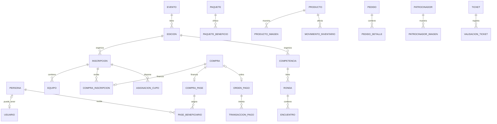

# Funcional 03 — Modelo conceptual de datos

**Importante:** no es un esquema final de migraciones ni una orden de crear cada tabla. Etiquetas: **C** = concepto existente para conservar/revisar; **N** = concepto nuevo propuesto; **O** = opcional, según alcance; **P** = pendiente de cerrar.

## 1. Mapa de entidades

| Módulo | Entidad | Estado | Relaciones principales |
|---|---|---|---|
| Eventos | `Evento` | C | Tiene muchas `Edicion` |
| Eventos | `Edicion` | N | Pertenece a `Evento`; se vincula a inscripciones, productos, torneos, pases |
| Usuarios | `Persona` | C | Documento único; puede existir sin cuenta |
| Usuarios | `Usuario` | C | Cuenta opcional `1:1` con `Persona`; grupos Django |
| Inscripciones | `Paquete`, `PaqueteDisciplina`, `PaqueteBeneficio`, `PaquetePrecio` | C | Paquete y su catálogo por edición |
| Inscripciones | `Inscripcion`, `Equipo`, `InscripcionPersona`, `Participacion` | C | Responsable, equipos y participantes |
| Inscripciones | `AsignacionCupo` | C | Vincula cupo pagado con persona/inscripción |
| Inscripciones | `CompraInscripcion` | C | Vincula `Compra` al alta/ampliación de cupos |
| Competencias | `Competencia`, `CompetenciaEquipo`, `Ronda`, `Encuentro` | C | Torneo por edición/disciplina/categoría |
| Pases | `Pase`, `PasePrecio`, `CompraPase`, `PaseBeneficiario` | C | Producto de entrada, compra y asignación nominativa |
| Beneficios | `AcreditacionEvento` o proyección de derechos efectivos | C/revisar | Persona + edición y estado de derechos |
| Beneficios | `AsignacionBeneficio` | O | Registro de derechos grupales/consumibles cuando no encajen en modelos existentes |
| Pases/admin | `CortesiaEntrada` o tipo de origen auditado | N conceptual | Persona, edición, tipo de entrada, actor, motivo |
| Commerce | `Compra` | C | Comprador Persona, total snapshot, orden, tipo/origen |
| Pagos | `OrdenPago`, `TransaccionPago`, `AprobacionPagoManual` | C | Orden por compra, intentos y evidencias |
| Marketplace | `CategoriaProducto`, `Producto`, `ProductoImagen` | N | Producto con `ImageField`, `orden`, `es_principal?` |
| Marketplace | `Pedido`, `PedidoDetalle` | N | Compra de tienda; detalle con snapshots |
| Marketplace | `MovimientoInventario` | N | Producto, cantidad +/-; motivo, actor, referencia |
| Marketplace | `ReservaInventario` | O | Reserva temporal si se usa estrategia explícita de checkout |
| Patrocinios | `Patrocinador`, `PatrocinadorImagen` | N | Identidad, logo, fotos, orden, edición/vínculo |
| Validaciones | `Ticket`/credencial | N conceptual | Referencia segura a derecho existente; no duplicar derechos |
| Validaciones | `ValidacionTicket` | N | Ticket, operación, actor, fecha, cantidad, resultado |

## 2. Esquema conceptual

Este diagrama muestra vínculos, **no cardinalidades finales garantizadas**: por ejemplo, compra y orden pueden tener cardinalidad condicionada por registro pendiente; definirlo en contrato técnico.

## 3. Cómo representa dinero, derecho y consumo

Ejemplo: una compra de entrada da lugar a `Compra` y `OrdenPago`, y (mediante el servicio de pases) a `CompraPase` con asignaciones `PaseBeneficiario` tras el pago. El acceso se evalúa contra derechos efectivos. Si la entrada requiere control, se emite una credencial/ticket que referencia ese derecho y permite generar `ValidacionTicket`.

Ejemplo distinto: una inscripción crea `CompraInscripcion` y, después de pago, cupos asignables; un paquete puede conceder FIESTA por cupo, pero `AsignacionCupo` **no se convierte** en `PaseBeneficiario` por automatismo sin una regla explícita.

Ejemplo tienda: `Pedido` se relaciona con `Compra` sin carrito mixto; `PedidoDetalle` posee snapshot precio/cantidad; `MovimientoInventario` rastrea venta o salida administrativa; `ValidacionTicket` indica entrega/consumo si corresponde.

## 4. Modelo de archivos en servidor

- `ProductoImagen.producto_id`, `imagen = ImageField(upload_to=...)`, `orden`, timestamps.
- `Patrocinador.logo = ImageField(...)` y `PatrocinadorImagen.patrocinador_id`, `imagen = ImageField(...)`, `orden`.
- Directorio persistente `MEDIA_ROOT` montado como volumen, servido con controles de tamaño/tipo/extensión y URL pública apropiada. No CDN.
- Seguridad: no confiar en nombre de archivo del usuario; definir política de archivos eliminados, respaldos y límites de tamaño con arquitectura local.

## 5. Restricciones/invariantes esperados

- Documento único `(tipo_documento, numero_documento)` y edición coherente en todas las FK relacionadas.
- Una activación efectiva por `compra_id`/concepto para evitar duplicar derechos al reintentar pago.
- No superar cupos comprados vigentes; idempotencia de asignaciones/consumos con concurrencia.
- Un movimiento de inventario no se borra para ocultar operaciones; reversas con movimiento compensatorio si procede.
- Un ticket no puede consumirse más que su cantidad permitida ni después de la revocación del derecho de origen.
- Snapshot histórico de precios usados aunque cambien precio actual o oferta.

## 6. Puntos por confirmar antes de migraciones

`PD-01` BOX/titularidad; `PD-02` revocación/transferencia de pases; `PD-03` tickets por unidad o parciales; `PD-05` inventario entre ediciones; `PD-06` devoluciones; `PD-07` guest checkout de inscripción.

## 7. Referencia actual

`04-datos-y-dominio(1).md`, §3, identifica 31 modelos de negocio en el código de referencia, incluidos `PaqueteBeneficio`, `AsignacionCupo`, `PaseBeneficiario`, `AcreditacionEvento`, `Compra` y transacciones. **Reutilizar conceptos no obliga a copiar sus columnas o constraints actuales**.
