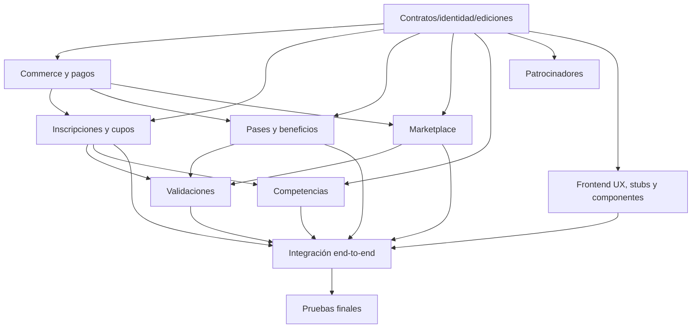

# Implementación 01 — Límites, dependencias y decisiones para el agente de arquitectura

**Documento de interfaz funcional, no prescripción de patrón técnico.** El proyecto local ya utiliza Django/Ninja, Next.js y un worker documental; el agente de arquitectura definirá estructura final de carpetas, DI, migraciones, despliegue y compatibilidad según entorno real.

## 1. Fundamentos que deben quedar acordados ANTES del paralelo

| Fundamento | Contrato mínimo que debe congelarse | Por qué |
|---|---|---|
| Evento/Edición | Identificadores, selección/alcance de edición, habilitación de módulo | Evitar cruces de años |
| Persona/Usuario | Documento único, roles Django, cuentas vs invitados, titularidad | Todos los dominios dependen de identidad |
| Commerce | `Compra` y snapshots, comprador, tipo/origen, estados, relación con orden | Inscripciones, pases y tienda lo reutilizan |
| Pagos | Inicio/consulta de orden, notificación validada, reintentos, idempotencia | Evitar doble habilitación de derechos |
| Contratos API | Envelope de éxito/error, paginación, tipos, fechas, precios, estados | Frontend puede trabajar en paralelo |
| Dominio de derechos | Quién crea derecho, cómo se consulta/revoca y valida | Acceso/beneficios/tickets coherentes |
| Multimedia | `ImageField`, rutas media, volumen persistente, validaciones | Marketplace y patrocinadores comparten infraestructura |
| UI base | Layouts, auth guard, servicio HTTP, caché, componentes reutilizables | Evitar que cada agente cree su framework visual |

**Secuencia recomendada:** validar límites y UX → contratos mínimos → stub/mocks de APIs → desarrollos paralelos → integración → validación final. No exigir que todas las reglas especiales de BOX o SMTP estén resueltas antes del trabajo no dependiente.

## 2. Dependencias por módulo

El gráfico señala **dependencia de contratos e integración**, no que los equipos deban esperar a que termine completamente otro backend para desarrollar sus tareas aisladas.

## 3. Política de propiedad de archivos (propuesta para reducir conflictos)

- Un propietario por módulo lógico y carpeta real acordada.
- Un integrador específico para archivos compartidos: settings, registro de routers, auth middleware, API base, modelos compartidos, esquema de migraciones común.
- Los agentes de dominio no modifican `commerce`/`pagos` directamente para añadir reglas propias: consumen su contrato o elevan propuesta al integrador.
- El agente UX puede implementar páginas con servicios mockeados **anclados a contratos**, no inventar campos ad hoc.
- El agente de competencias no manipula compra, stock ni pases.
- Los agentes de marketplace/patrocinadores respetan un único contrato para subida y almacenamiento local de imágenes.

## 4. Decisiones técnicas a cargo del agente local

| Decisión | Invariante funcional |
|---|---|
| Estructura de apps Django | Ningún módulo ajeno modifica reglas de otro |
| Sincronía de activación de compras | Idempotencia + recuperación ante fallo posterior al cobro |
| Diseño exacto de estados | Presentación clara y máquina de estado consistente |
| Uso de `ImageField` + almacenamiento | Archivos persistentes y no dependientes de CDN |
| Selección de edición (ruta/contexto) | Nunca mutar inadvertidamente edición equivocada |
| Links temporales de compra invitada | Seguridad y revocación de acceso |
| Diseño de módulos `validaciones` y `beneficios` | No duplicar derechos ni confundirlos con permiso Django |
| Pruebas/runner CI | Crear pruebas por tarea; ejecutar suite al final de integración |

## 5. Qué NO hay que heredar sin revisar

- `EVENTO_ACTIVO_NOMBRE` como única selección de edición (auditado en `04-datos-y-dominio`).
- Modelo de roles de once capacidades sin acciones administrativas reales.
- Dos catálogos frontend distintos con fallback de precios ficticios.
- Dashboard de 499 líneas con `useEffect` de carga ad hoc.
- Checkout Izipay que renueva cada intento sin revisar estado del anterior.
- Permisos de negocio atados al rol técnico de superusuario.
- Pantalla admin de equipos sin detalle o pagos que mezcla tres estados sin contexto.
- Reutilizar semillas de fechas/precios como verdad definitiva de próximas ediciones.

## 6. Control de cambios

Toda necesidad que afecta a dos módulos modifica primero su documento de contrato y registra una decisión (DEC o PD). El integrador notifica a los agentes consumidores. Las tareas finales se consideran completadas solo con flujo y contrato implementados, no solo modelos o endpoints creados.
